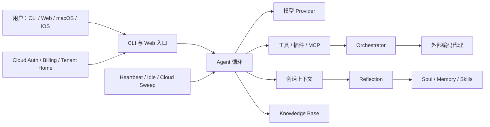
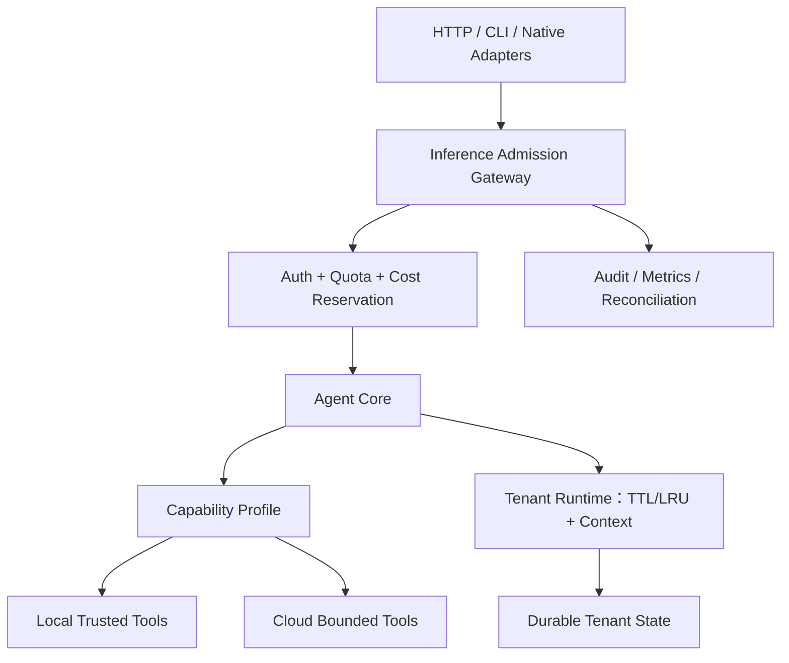

# 架构认知

## 运行时总图

## 组装路径

`src/cli.ts` 是组合根：

1. 解析 CLI 与环境配置。
2. 创建模型 Provider。
3. 创建内建工具。
4. 合并批准的技能、插件与 MCP 工具。
5. 载入会话、Soul、知识库和反思机制。
6. 启动 REPL 或把组合后的能力交给 Web 服务。

这一设计让本地功能组合灵活，但也意味着 Web/Cloud 会继承 CLI 的完整工具集合。Cloud 安全边界应在组合阶段和服务器路由阶段双重建立。

## Agent 循环

2026-11 本机只读连接：`src/connectors/service.ts` 为 GitHub、Google Calendar、Gmail、Linear、Google Drive、Notion、Slack 共享持久请求、授权尝试隔离、资源确认、取消、恢复租约和结果提交；`types.ts` 定义经过审查的只读适配器契约。`github.ts` 保留旧 API 的兼容包装。Google 驱动将日历忙闲、日程详情和 Gmail 标签读取限制为固定操作、固定 Google 主机、DNS 固定、无重定向和有界响应。仅 `local-owner` Web 开放 `/api/connectors` 及其子路径，Cloud/远程设备拒绝。

明确的只读聊天会先保存原文和附件、展示统一连接卡，再在同一 session 队列自动恢复。恢复重新构造工具集合：对应 provider 的单一读取工具；仅 GitHub 原请求明确涉及本机文件时加 `read/ls/grep`。不带 Shell、旧版写工具、插件 Hook 或子代理。新用户消息取消未完成的连接任务。本切片每 provider 一个账号，每个任务一个来源；混合来源请求提示拆分，不静默完成一部分。正常通用聊天仍沿用原注册表。

状态落在本机 Home 的 `connectors/{provider}/state.json`（v2），GitHub v1 校验后备份并迁移，保留 request ID；文件锁和每请求恢复租约防止并发重复执行。Session 的 `connectorRequestId` 标记防止重复结果；`connector_trace` 留诊断过程，历史 API 不把系统续跑事件当用户消息。Google 桌面授权使用 PKCE、state 和临时 loopback callback；凭据存 SecretStore，刷新串行且先保存再读取。旧邮件 `mail/secrets.json` 在访问时写入同一 SecretStore、回读验证后原子替换为引用，损坏源文件拒绝迁移。Google OAuth 只读 scope 与 LISA 选择的资源范围分开校验；日历忙闲档不会因 Google 令牌已有更宽权限而升级为详情档。邮件头与最多 400 字短摘要经既有敏感内容过滤后才交给模型，不读取正文或附件。凭据撤销、取消、过期均在执行和结果提交边界复核。

Linear 使用官方 `/mcp/readonly`、DCR + PKCE `read` 授权与 issuer 绑定的 loopback 回调。`src/mcp/http.ts` 提供 DNS 固定、禁重定向、有界响应的远程传输；`readonly-http.ts` 仅接受经过审查的工具和参数，不暴露服务端 prompts 或任意工具。驱动只提供 `linear_read` 的团队清单与有限工单读取，核对账号和稳定团队 ID，再用当前 key 查询并排除子团队；固定字段选择和返回团队 ID 复核防止扩大范围。OAuth 工作区权限与 LISA 团队选择分别约束。`catalog.ts` 是固定来源目录，新增目录项不会授权任意 MCP。

Drive 使用 Google 桌面 Picker OAuth（仅 `drive.file`、`trigger_onepick`，state/PKCE 回调携带选定文件 ID），不请求全盘权限或浏览器 access token。卡片二次确认后，仅允许选定 ID 的元数据、文本下载、Docs/Slides 文本导出和 Sheets 首个工作表 CSV；最多 1 MB / 30,000 字，拒绝文件夹、快捷方式和附件。Google 文件级授权含写权限，UI 明确告知；LISA 执行器仅有读操作。

Notion 使用 confidential OAuth + state + 预注册 localhost 回调；不假称供应商支持 PKCE。`notion-http.ts` 固定 API 版本和读路由，OAuth introspection 必须返回且仅返回 `read_content`。凭据轮换串行保存，身份绑定 workspace ID 与 users/me ID（兼容 person/bot）。确认页面后最多读取 200 普通块、4 层、12 次 children 请求和 30,000 字；不展开子页面、数据库、同步块或外部链接。读取前后复核页面与已遍历容器，所有正文均为不可信数据。两者沿用公共取消、租约、重启恢复和单次结果提交。

Slack 使用注册桌面应用的 PKCE + user OAuth 和轮换令牌，无客户端密钥；四项频道读取 scope 精确匹配，实时 scope 头与刷新响应仅额外允许隐式 `identify`。`slack_read` 固定 Web API 读取所选成员频道的历史/讨论串，禁止私信、共享频道、搜索、文件和写入；不是官方 MCP 透传。默认七天、最多 31 天、100 条/40,000 字符，读取前后检查账号/频道，结果一律不可信。成员列表可省略 `is_member`，但确认和读取的频道详情必须明确为 true。配置、边界及真实验收见 `docs/PLAN_CONNECTOR_EXPANSION_2026-11-07.md` 第 11 节。

`src/agent.ts` 的核心职责：

- 调用统一 Provider 接口并流式输出；
- 接收模型的 tool call；
- 校验工具名与参数；
- 经过审批与 Hook；
- 执行工具并把结果放回上下文；
- 受最多 32 次迭代、Token 预算、终止信号和异议机制约束；
- 支持 Prompt 热更新。

Prompt 由 Soul、技能、记忆和知识库共同组成。Agent 本身是核心能力边界，所有 Web、自治与外部表面最终都应通过一致的推理准入与审计层调用它。

## Soul 与 Reflection

Soul 位于动态 `lisaHome()` 下，包含：

- identity / purpose / constitution
- emotions / values / opinions / desires
- journal / relationships
- memory / skills

Soul 写入具备文件锁、原子写入、审计和 Git 溯源等防护。Reflection 从会话中提取结构化操作，更新日志、记忆、技能、情绪、观点和欲望，并对格式错误进行重试。

关键风险不是“是否能写”，而是“同一段会话是否会被重复反思”。Cloud sweep 当前更接近按时间扫描，而不是按消息水位和幂等键消费。

## Knowledge Base

知识库大致有三层：

1. 原始来源与摄取适配器；
2. Wiki / Schema 与链接图；
3. TF-IDF 检索与 Git 版本管理。

知识库输入会进入 Prompt，必须继续把外部内容视为不可信数据，而不是指令。路径限制、来源元数据、注入防护和可追溯性是它的核心安全属性。

## 自治机制

自治分为不同信任级别：

- 自动 Heartbeat / Idle：使用受限工具集；
- 用户编写的定时 Heartbeat：可以使用完整工具；
- Cloud autonomy sweep：遍历账户并对最近会话做反思。

后续设计应明确记录每次自治行为的触发者、能力配置、预算、会话水位、幂等键和结果，而不是只依赖“是哪条代码路径”推断权限。

## Orchestrator

编排器观察 Claude、Codex、OpenCode、Aider、GitHub 等来源，把状态规范化后用于建议、展示和调度。它支持受管代理与 PTY 代理。

这是 LISA 的差异化能力之一，也是一条高权限路径。Cloud 中不得让租户直接继承宿主机进程、任意工作目录或运营方 MCP/插件能力。

## Web 与 Cloud

Web 服务同时承担：

- 静态 UI 与客户端脚本；
- REST 与 SSE；
- 对话；
- 认证、邮箱验证和账户；
- 套餐、额度、IAP；
- Soul、计划、知识库和反思接口；
- 外部代理控制；
- 自治调度。

`AsyncLocalStorage` 将请求映射到用户专属 Lisa Home，SSE 事件也有租户过滤，这是正确基础。但进程级缓存、最近活动、Advisor 状态和部分配置仍是全局的，说明租户边界尚未完成。

## 持久化

当前同时使用：

- 本地文件与原子写入；
- Git；
- 可选对象存储；
- 可选 Firestore；
- 进程内缓存。

合适的目标不是把所有内容塞入一个数据库：

- 本地版继续使用文件和 Git，保留可检查、可迁移、用户拥有的特性；
- Cloud 的账户、认证、余额、交易与租约必须使用支持事务和唯一约束的权威存储；
- Soul 大对象可以保留为对象存储或版本化文档，但要有 schema version 和迁移。

## 跨端 API 契约

- `contracts/lisa-api-v1.openapi.json` 是 TypeScript 服务端与 iOS 客户端共享的
  OpenAPI 3.1 源；生成常量不得手改。
- `/api/*`、`/chat`、`/events` 响应携带 `X-Lisa-API-Version`。v1 保持现有 body
  兼容，允许新增可选字段和未知 SSE 事件。
- Lisa Pocket 容忍无版本头的旧服务和同主版本新增字段，但拒绝更高主版本。
- `src/web/api-contract.test.ts` 用实际 DTO builder 与代表性 fixture 做 schema
  验证；破坏性协议变更必须升主版本或增加版本路由。

## 建议的目标边界

建议保持模块化单体，先建立明确边界，再决定是否需要拆服务。
