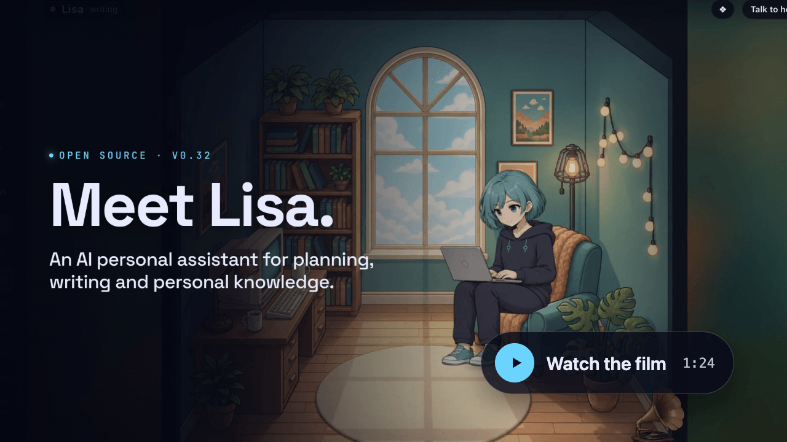
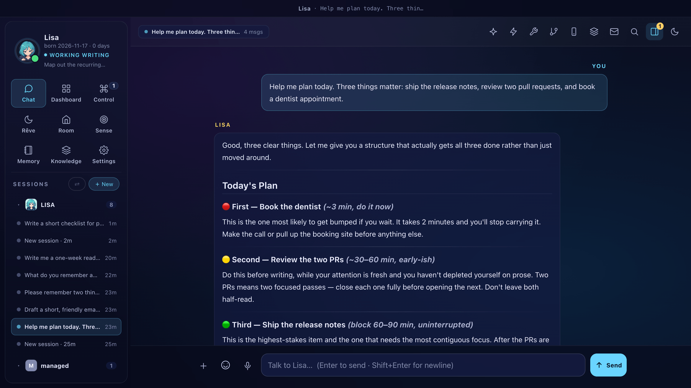
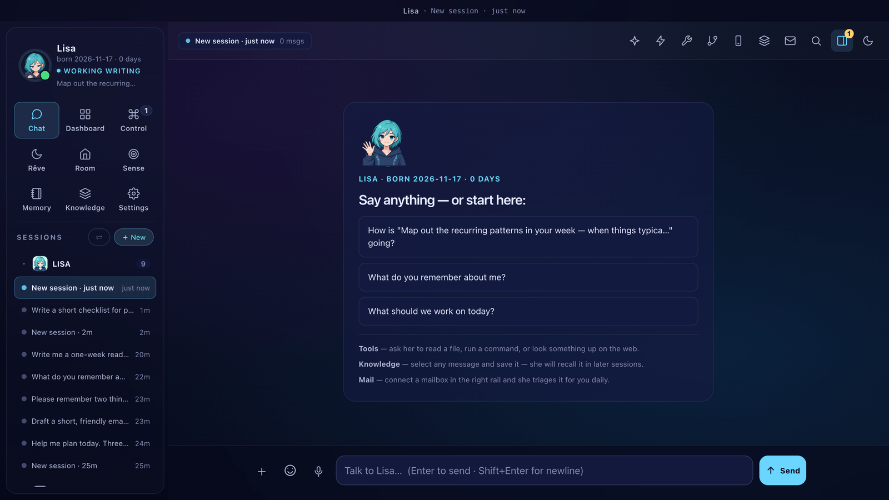
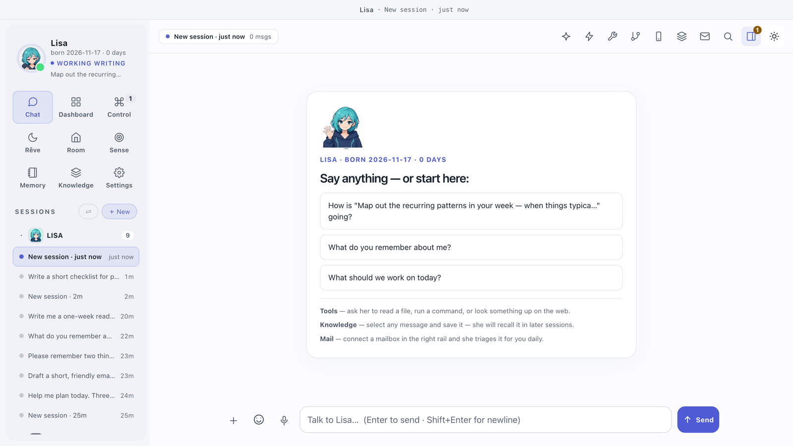
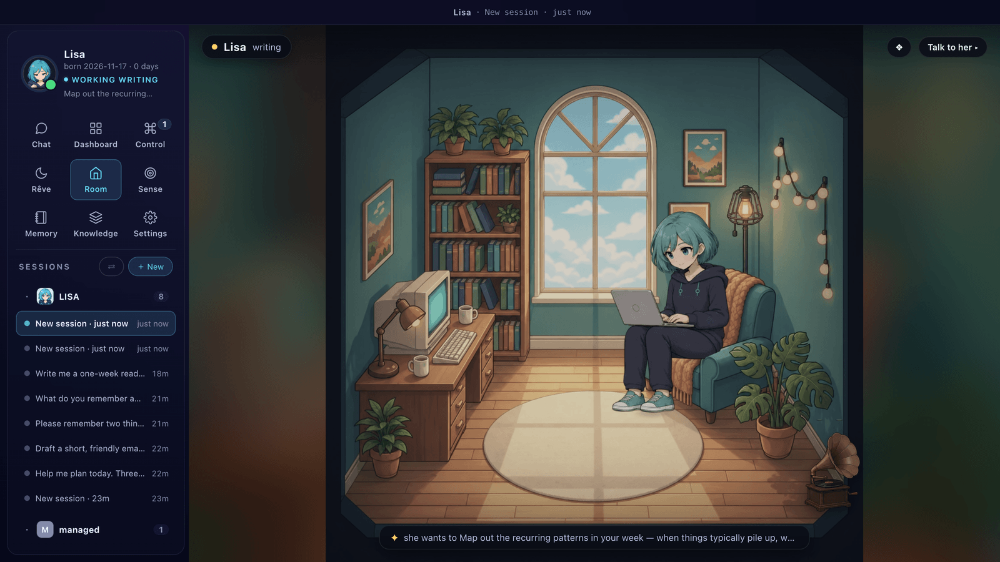
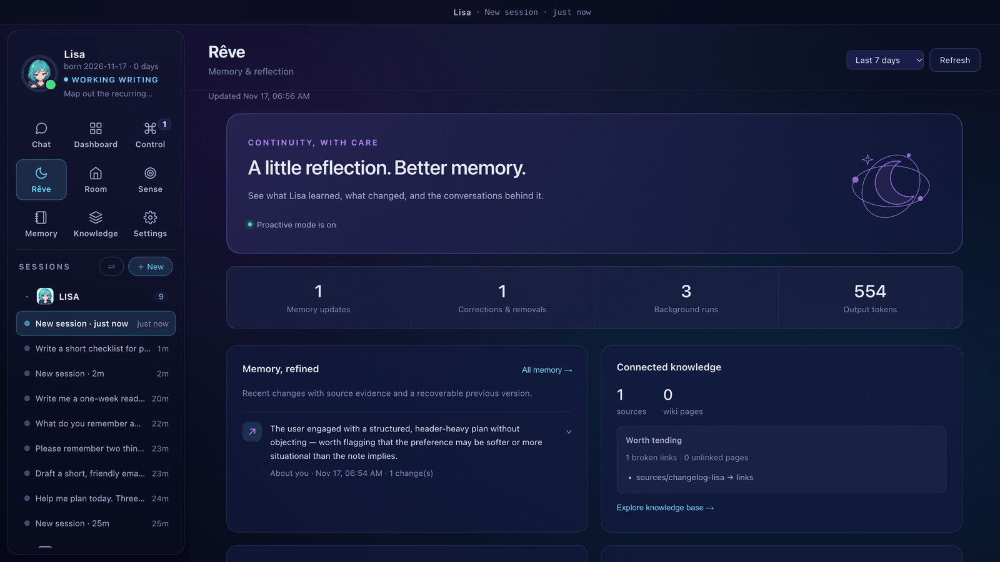
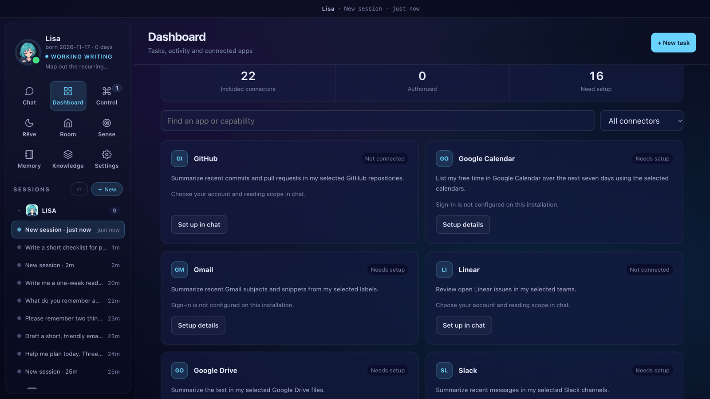
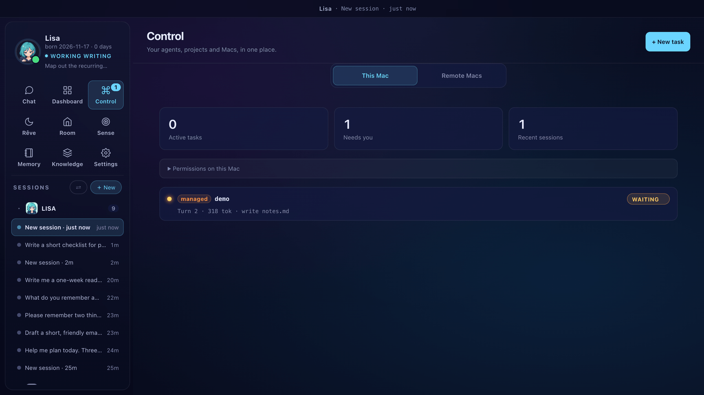

# LISA


[](https://www.npmjs.com/package/@oratis/lisa)
[](https://github.com/oratis/homebrew-tap)
[](https://github.com/oratis/LISA/releases/latest)
[](./LICENSE)
[](https://github.com/oratis/LISA/stargazers)
[](https://github.com/oratis/LISA/discussions)

> English ｜ [中文](./README.zh-CN.md)

**An open-source AI Personal Assistant for planning, writing and personal knowledge.** Plan a day, draft a message, build a personal knowledge base, or coordinate coding agents from your Mac. Use LISA Cloud for hosted chat, or run your own instance with your choice of model.

[Website](https://meetlisa.ai) · [Guide](docs/GUIDE.md) · [What's new in 0.32](docs/RELEASE_v0.32.0.md) · [Latest release](https://github.com/oratis/LISA/releases/latest) · [Roadmap](docs/PLAN_ALWAYS_ON_UPGRADE_2026-09-30.md)

<p align="center">
  <a href="https://www.youtube.com/watch?v=QggT1pvKpBU"></a><br>
  ▶ <a href="https://www.youtube.com/watch?v=QggT1pvKpBU">Watch the 0.32 film on YouTube</a> · 1:24
</p>

## Choose where Lisa runs

| Entry point | What you get | Requirements |
| --- | --- | --- |
| **Mac app** | Web workspace, menu-bar Island, local tools and agent controls | Download the signed, notarized **Lisa-Suite.dmg** from Releases; Node and the backend are bundled |
| **CLI / self-hosted web** | Local assistant, configurable providers, knowledge, integrations and development tools | Node **22.19+** and a provider key or local model |
| **LISA Cloud** | Account-based chat, memory and knowledge tools, without setting up a Mac | [Sign in](https://meetlisa.ai/cloud/); usage allowance and optional credits apply |
| **Lisa Pocket (iOS)** | Cloud chat or access to your reachable Mac; separate saved connections | **1.4 is available on the [US App Store](https://apps.apple.com/us/app/lisa-pocket/id6784690058)**; availability varies by region |

Cloud and Mac are **separate instances**: their histories, memories and credentials do not automatically sync. Local tools need your Mac to be running and reachable. Cloud does not expose your Mac's shell, mail, coding agents or host-level push services.

<a id="install"></a>

## Quick start

**Mac app.** Download **Lisa-Suite.dmg** from the [latest release](https://github.com/oratis/LISA/releases/latest), drag Lisa to Applications and open it. Its setup screen asks for a model key; nothing else needs installing.

**CLI and self-hosted web.** Install with Homebrew or npm:

```sh
brew install oratis/tap/lisa
# or
npm install -g @oratis/lisa
```

Then start Lisa:

```sh
lisa serve --web        # web workspace at http://localhost:5757
lisa                    # terminal chat
lisa doctor             # check config, providers and network
```

The web workspace asks for one model key on first launch and saves it to `~/.lisa/config.env` on your machine. For terminal chat, add the key to that file yourself, for example `ANTHROPIC_API_KEY=your-key`. Lisa's identity is created once, at the start of the first session, and takes about half a minute.

Anthropic, OpenAI, Gemini, OpenAI-compatible services and local models are supported. See [providers](docs/PROVIDERS.md) for keys, model selection and Ollama / LM Studio setup. Coding work can also use supported CLI subscriptions through [coding plans](docs/GUIDE.md#coding-plans--use-a-subscription-instead-of-an-api-key). To update a Homebrew or npm install later, run `lisa upgrade`.

## What you can do

- **Start with everyday work.** Planning, writing and idea starters open editable drafts. Chat supports streaming replies, tool activity, history, cancellation and retry.
- **Build lasting context.** File-backed identity, memories, opinions and journals evolve across sessions within the same instance. Review and reflection can update Lisa's desires and skills; Rêve lists what changed, with its source conversation and a recoverable previous version.
- **Keep a personal knowledge base.** Save links, ingest supported articles and video transcripts, search a linked wiki, and generate briefs from configured feeds.
- **Coordinate coding agents across Macs.** Control observes supported Claude Code, Codex, OpenCode and Aider sessions on this Mac. Fleet starts Claude Code in workspaces you authorize one at a time, on this Mac or a paired one, and keeps a reconnectable task timeline with per-turn file diffs in isolated worktrees. Review a finished turn, hand it to Claude or Codex, restore a single file, or confirm a merge into the source branch; each step shows a preview first. Pocket follows shared tasks read-only by default, and a separate grant enables approval decisions. See [Fleet setup and limits](docs/FLEET.md).
- **Connect your local workflow.** Twenty-two read-only source connectors cover documents, tasks, calendars, mail and design tools, including Box files, Obsidian vaults, selected Feishu documents and T3 project thread lists. Dashboard lists their saved authorization status; browse `/connectors` in chat, authorize an account and choose what Lisa may read. Availability depends on local OAuth configuration, and Apple Calendar and Reminders require a Swift toolchain. MCP servers, skills, plugins and messaging channels remain optional. See [connector setup](docs/PLAN_CONNECTOR_EXPANSION_2026-11-07.md).
- **Choose screenshot context.** Default capture is image-only; an explicit action collects front-window text and coordinates for preview, with a separate checkbox before sending. Missing permission keeps the image-only path.
- **Give Lisa time to work.** Durable goals, routines and local watchers come with saved runs, cancellation and recovery. Tasks drafted in chat stay off until you enable them. Hosted tasks remain off by default; task side effects without an approval integration are denied.
- **Keep her in view.** A pixel-art room with seated working, reading and tea animations, mood portraits, twelve chat stickers and the Mac Island reflect real activity. Mobile widgets and Live Activities depend on a configured, reachable Mac and notification setup.

## Memory, identity and control

LISA's **SOUL** is a set of persistent files for identity, purpose, constitution and values. **DESIRES** guide autonomous work; **HEARTBEAT** and **REVE** provide scheduled work and reflection. These are software mechanisms for continuity and behavior, not a claim of consciousness.

Local data lives under `~/.lisa` by default. Choosing a remote model sends relevant context to that provider; local storage does not mean local-only inference. Lisa Pocket discloses recipients before AI chat and supports withdrawing permission. See the [privacy policy](https://meetlisa.ai/privacy/) and [security policy](docs/THREAT_MODEL.md).

**Warden** provides deterministic action decisions, scoped grants, an approval inbox and audit records. It is **opt-in for web chat**:

```sh
# Warden ships in v0.28.1 and later.
lisa serve --web --approval warden
lisa approvals list
```

Warden does not cover every execution surface and does not replace an OS sandbox. Credential handles and inbound-mail filtering provide additional building blocks; they are not a complete cloud connector platform. Read [the design and limits](docs/DESIGN_WARDEN.md) and [threat model](docs/THREAT_MODEL.md).

The **reach-out gate** applies source controls, quiet hours, deduplication and budgets to integrated proactive senders. Approval and critical notices have special delivery rules; tenant-level cloud APNs remains future work. Account-based Mac connections already use authenticated LAN access with an encrypted cloud relay fallback; the Mac must stay awake. See [the reach-out policy](docs/POLICY_REACH_OUT.md).

## Development status

**v0.32.0** is the current release: the companion and sticker refresh, 22 connectors including Box and Obsidian, localized Control workflows, and the three Fleet workflow phases with connection recovery and session renewal. GitHub artifacts, the notarized Mac app, npm, Homebrew, the hosted backend, relay and website are published and verified; Pocket is released separately. Details are in the [release notes](docs/RELEASE_v0.32.0.md), [changelog](CHANGELOG.md), [publication record](docs/RELEASE_VERIFICATION_v0.32.0.md) and [release checklist](docs/RELEASE_CHECKLIST_v0.32.0.md).

| Area | Status |
| --- | --- |
| Mac app, CLI and self-hosted web | 0.32.0 published on every channel |
| Fleet: timelines, per-turn diffs, handoffs, file restore, confirmed merge, cleanup and quotas | Shipped in Mac/CLI 0.32.0. A second-Mac acceptance run with a live Claude provider passed; new-file Write and live remote Codex were not part of it. Viewing shared tasks in Pocket needs a Pocket build that includes it |
| Mac connections and account sessions | LAN/relay recovery, session renewal and revocation are implemented. Network-switch acceptance on a physical iPhone is still pending |
| Lisa Pocket (iOS) | **1.4 is live** on the US App Store, released November 15, 2026, with the Room and iPad refresh. The complete-extension build, which adds multi-Mac switching and task approvals, remains in internal TestFlight |
| Connectors | 22 read-only connectors. Box and Feishu document reads pass offline tests and have not been checked against live accounts |
| Warden, durable goals, routines and watchers | Available. Warden web policy is opt-in and hosted tasks remain off by default |
| Model routing and costs | Purpose-based routing and opt-in estimated budgets; these are not a universal spending ceiling |
| Not yet built | Cross-device memory synchronization and general write connectors |

Product research on Muse and other personal assistants informs the direction, with implementation boundaries documented in the [Muse review](docs/RESEARCH_MUSE_2026-09-27.md), [always-on research](docs/RESEARCH_ALWAYS_ON_AGENTS_2026-09-30.md) and [upgrade plan](docs/PLAN_ALWAYS_ON_UPGRADE_2026-09-30.md). LISA is an independent project.

## Screenshots

<p align="center">
  <a href="assets/screenshots/hero.png"></a>
</p>

<table>
<tr>
<td width="50%" align="center">
  <a href="assets/screenshots/shell-nebula.png"></a><br>
  <b>Workspace — Nebula</b><br>
  <sub>Sessions, chat and a nine-view navigation grid. Her portrait follows her mood.</sub>
</td>
<td width="50%" align="center">
  <a href="assets/screenshots/shell-calm.png"></a><br>
  <b>Workspace — Calm</b><br>
  <sub>The same workspace in the light theme.</sub>
</td>
</tr>
<tr>
<td width="50%" align="center">
  <a href="assets/screenshots/room.png"></a><br>
  <b>Room</b><br>
  <sub>A pixel-art room that reflects what she is doing. Here she is writing a reply.</sub>
</td>
<td width="50%" align="center">
  <a href="assets/screenshots/reve.png"></a><br>
  <b>Rêve</b><br>
  <sub>What she learned and changed, with the conversations behind it and a recoverable previous version.</sub>
</td>
</tr>
<tr>
<td width="50%" align="center">
  <a href="assets/screenshots/dashboard-connectors.png"></a><br>
  <b>Dashboard</b><br>
  <sub>Tasks, activity and the catalog of 22 read-only connectors.</sub>
</td>
<td width="50%" align="center">
  <a href="assets/screenshots/control.png"></a><br>
  <b>Control</b><br>
  <sub>Agents and tasks on this Mac and on paired Macs. A managed task waits for the next instruction.</sub>
</td>
</tr>
</table>

<p align="center">▶ <a href="https://www.youtube.com/watch?v=QggT1pvKpBU">Watch the 0.32 film on YouTube</a> · 1:24</p>

## Develop and contribute

```sh
git clone https://github.com/oratis/LISA.git
cd LISA
npm ci
npm run build
node dist/cli.js serve --web
```

`npm link` puts the build on your `PATH` as `lisa`. Before submitting a change, run the relevant checks:

```sh
npm run typecheck
npm run typecheck:client
npm test
node scripts/check-md-links.mjs
node scripts/check-readme-drift.mjs
```

The browser suite (`npm run test:e2e`) runs offline against a stub model and needs `npx playwright install chromium` once. See [Contributing](CONTRIBUTING.md) for the full development workflow and native build instructions in [iOS](packaging/ios-companion/README.md) / [Mac](packaging/mac-client/README.md).

## Learn more

- [User guide](docs/GUIDE.md): installation, channels, knowledge, mail, autonomy, permissions and tools.
- [Docs index](docs/README.md): plans, research, release notes and runbooks.
- [Changelog](CHANGELOG.md) · [Releases](https://github.com/oratis/LISA/releases).
- [Issues](https://github.com/oratis/LISA/issues) for bugs · [Discussions](https://github.com/oratis/LISA/discussions) for questions and ideas.

## License

MIT — see [LICENSE](LICENSE). Architecture draws on pi-mono, OpenClaw, hermes-agent, Claude Code and Codex; [credits](docs/GUIDE.md#credits).
