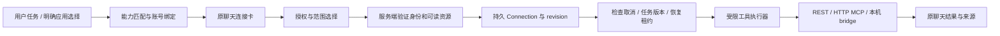

# LISA 其他连接器调研与接入方案

> 状态：C0/C1/C2 已合并；C3 Drive/Notion 本机切片已实现，详见第 10 节；其余为规划。调研日期：2026-11-07。实现基线：PR [#436](https://github.com/oratis/LISA/pull/436) 的本机 GitHub 只读连接卡、授权和原聊天恢复。
> 延续：[插件与连接器方案](PLAN_PLUGINS_CONNECTORS_2026-11-07.md)、[Grok Bot / Manus 调研](RESEARCH_PLUGINS_CONNECTORS_2026-11-07.md)。供应商能力来自下列官方文档；优先级、模块设计和工期为 LISA 的建议，不代表供应商承诺。调研阶段未登录账号；后续实现的真实授权范围和验收结果分别记录在第 8、9、10 节。

## 1 建议先交付什么

下一批先做 **Google Calendar + 现有 Gmail 的连接卡化**，形成“今天安排 → 重要邮件 → 会前准备”的日常助手流程；随后接 **Linear 只读 MCP**，验证通用远程 MCP 的授权、工具过滤和任务恢复。再扩到 Notion / Drive 的指定资料，最后按用户实际使用的工作套件接 Slack、飞书或 Microsoft 365。

不要求用户一次连接整个 Google Workspace。一个账号可以复用身份，但日历、邮件、文件的访问权限按任务分别开通。首次用户问“我今天有什么安排”只出现日历卡；只有会议准备确实需要邮件时才推荐 Gmail。

Manus 当前目录覆盖 Gmail、Calendar、Drive、Notion、Slack、Outlook、GitHub 以及电商、项目管理类服务，证明“应用目录 + 任务内连接”已有广泛产品形态；目录覆盖面并不能说明某个服务对 LISA 提供相同权限或接入资格。[Manus 连接器目录](https://www.manus.im/features/connectors)

## 2 候选连接器与实际接入条件

P1 为下一阶段，P2 为其后，P3 按用户需求推进。表中“只读”明确区分供应商令牌的权限和 LISA 执行器的限制。

| 优先级 / 应用 | LISA 首个场景 | 建议路径与授权 | 关键条件 / 边界 |
|---|---|---|---|
| P1 · Google Calendar | 今日安排、空闲时段、会前提醒 | OAuth + Calendar REST；空闲查询用 `calendar.freebusy`；事件详情用 `calendar.events.readonly`，选择日历时加 `calendar.calendarlist.readonly` | 空闲模式不能承诺读取会议内容；指定 calendar ID 仍由 LISA 强制过滤。[权限文档](https://developers.google.com/workspace/calendar/api/auth) |
| P1 · Gmail | 未处理邮件摘要、某次会议相关邮件 | 复用当前 Gmail REST / OAuth，再接通卡片与恢复；首版保持 metadata + 有限 snippet | `gmail.readonly` 与 `gmail.metadata` 都属 Restricted；改用 metadata 不会消除审核要求。`gmail.compose` 同时包含发送，不能描述成供应商侧“只存草稿”。[权限与审核要求](https://developers.google.com/workspace/gmail/api/auth/scopes) |
| P1 · Linear | 我的待办、阻塞事项、与 GitHub 合并周报 | 官方 `https://mcp.linear.app/mcp/readonly`，同时请求 OAuth `read` scope | 官方只读端点只暴露读工具，`read` 令牌不能调用写 API；每个 workspace 单独绑定。[官方 MCP](https://linear.app/docs/mcp) |
| P2 · Notion | 总结指定项目页面与需求、会议知识准备 | 严格只读版优先 Notion API connection，仅启用 Read content，按授权页面边界读取 | 官方 MCP 可读写用户可访问内容，不能直接称为供应商侧只读；API 的 Read content 可独立设置。[API capabilities](https://developers.notion.com/reference/capabilities) · [官方 MCP](https://developers.notion.com/guides/mcp/get-started-with-mcp) |
| P2 · Google Drive / Docs / Sheets / Slides | 选几份资料做摘要、对照表格与文档 | 先 Picker + `drive.file` 的指定文件导入；LISA 只开放读取、下载和导出。全文搜索整个 Drive 作为独立权限档位 | `drive.file` 是较窄的文件范围，却包含写能力；`drive.readonly` 才是只读全盘且属于 Restricted。两种产品承诺须分开。[Drive scopes](https://developers.google.com/workspace/drive/api/guides/api-specific-auth) |
| P2 · Todoist | 今日 / 逾期待办，与日历合并计划 | REST OAuth `data:read`；官方托管 MCP 可作为后续路线 | 官方已有 MCP；接入时仍需验证它能否使用本期要求的只读 scope，不能默认其完整工具集均可用。[API 与权限](https://developer.todoist.com/api/v1/) · [官方入口](https://developer.todoist.com/) |
| P2 · Slack | 指定频道近期讨论、决定与待办 | 官方 Streamable HTTP MCP + 注册 Slack app；按需选择搜索 / 历史读取 scopes | 不支持 DCR；只允许内部应用或已发布目录应用使用 MCP，未列出的分发应用不可直接上线；需要用户 token，不能把现有 bot 当全工作区读取权。[官方 MCP、资格与 scopes](https://docs.slack.dev/ai/slack-mcp-server/) |
| P2 · 飞书 | 指定云文档、项目资料与会议准备 | 优先受控 REST + 用户授权；绑定企业和用户，明确文件 / 知识空间范围 | 官方有远程 MCP 工具文档，但旧远程调用页已标记 Deprecated；新版资格和凭据生命周期需专门验证。应用 scope 与文档访问权限都要满足。[云文档 API](https://open.feishu.cn/document/server-docs/docs/docs-overview?lang=zh-CN) · [MCP 工具](https://open.feishu.cn/document/mcp_open_tools/supported-tools?lang=zh-CN) · [旧调用页](https://open.feishu.cn/document/mcp_open_tools/call-feishu-mcp-server-in-remote-mode) |
| P2 · Outlook Mail / Calendar | Microsoft 用户的收件箱和日程摘要 | Microsoft Graph delegated OAuth；日历可先 `Calendars.ReadBasic`，邮件可先 `Mail.ReadBasic`，需要正文再增量申请 `Mail.Read` | Mail.ReadBasic 不含正文、预览和附件；Calendar Basic 不含正文、附件等。优先用户委托权限，避免全租户 application 权限。[Graph 权限](https://learn.microsoft.com/en-us/graph/permissions-reference) |
| P3 · OneDrive / SharePoint | 指定工作文件、团队知识资料 | Graph；个人文件和企业 Selected 授权分两条适配 | Selected 需要资源级授权，不能只加 OAuth scope 就读取目标文件；企业管理员流程单独设计。[Selected permissions](https://learn.microsoft.com/en-us/graph/permissions-selected-overview) |
| P3 · Jira / Confluence | 项目进展、工单背景、团队知识 | Atlassian 官方 Rovo MCP，OAuth；当前文档入口为 `https://mcp.atlassian.com/v2/mcp` | 工具集包含读写，先固定读取工具；组织策略、工具认证方式和可能的 Rovo 用量须验证，避免照搬旧 v1 示例。[官方概览](https://developer.atlassian.com/cloud/rovo-mcp/) · [认证](https://developer.atlassian.com/cloud/rovo-mcp/guides/authentication-and-authorization/) |
| P3 · Figma | 指定设计稿的需求理解、实现对照 | 官方 remote MCP，限定文件 / 节点与读取工具 | 新 MCP 客户端需申请接入；账号方案影响额度。取得 LISA 客户端资格前不承诺一键可用。[远程服务](https://developers.figma.com/docs/figma-mcp-server/remote-server-installation/) · [权限与限额](https://developers.figma.com/docs/figma-mcp-server/plans-access-and-permissions/) |
| P3 · Dropbox | 用户指定文件夹的资料整理 | REST OAuth `files.metadata.read` + `files.content.read`；独立选择路径范围 | 只申请需要的读 scopes，文件内容和文件列表分开按需取回。[官方权限示例](https://dropbox.tech/developers/customizing-scopes-in-oauth-flow) |
| P3 · Apple Calendar / Reminders | Mac 本地安排和待办 | 原生 EventKit bridge + 系统权限；绑定本机 Home | 读取日历需要 Full Access，系统 Write Only 不能读取；“LISA 只读”由执行器保证，不能伪称系统授予了只读。Mac 离线时不能转向云主机读取。[Apple EventKit](https://developer.apple.com/documentation/eventkit/accessing-the-event-store) |

### 2.1 为什么 Google 先用 REST，Linear 先用 MCP

Google 已提供 Calendar、Gmail、Drive 等官方远程 MCP，当前总览明确标为 **Developer Preview**，需要加入预览计划并启用相关服务。其出现不意味着所有 LISA 用户已经可用。首批复用已有 Gmail API、采用成熟 Calendar API；MCP 作为可替换 transport，在取得资格后评估。[Google Workspace MCP 配置与前置条件](https://developers.google.com/workspace/guides/configure-mcp-servers)

Linear 的只读端点和只读 OAuth scope 能直接匹配首期边界，适合作为第一家远程 MCP 验证对象。Slack 的固定 app、confidential OAuth 与分发资格则能在第二轮检验授权服务是否真正支持供应商差异，不能为所有 MCP 都硬套动态注册。

Google 上线评估要覆盖 OAuth 应用状态、scope 验证、用户数据用途和数据经过的服务。Gmail / Drive 的 Restricted 数据若存储或传输到服务器，会涉及官方安全评估要求；只在 Mac 保存令牌，不足以证明发送到云模型的邮件数据无需评估。审核周期单列，不包含在工程估时中。[Gmail 官方说明](https://developers.google.com/workspace/gmail/api/auth/scopes) · [Drive 官方说明](https://developers.google.com/workspace/drive/api/guides/api-specific-auth)

## 3 LISA 现有基础：可以复用什么，缺什么

| 代码依据 | 已有能力 | 本期扩展所需变化 |
|---|---|---|
| [GitHub 服务](../src/connectors/github.ts)、[Web 接线](../src/web/github-api.ts) | 持久卡片状态、账号 / 仓库绑定、授权尝试隔离、取消、失效、恢复租约 | 从 GitHub 专用状态抽出公共 lifecycle；增加多 provider / 多 account / 多 resource 类型 |
| [GitHub 卡片](../src/web/assets/client/connectors.js) | 原聊天内授权、范围选择、同卡更新、刷新恢复；中英文文案 | 通用 CardView + provider 描述；支持重新选择账号、仅空闲 / 详细日程等能力档位 |
| [Gmail OAuth](../src/mail/google-oauth.ts)、[Gmail 读取](../src/mail/connectors/gmail.ts) | 只读 scope、loopback 登录、刷新 token、邮件头与有限 snippet | 接入卡片；抽 OAuth 公共层；补 PKCE、刷新锁、统一出站限制与错误脱敏；不能直接宣称已支持任意全文邮件搜索 |
| [邮件账户存储](../src/mail/accounts.ts) | 账户元数据与 SecretStore 引用 | 已支持旧凭据在访问时迁移：写入、回读验证、原子切换引用；损坏文件拒绝覆盖 |
| [MCP client](../src/mcp/client.ts) | stdio 连接、工具转换 | 尚无 HTTP transport / OAuth；当前继承整个 process.env。补受控凭据注入、分页工具发现、动态过滤、错误分类与断线处理 |
| [Slack channel](../src/channels/slack.ts)、[飞书 channel](../src/channels/feishu.ts) | 从聊天平台收消息 / 发回复 | 属于消息渠道适配；不等于用户工作区搜索或云文档的账号连接授权 |
| [SecretStore](../src/warden/secrets.ts)、[会话存储](../src/sessions/store.ts)、[任务模块](../src/tasks) | 凭据接口、持久结果标记、任务基础 | 复用边界；连接状态仍须从服务端核验，Cloud 必须按认证 UID 隔离 |

GitHub 当前切片的限制也要保留在验收说明中：只支持本机 local-owner Web；等待连接时整个原任务等待；新用户消息会取消未完成 continuation；原生端和 Cloud 未启用；gh 登录的供应商权限可能大于执行器开放的读取范围。

## 4 统一接入层设计

### 4.1 公共对象与模块

沿用已有方案的数据模型，不为每家服务复制一套卡片和恢复机制。

| 对象 | 必需字段 / 职责 |
|---|---|
| ConnectorDefinition | provider、名称、支持操作、auth method、transport、可信端点、可用平台、scope 档位、前置资格；不含用户秘密 |
| Connection | owner / Home / host、providerAccountId、workspace / tenant ID、grantedScopes、resourceBounds、credentialRef、epoch、健康状态 |
| ConnectionRequest | 原消息与会话引用、所需操作、账号约束、必需 / 可选、状态、过期时间、revision；客户端不能自行写入 connected |
| TaskBinding / Continuation | connectionId、允许操作、资源范围、原任务版本、已完成步骤、结果水位、取消状态、恢复租约 / 去重键 |

拟新增公共模块：`src/connectors/{types,catalog,store,service,auth,resume}.ts`；供应商逻辑移入 `src/connectors/providers/`；HTTP MCP 实现放在 `src/mcp/`。保留当前 GitHub API 为兼容包装，再引入版本化通用连接 API，避免已有卡片在升级后失效。

### 4.2 授权与账号绑定

授权服务支持已注册 OAuth client、符合供应商要求的客户端发现 / 注册，以及现有设备码和本机系统授权。HTTP MCP 采用当前授权规范；stdio 不套用 HTTP OAuth 流程。[MCP Authorization](https://modelcontextprotocol.io/specification/2026-07-28/basic/authorization)

- 登录由用户点击可信卡片开始，系统浏览器完成；不让模型拼接任意认证地址、收集聊天中的 token 或自行切换账号。
- 将 state、PKCE、规范回调地址、owner / Home、requestId、期望 issuer 和账号约束绑定；一次消费，过期与重放不改变连接状态。confidential client secret 留在可信服务端，不能装进分发的桌面二进制；本机自带应用配置与托管认证服务是两个部署选项。
- 回调成功后取稳定账号 ID、实际 scopes 与可读资源探针；完成这些步骤才显示“可用于本任务”。用户名、邮箱只作显示，不作唯一授权标识。
- 刷新按 connection 单飞加锁；新凭据验证后原子替换。撤销 / 换账号提升 epoch，旧队列请求失效。失败的重连不得覆盖仍有效的原账号。
- `resourceBounds` 分服务表达：calendar IDs、repository IDs、page roots、team / project IDs、channel IDs、file IDs；每次执行复核，不只在 UI 勾选时检查。
- 断开 LISA 连接立即停止待执行和在途操作，并删除本地凭据；供应商全局授权撤销是另一个明确动作，不假称本地断开已注销所有第三方登录。

### 4.3 只读工具与数据边界

工具白名单由经过审查的 adapter 定义，包含操作语义、参数约束、返回资源验证和可用 scope。MCP annotations 可帮助展示，但不能作为免审权限证明；新发现工具默认不启用。按任务加载少量工具，工具清单变化后重新验证。[MCP Tools](https://modelcontextprotocol.io/specification/2026-07-28/server/tools)

GitHub 当前的 GET-only 实现可以保留在 GitHub adapter 内；不要推广为所有连接器的唯一规则：日历 free/busy、搜索与 GraphQL 读取可能使用 POST，判定应基于受控操作和载荷。对无法可靠限定频道 / 页面范围的宽泛搜索工具，首版停用它，改为定向读取或受控 API。

每次调用复核 owner、连接 epoch、账号、scope、资源和任务绑定；限制时间窗、分页数量、返回字节和运行预算。HTTP MCP 的 metadata 发现、令牌端点、资源链接和重定向同样经过出站策略与 SSRF 防护，授权头不转发给非目标服务。任意自定义 stdio 仍是高级本机能力，不能自动进入 Cloud 或普通任务。

邮件 / 文档 / 消息属于外部数据，其内容不能触发安装、扩权或发送动作。默认按请求取回有限片段与来源链接，不自动全盘索引；缓存按账号与资源隔离并设置保留期。结果只携带必要内容；审计记录操作、资源 ID、状态和耗时，不记录 token 或整段私信。

### 4.4 原任务恢复

复用 GitHub 的持久请求、恢复租约和结果提交标记，增加通用 `intentRevision` 与每次恢复的 fencing token。授权成功事件只提示服务端有待处理工作；SSE 不承担可靠队列职责。刷新 / 重启后先读取权威状态，旧 revision 不覆盖新卡片。

后续将当前“新消息一律取消”改成明确的任务控制：用户取消、改变目标账号或改写任务范围会终止 / 重新绑定 continuation；进度询问可保持等待。实现语义分流之前保持现有保守行为，不能仅靠模型猜测就恢复已被替换的任务。

多连接任务保存已完成步骤；缺少可选邮件权限时，可先给出日历结果，授权后补充邮件。账号、范围或动作发生实质变化时停在选择步骤；原来已经授权的同一只读任务恢复时，无需再问一次“是否继续”。定时摘要须由用户明确启用，连接邮箱本身不创建后台任务。

### 4.5 存储迁移与部署

先保持 local-owner 范围。将 GitHub v1 状态迁移到公共 store 时保留 request ID、结果标记与幂等关系；备份可验证，损坏或不兼容状态拒绝恢复。邮件迁移采用“读旧记录 → 写 SecretStore → 回读验证 → 原子切换引用”，完成前不删除旧凭据；错误不转成空账户覆盖。

Cloud 作为后续独立交付：按认证 UID 的租户存储、KMS / SecretStore、事务租约和计费路径上线。若业务需要 Slack 这类 confidential OAuth，可先设计受控认证 broker，但不能借此放开 Cloud 的宿主文件、shell 或全局 MCP。Pocket / Mac 跨端卡片绑定原 Home；执行机离线就等待，不把凭据自动迁往其他 Home。

## 5 三个首发流程的具体范围

| 用户任务 | 卡片内容与默认范围 | 授权后自动完成 | 首版明确排除 |
|---|---|---|---|
| “看看明天有哪些空档” | Google Calendar；只读忙闲、指定日期；只有要选多个日历才申请列表能力 | 用用户时区返回空闲时间并注明数据范围 | 建会、邀请参与者、修改日程 |
| “总结最近三天需要我处理的 Gmail” | Gmail；账号、近三天、有限摘要；已有邮箱迁移后探测可用性 | 复用现有读取器整理邮件头 / snippet；证据不足明确说明 | 发送、归档、标已读、批量正文 / 附件抓取 |
| “结合 GitHub 和 Linear 写这周进展” | 复用已连接 GitHub；Linear 选择 workspace 和项目 / team 范围 | 两份已授权读取结果在同一聊天合并，附 issue / PR 来源 | 新建 issue、改状态、跨 workspace 搜索 |

API 草案：目录 `GET /api/connectors`；当前用户连接 `GET /api/connections`；创建 / 查询请求与 authorize / confirm / cancel / retry；独立 disconnect。OAuth callback 由服务端 state 找回请求，客户端提交的 owner / session / account 不作为授权事实。新增接口先写 OpenAPI 与客户端生成契约，GitHub 旧路径继续工作。

## 6 分批实施与工作量

以下是基于当前代码的粗估，单位为一名熟悉仓库工程师的有效工作日；包括必要自动测试，不含供应商审核、真实组织账号准备和原生跨端发布。不是排期承诺。

| 批次 | 交付内容 | 依赖 / 验收门槛 | 估时 |
|---|---|---|---|
| C0 | 提取公共模型、store、CardView、任务绑定；GitHub 兼容迁移 | 既有授权与恢复回归通过；API 契约同步 | 3–5 日 |
| C1 | Google OAuth 公共层、Gmail 安全迁移与卡片、Calendar 两档读取 | 本机测试账号真实授权；scope / 撤销 / 时区边界验收 | 5–8 日 |
| C2 | HTTP MCP、授权发现 / 已注册 client、受控工具目录；Linear 只读 | 只读 scope + endpoint、分页、取消、断线与重复结果验收 | 4–6 日 |
| C3 | Notion 指定页面 + Drive 指定文件 | 资源边界、导出内容限额、失去共享权限后拒绝；Google 审核条件明确 | 5–8 日 |
| C4 | Slack / 飞书 / Microsoft 365 中按需求选一套 | 获得对应应用 / 企业资格；不能套用其他服务的登录实现 | 每套另估，预留 5–10 日验证 |

C0 后优先 C1；若 Google 应用资格影响公开测试，先推进 C2，不让整套连接平台等待一家审核。第一阶段可用目标为 GitHub + Calendar + Gmail + Linear；生产发布以真实账号验收为准。

单列发布前置：Google scope 验证和数据处理评估；Slack 内部应用试点或 Marketplace 路径；Figma 客户端登记；飞书新 MCP / 自建应用资格；Microsoft 企业同意策略。未解决的连接器在目录显示实际前置条件，不出现可用的连接按钮。

## 7 验收与观测

| 维度 | 必须验证的结果 |
|---|---|
| 体验 | 中文 / 英文卡片；账号与范围可见；连接后原聊天自动恢复；拒绝后不重复提示；已有连接直接使用 |
| 授权 | 取消登录、回调重放 / 过期、scope 不足、选错账号、多个 workspace、刷新失败、撤销后再次调用 |
| 执行 | 跨账号 / 跨租户 / 跨资源读取被拒绝；只读连接无法调用写工具；工具自称只读不能绕过策略；来源内容不能扩权 |
| 恢复 | 刷新、进程重启、两进程抢占、重复确认、响应到达前断开；一项任务最终结果只出现一次 |
| 数据 | 旧状态和邮箱凭据迁移中断 / 损坏不丢失；分页、429、超时有界；日志和客户端无秘密；断开后缓存策略生效 |
| 服务差异 | Calendar 跨时区 / 全天事件 / 夏令时；Gmail 撤销和有限片段不足；Linear workspace 隔离；Drive / Notion 资源共享权限变化 |

自动测试使用受控供应商替身，并保留每家服务的真实测试账号清单：首次授权、刷新、撤销、范围变更、一次原任务恢复。替身通过不等于供应商 OAuth 已跑通。

记录连接提示 → 点击 → 身份验证 → 范围确认 → 恢复完成的转化与耗时，按 provider 区分取消、权限不足、审核未满足、限流和服务故障。指标只用请求 ID 与状态，不上传用户邮件、文档正文或认证码。

## 8 本轮交付与下一步

PR #436、[#437](https://github.com/oratis/LISA/pull/437) 已合并。C0/C1 的本机 Web 切片已交付，C2 接入 Linear 并复用公共生命周期；多账号、混合来源任务、Cloud 和原生端另行推进。

## 8 C0/C1 实现与验收（2026-11-07）

实现入口为 [公共生命周期](../src/connectors/service.ts)、[适配器契约](../src/connectors/types.ts)、[Google 驱动](../src/connectors/google-driver.ts)、[桌面 OAuth](../src/connectors/google-oauth.ts)、[受控传输](../src/connectors/google-http.ts)、[公共卡片](../src/web/assets/client/connectors.js) 和 [HTTP 接口](../src/web/connectors-api.ts)。本切片沿用已有工程结构，没有预建尚无调用者的 catalog/store/resume 文件；C0/C1 交付时目录是固定三项，C2 已抽入 `catalog.ts` 并加入 Linear。GitHub 旧 API 保留，新增接口同步到 OpenAPI。

| 来源 | 授权与确认 | 允许读取 | 执行限制 |
|---|---|---|---|
| GitHub | 既有登录或设备授权，再选择仓库 | 原有仓库只读操作 | 旧 v1 状态迁移到 v2，保留请求及结果标记 |
| Google Calendar 忙闲 | `calendar.freebusy`，确认主日历 | 指定日期的忙闲区间 | 无事件标题；每次最多 31 天、200 区间 |
| Google Calendar 详情 | `calendar.events.readonly`、`calendar.calendarlist.readonly`、`calendar.events.freebusy`，逐项选择日历 | 展开重复事件后的详情、全天日期、时区或忙闲 | 每次最多 31 天、30 事件，提示截断；无创建、改动或邀请 |
| Gmail | `gmail.readonly`，逐项选择标签 | 发件人、主题、时间、最多 400 字摘要及邮件链接 | 每次最多 31 天、20 封，提示截断；无正文、附件、发送、归档或删除 |

Google 另外请求 `openid` 和 `userinfo.email` 绑定稳定账号 ID 及经验证邮箱。权限请求、实际授予 scope、LISA 资源范围分别保存并复核；已有更宽令牌不能提高本次选择的读取档位。Gmail 的供应商令牌可以读取整个邮箱，标签和字段限制由 LISA 驱动执行，不宣称 Google 提供标签级 OAuth。授权后仍须在卡片确认资源，默认不勾选。

### 本机配置与操作

1. 在 Google Cloud 项目启用 Calendar API 和 Gmail API，配置 OAuth 同意屏幕及允许的测试账号。创建 **桌面应用** OAuth 客户端，下载 JSON；Web 客户端不能用于此回调。
2. 在本机 `~/.lisa/config.env` 配置 `LISA_GOOGLE_CLIENT_FILE=/absolute/path/to/desktop-client.json`，或使用 `LISA_GOOGLE_CLIENT_ID` 与可选 `LISA_GOOGLE_CLIENT_SECRET`。JSON 和密钥不提交仓库。文件方式仅保存路径；凭据随后进入 SecretStore。
3. 本机 Web 聊天发送“查看 Google Calendar 今天的忙闲”“查看 Google Calendar 明天日程”或“总结 Gmail 今天邮件”，点击对应登录档位，完成 Google 授权后返回卡片选择范围。确认后自动恢复原聊天。
4. 卡片支持取消、失败重试、重新授权和断开。断开删除 LISA 保存的凭据、停止未完成任务；不自动撤销同一 Google 应用的其他授权。若要切换已连接账号或日历权限档位，先断开再发起读取请求。

Google 的桌面流程采用 PKCE 与临时 loopback callback；实现依据 [Google 官方桌面 OAuth 文档](https://developers.google.com/identity/protocols/oauth2/native-app)。公开分发前仍需独立配置 LISA 应用品牌与 Google 所要求的审核，不能将测试账号授权等同于公开发布资格。

### 验证范围

自动测试覆盖真实本机 HTTP 回调与 PKCE/state 校验、两档日历 scope、时区/全天事件、标签范围、过期刷新、撤销后停止提交、旧 GitHub/邮件状态迁移、重启去重、Cloud/跨站拒绝和邮件验证码过滤。浏览器测试覆盖 Google Calendar/Gmail 的卡片、授权回调、范围确认、原聊天结果、刷新去重、取消，以及 GitHub 原有路径；供应商响应与模型在自动测试中为测试替身。

真实账号验收使用隔离的本机预览 Home，不启用后台邮箱轮询。Calendar 忙闲已完成真实 OAuth、主日历确认和原任务自动恢复。Gmail 已完成真实 OAuth、INBOX 标签确认和原任务自动恢复，并在结果中正确说明单次 20 封上限及截断。日历详情已通过自动测试，未读取真实日程内容。

### 当前边界

每个来源连接一个账号；每条请求只处理一个来源，混合请求提示分别发送。资源选择会用于后续同来源只读任务，直到断开。新用户消息取消未完成的续跑；授权窗口关闭后可取消或等候十分钟超时。首批仍限本机 local-owner Web，Cloud、远程设备和原生客户端未开放。旧 CLI 邮箱登录入口仍保留，但凭据保存已经迁入 SecretStore；新卡片不自动开启旧邮件分类/轮询，也不继承旧邮箱的读取同意。

## 9 C2 Linear 实现与验收（2026-11-07）

### 接入方式

[Linear 驱动](../src/connectors/linear-driver.ts) 复用 `ReadonlyConnector` 的持久状态、资源确认、续跑租约、取消和结果去重。`catalog.ts` 保存四个经过审查的来源，Web 接口与卡片使用同一生命周期表面。没有把任意 MCP 服务注册为已授权连接器。

[OAuth](../src/connectors/linear-oauth.ts) 固定发现 `mcp.linear.app` 的资源与授权元数据，经 Dynamic Client Registration 创建公共客户端，只申请 `read`，使用 PKCE S256、随机 state、严格 issuer 校验及临时 `127.0.0.1` 回调。无需用户配置 Linear 客户端 ID 或提交 API key。`oauth-loopback.ts` 封装可复用的单次回调；现有 Google OAuth 保留兼容路径。

[HTTP 传输](../src/mcp/http.ts) 和 [只读 MCP 客户端](../src/mcp/readonly-http.ts) 使用 SDK 的 Streamable HTTP，支持 JSON 和有限 SSE 响应，固定 HTTPS 主机与路径、公共 DNS 地址、禁重定向、单请求 30 秒与 1 MB 上限。关闭不需要的后台通知流；暂时断线最多新建一次连接重做只读查询，权限与数据校验错误不自动重试。令牌刷新由公共凭据锁串行处理，轮换后的 access/refresh token 先保存再读取。

实现依据：[Linear 官方 MCP](https://linear.app/docs/mcp)、[MCP 授权规范](https://modelcontextprotocol.io/specification/2025-11-25/basic/authorization)、[Streamable HTTP 规范](https://modelcontextprotocol.io/specification/2025-11-25/basic/transports)。实际公开元数据确认只读资源支持 `read`，授权服务提供注册、S256 与 issuer 参数；忽略未授权响应中较宽的 `read write` challenge，绝不据此扩大权限。

### 资源与操作范围

- Linear 授权绑定所选工作区；LISA 再按稳定团队 ID 限制读取。团队级限制由 LISA 执行，不宣称 OAuth 本身按团队缩小权限。每个来源仍仅一个连接；切换工作区须断开后重新授权。
- 身份验证和团队清单在授权后用于连接卡，团队默认不选。确认后只恢复原聊天、原请求；后续同来源只读任务复用选定团队，新用户消息取消未完成任务。
- 模型仅获得 `linear_read` 的 `list`、`issues` 两种操作。内部只允许 `get_user`、`list_teams`、`get_team`、`list_issues`；服务公布的新工具或自称只读的工具均不能扩权。已知工具参数被移除、增加未知必填参数或只读声明改变时停止。
- 先按所选团队 UUID 核对身份，再用当前团队 key 查询并显式传 `includeSubTeams=false`（官方 UUID 查询会包含子团队）；按更新时间排序，排除已归档工单，可选只看分配给当前账号的工单；每页最多 20 条、最多 5 页。用官方 `fields` 参数只请求 UUID、标题、描述、状态、负责人、时间、链接和团队 ID；兼容人类可读 `id` 与独立 `uuid`。标题最多 400 字、描述最多 1,200 字，只保留已验证的 Linear 来源链接。分页不足或截断明确返回；不声称是全工作区总数。
- 每次读取核对账号及团队，返回工单的团队 ID 不匹配则整体拒绝。描述等外部内容标为不可信；不提供全局搜索、评论、附件、创建、编辑或分配能力。
- 只开放本机 `local-owner` Web；Cloud、远程设备仍拒绝。通用 API 的 provider、账号显示名与团队资源类型已同步 OpenAPI。已有 GitHub API 保持兼容。

### 验证记录

自动测试覆盖 DCR/PKCE/state/issuer、只读 scope、令牌轮换、公共 DNS 固定、重定向和响应上限、SDK JSON/SSE、未知工具/参数拒绝、团队与账号隔离、重启恢复、撤销后停止提交，以及 Cloud/跨站拒绝。浏览器测试使用真实本机回调和 SDK，供应商及模型响应为测试替身，覆盖连接卡、默认不选团队、确认后自动恢复、刷新去重、连接复用、取消和混合来源提示。

真实账号验收在隔离的本机预览 Home 进行，仅请求所选团队返回的工单数量。已验证官方 DCR、只读授权、账号与团队清单、默认不选团队、确认后原聊天自动恢复，最终卡片显示任务完成，结果只输出返回数量。真实返回确认了小写 `bearer`、SSE、团队 key、字段选择和 UUID 形态，已补入兼容与范围测试。授权后的服务重启保留了待确认卡片与凭据。没有公开工单内容或账号邮箱；真实撤销和令牌过期轮换仍由自动测试覆盖，未对该账号主动制造失效。

## 10 C3 Google Drive / Notion 实现与验收（2026-11-07）

PR [#438](https://github.com/oratis/LISA/pull/438) 已合并。本批复用 `ReadonlyConnector`，固定目录扩为六项，增加 `google_drive_read` / `notion_read` 三种操作：`list`、`metadata`、`content`。Web 连接卡、取消、重新授权、断开、原聊天自动恢复、重启租约与结果去重均复用现有实现；Cloud 和远程设备仍拒绝访问。每个来源仅一个账号/工作区，混合来源仍提示拆开请求。

### Drive

采用 [Google 桌面 Picker OAuth](https://developers.google.com/workspace/drive/picker/guides/desktop-mobile-picker)：只请求 `drive.file`，不叠加 openid/email；以 `about.user.permissionId` 绑定账号。授权使用 PKCE、随机 state、临时 loopback 回调，并验证 `picked_file_ids`（最多 30 个）。不通过全盘列表推断用户选中了什么，不向网页发送 access token。Google 的文件级 scope 包含写能力，连接卡明确披露；LISA 仅实现读取，且再次限制为卡片确认的文件。

仅支持 Docs/Slides 的纯文本导出、Sheets 首个工作表 CSV、普通文本/Markdown/CSV/TSV/JSON。文件类型、选定 ID、账号、下载权限和访问状态均验证；内容最多 1 MB、输出最多 30,000 字。禁止文件夹、快捷方式、PDF、二进制附件、任意 URL 和全盘搜索。来源内容作为不可信数据，正文不成为系统指令。

配置仍使用 `LISA_GOOGLE_CLIENT_FILE` 的桌面应用 JSON。对应 Cloud 项目须启用 **Drive API 与 Google Picker API**；文件类型和导出限制参见 [官方导出表](https://developers.google.com/workspace/drive/api/guides/ref-export-formats)。公开分发须使用正式 LISA 品牌客户端，现有 Luddi 仅用于本次本机验收。

### Notion

采用 [Notion OAuth](https://developers.notion.com/guides/authorization/overview) 和固定 REST API，应用只启用 **Read content**，关闭写入、更新、评论和用户资料权限。每次使用前通过 [token introspection](https://developers.notion.com/reference/introspect-token) 验证 `active=true` 且 scope 仅为 `read_content`；未知/更宽 scope 拒绝。令牌轮换先持久化，再继续读取。身份按工作区 ID 加 users/me 稳定 ID 绑定，兼容 bot/person。

授权采用 confidential Basic token exchange、随机 state 和预注册 `http://localhost:4860/oauth/notion`。Notion 开发者门户拒绝 IP 形式回调；供应商未文档化 PKCE/issuer，本实现不假称支持。回调仅监听 127.0.0.1，严格校验 Host、路径、state 和单次消费，十分钟超时。

创建 OAuth connection 后，把 `clientId`、`clientSecret`、`redirectUri` 写入私有本机 JSON（权限 0600），在 `~/.lisa/config.env` 设置 `LISA_NOTION_CLIENT_FILE` 指向它；也支持 `LISA_NOTION_CLIENT_ID`、`LISA_NOTION_CLIENT_SECRET`、`LISA_NOTION_REDIRECT_URI`。密钥不得放入仓库、聊天或模型上下文。固定回调端口须可用。

页面清单来自连接已获访问的页面，默认不选。确认后读取指定页面的普通内容块，最多 200 块、4 层、12 次 children 请求，另有最多 10 次容器复核和两次页面读取；单块 2,000 字、总计 30,000 字，截断和省略类型明确返回。不深入子页面/数据库，不展开同步块，不下载附件或跟随链接。返回前复核已遍历容器所属关系与根页面权限，越界/移动/撤销时不返回已缓冲的正文。

### 验证范围

自动测试覆盖两种真实本机回调、scope/state/PKCE、Notion Basic 交换、令牌轮换、指定文件/页面范围、错误类型、外部 URL 拒绝、子页面与同步块省略、移动/撤销后停止、截断与导出限制、重启恢复去重、断开与跨站/非 owner 拒绝。浏览器测试覆盖两种连接卡、默认不勾选、刷新、原任务仅完成一次、后续复用、取消及混合来源提示；供应商和模型响应使用测试替身。

真实 Notion OAuth 已验证 `read_content`、页面选择、连接卡确认和原任务自动恢复；所选页面返回 0 个普通块/0 字，无截断。非空页面、嵌套内容、撤销及刷新由自动测试验证，不把空页面验收描述成覆盖所有内容类型。
