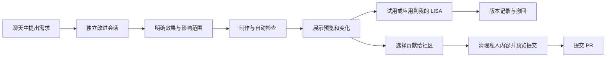

# “改进 LISA”专属会话、个人能力与社区贡献方案

> 状态：Proposed，尚未实现。日期：2026-11-07。依据：本地工作区 `972b097` 及当前未提交改动、现有技能／插件／Warden／GitHub 连接代码和 GitHub、Apple 官方文档。
> 本次已经完成的 Mac 界面更新是独立交付，不代表本文中的专属会话或 PR 流程已上线。

建议增加一个常驻的“改进 LISA”入口。用户在普通聊天中提出改进要求后，LISA 将相关上下文带入独立的改进会话，生成可以试用、撤回、选择分享的能力版本。个人定制保存在用户自己的 Home；通用改进可以由用户发起，整理成对 `oratis/LISA` 的 PR。

产品的长期结构是：**官方基础版本 + 个人能力组合 + 可选择的社区贡献**。用户无需了解 Git 就能定制自己的 LISA，也无需为定制注册 GitHub。共享的是可复用的能力实现，个人记忆和账户连接留在用户自己的环境。

## 1. 用户体验与会话结构

### 1.1 一个固定入口，每项改进有独立会话

侧栏增加“改进 LISA”，提供“新改进”“我的能力”“改进记录”三个入口。用户进入后可以直接说“我想让你……”。每项需求创建一个 `kind=improvement` 的会话，仍然使用现有聊天、附件、流式进度和重命名能力，并附带版本、改动、试用和贡献状态。

普通聊天中也可以触发。例如用户说“以后帮我按这个格式整理周报”，LISA 展示一张改进卡，用户可直接选择“为我创建这个能力”。如果用户已明确要求实际修改，直接创建改进会话并开始授权范围内的准备工作。纯粹吐槽或讨论只提供入口，不把它自动解释成修改指令。

原聊天保留一张关联卡，可返回原任务；改进会话保存原消息引用和用户选定的必要上下文。默认不复制全部聊天、附件、记忆或其他项目。将会话历史视为需求证据，不将其中的网页、邮件或仓库文本提升为权限指令。

### 1.2 具体流程

“个人应用”和“贡献社区”是两条独立路径。用户可只分享已经检查的补丁而不安装，也可长期使用个人能力而不公开。PR 被关闭不移除个人能力；PR 被合并也不立刻改变所有人的 LISA。

每个会话显示：希望改善什么、会改变哪些行为、涉及哪些数据／应用、当前进度、试用入口、最近检查、已启用版本。代码、差异和日志放在展开详情中。默认主按钮是“试用”“应用到我的 LISA”“撤回”；“贡献给社区”是独立的次级动作。

### 1.3 一个完整示例

用户：“以后帮我按这个格式整理 GitHub 周报。”

1. LISA 识别为个人技能 + 现有 GitHub 读取能力 + 可选定时触发。已有连接和权限直接使用，缺少时沿用连接器卡。
2. 在改进会话中，用合成数据或用户选定的样本展示一次周报预览，说明哪些仓库和信息会参与。
3. 用户应用后，能力出现在“我的能力”；定时触发需要明确选择频率，不能从“周报格式”推断用户要求定时执行。
4. 用户继续说“帮我把这个功能贡献出去”，LISA 提取通用模板和实现，用虚构账号／仓库替换个人样例，展示待公开文件与 PR 正文。
5. 确认该提交后，在用户 fork 的分支推送并创建 Draft PR，原会话持续显示真实结果。没有 GitHub 账号也能导出补丁或能力包。

## 2. 哪些内容可以因人而异

| 层级 | 例子 | 建议落点 | 激活方式 | 社区贡献方式 |
|---|---|---|---|---|
| 偏好与行为配置 | 回答长度、语言、输出格式、默认模型 | 用户 Home 下有版本的 profile | 下一轮对话生效，可撤回 | 分享去除个人数据的模板 |
| 技能与工作流 | 周报、阅读笔记、会议准备、重复任务 | 声明式技能包，组合已有获准工具 | 样例通过后启用；新增权限另行明确 | 提交通用 skill／recipe 和合成样例 |
| 工具与界面扩展 | 新文件解析器、服务适配器、侧栏卡片、主题 | 有 manifest 的扩展包与稳定扩展接口 | 独立执行环境试用，按权限和版本启用 | 提交扩展实现、测试与说明 |
| 核心与原生应用 | 会话机制、消息协议、原生菜单、基础安全修复 | 专属源码工作区和候选构建 | Mac 开发预览；正式版走发布流程 | 提交核心 PR，由维护者审核发布 |

个人名字、Soul、记忆、知识库、账户凭据、真实工作材料不属于可公开的能力实现。模型选择和路由可以个性化，首期不引入按用户微调模型权重。

优先用配置、现有工具和声明式技能满足需求。新增 JS、任意 Shell、全量源码分叉属于更高成本路径，必须能解释为什么现有扩展能力不足。长期维护单位是“小而可组合的能力包”，核心改动则尽量回到主线，减少用户长期维护巨大个人分支的负担。

## 3. 现有基础与真实缺口

| 已有代码 | 可以复用 | 需要新增或改造 |
|---|---|---|
| `src/sessions/`、Web 会话列表 | 对话持久化、会话切换、名称、历史 | 会话类型、来源关联、改进对象关联、状态卡 |
| `src/skills/manager.ts` | 创建、修改和读取 SKILL.md | 版本快照、样例检查、试用与激活分离 |
| `src/skills/executable.ts` | 按内容 SHA256 审批、禁用、审计 | 当前 tool.js 在主进程动态加载；需要真正独立的受限执行环境，才能面向普通用户开放生成代码 |
| `src/plugins/loader.ts` | 插件包含 commands、skills、hooks、MCP 等 | 插件路径当前基于全局 Home；需要按用户实例解析、版本固定、权限描述、兼容性检查 |
| `src/warden/`、`src/sandbox/` | 动作审批、凭据代理、路径／进程约束 | 改进会话显式使用受限策略；当前通用默认是 danger-full-access，不能直接继承 |
| `src/tools/redeploy.ts` | 源码构建与 supervisor 重启 | 不适合普通安装版直接调用；需要可信激活服务、健康检查、上一版本指针及失败恢复 |
| `src/connectors/github.ts`、`github-driver.ts` | 账号连接、选仓库、恢复、撤销与凭据存储 | 这个新连接器目前只读；需要独立的贡献写入操作、范围约束和幂等流程 |
| `src/tools/github.ts` | 旧版 gh 读写动作 | 不能因此声称新连接卡已经具备受限写入能力；贡献流应通过统一网关提供专门操作 |
| `src/web/event-bus.ts`、`src/paths.ts` | Home 作用域、租户过滤事件 | 任务恢复、对象 revision 与激活锁；事件只是通知，持久化状态才是事实 |

关联方案：[连接器方案](PLAN_PLUGINS_CONNECTORS_2026-11-07.md)、[跨平台设计](DESIGN_CROSS_PLATFORM_ASSISTANT_v1.0.md)、[Warden](DESIGN_WARDEN.md)。新功能复用它们的身份、连接和执行边界，不另起一套账号或秘密存储。

## 4. 执行架构

### 4.1 四个职责

1. **改进服务**：保存需求、范围、状态、验收样例和用户选择，调度制作／测试／预览。普通聊天只获得创建和查询改进的能力。
2. **制作与验证执行器**：只在此次改进的工作目录内写入；模型、LISA 自身或已授权的 Claude／Codex 都可作为实现后端，输出统一 ChangeSet 和证据。产品不依赖某一个编码代理。
3. **可信激活服务**：检查产物摘要、兼容性和授权，管理版本指针、重启、健康检查与恢复。它在生成代码的可写范围之外，模型不能自行修改审批记录或激活策略。
4. **贡献服务**：从选定产物构造公开补丁，检查账号、仓库、分支和批准的内容，再执行远程操作。构建进程与模型均拿不到 GitHub token。

拟新增 `src/evolution/` 下的 `service`、`store`、`workspace`、`validate`、`preview`、`activate` 和 `contribute`，HTTP 路由拆到 `src/web/evolution-api.ts`。具体命名可在实现时调整；避免继续把全部职责塞入 `server.ts`。

### 4.2 工作目录与数据隔离

每个改进使用专属源码镜像／worktree，绑定可信来源、基础 commit、能力版本和变更摘要。目录位于用户 Home 的开发区，例如 `evolution/workspaces/<changeId>`，不使用用户当前正在编辑的项目作为试验区。并行改进可以分别制作，应用到同一 Home 时串行执行并检查基础版本是否变化。

代码构建在没有用户凭据、没有真实 Soul／记忆／会话目录的环境中执行；使用明确的文件和网络允许范围。依赖安装及测试脚本也执行在这个环境中。独立子进程本身不构成隔离，必须落到宿主可执行的 OS 约束；无法提供约束时，停止执行代码并仍允许生成补丁／查看预览说明。

试用采用测试 Home、合成资料或经用户选择的快照，禁用真实发送、支付、发布和其他外部写入。需要真实样本的只读检查，使用单独授权的读取代理。不能让“试用一次”写入正式记忆或修改真实业务数据。

每项改进设模型用量、最长运行时间、自动修复次数、磁盘与构建日志上限；到达上限保留产物和下一步，不继续无界迭代。测试失败停留在会话内，不影响日常聊天。

### 4.3 数据模型与恢复

| 对象 | 建议字段 | 关键约束 |
|---|---|---|
| ImprovementSession | id、owner、homeId、hostId、originSessionId、originMessageIds、goal、scope、budget | 会话 kind 不能由模型伪造权限；来源是引用 |
| ChangeSet | id、revision、baseCommit、baseProfileVersion、files、digest、requiredCapabilities、acceptanceCases | 预览、测试和批准必须对应同一份内容 |
| CapabilityVersion | packageId、version、digest、source、compatibility、dependencies、permissions、dataSchemaVersion | 内容不可变；同名新内容生成新版本 |
| Activation | oldVersion、newVersion、grantId、checkpoint、health、startedAt、completedAt | 同一 Home 的激活有锁和 compare-and-swap |
| Contribution | accountId、upstreamRepoId、forkRepoId、branch、commitSha、exportDigest、PR URL、status | 固定实际账号／仓库；远程结果可对账 |

工作进度、个人激活和社区贡献分开保存。例如工作状态为 `preview_ready`，激活为 `active`，贡献为 `pr_open`，可以同时成立。不要把它们塞进一个互斥状态枚举。

崩溃恢复从持久化检查点继续。重复点击应用不重复启用；推送或创建 PR 请求超时后，先按账号、head 分支与 base 查询实际结果，再重试。用户取消、账号撤销或产物改变后，旧批准失效。SSE 使用对象 ID 和 revision；客户端重连先拉最新快照。

## 5. 个人应用、回退与官方升级

**应用流程**：固定产物 → 检查兼容和权限 → 建立恢复点 → 在空闲边界切换版本 → 执行健康检查与验收样例 → 标记已应用。正在运行的对话固定到原能力版本，新一轮才采用新版本；需要服务重启时先保存会话和任务检查点。

配置和文本技能可以在下一轮装载。执行代码必须通过受限扩展宿主；核心 runtime 使用独立版本目录，切换可信指针，保留上一版。启动失败、检查失败或用户选择撤回时，恢复上一个健康版本。

数据迁移与代码回退分别管理。采用版本化数据和尽量可逆的迁移；不能把旧文件全量覆盖回去而丢失试用之后的新消息。无法安全回退的迁移必须在应用前说明影响并建立可验证备份，首期不自动应用此类迁移。

官方升级时，读取个人能力锁文件，在候选官方版本上做兼容测试：兼容则保留，冲突则暂停相关能力并说明原因，用户仍可使用官方基础能力。核心补丁用三方合并生成新候选，重新测试；未经检查不能把冲突消解当作成功更新。上游已包含同一能力时，按来源／patch 关系识别并移除重复覆盖，保留个人设置。

Mac 正式产品将可变内容放在用户数据目录，保持签名 App 的基础程序稳定；原生二进制和基础安全机制走正常签名发布。Apple 明确说明，修改签名包会破坏签名封装。[Apple 代码结构说明](https://developer.apple.com/documentation/xcode/embedding-nonstandard-code-structures-in-a-bundle)

## 6. GitHub 与 PR 完整流程

### 6.1 贡献目标

默认上游是已核验的公开仓库 `oratis/LISA`，当前默认分支 `main`，执行时重新核验 repository ID 和 default branch。即使本机用户拥有上游管理员权限，默认仍按普通贡献者流程操作；不直接向主分支写入。

为模板／技能预留 `examples/skills/`，为可分发扩展预留 `extensions/`，核心修复进入现有 `src/`。前两个目录是建议的新贡献布局，需要维护者认可后建立；当前不能把它们描述为现成市场。社区目录、安装分发和签名审核是 PR 流程之后的独立阶段。

### 6.2 用户看到的贡献流程

1. 选择要贡献的改进版本。LISA 判断是否值得通用化，并查询相似 issue／PR，避免反复投稿。
2. 生成独立导出目录，仅包含此次允许的文件。真实记忆、聊天记录、配置、token、本机路径和未经授权的附件均不进入导出；敏感内容扫描与人工预览共同把关。
3. 在合成样例上重新测试导出内容，生成“改了什么、为什么、验证了什么”的 PR 正文。不能把本机私有样例通过的结果冒充公开补丁也已通过。
4. 显示账号、目标仓库、公开可见性、文件清单、差异、PR 标题正文和许可说明；用户选择“提交这份改动”。若此前已明确授权发布这一确定版本，沿用该授权。
5. 复用／建立用户 fork，创建 `lisa/improve-<id>` 分支，只推送批准的提交，创建 Draft PR。返回真实 PR URL，后续状态从 GitHub 查询。
6. 用户可在同一会话要求修改；后续 diff 进入同一 PR 的新提交，扩大公开内容或权限时重新明确范围。CI 失败、维护者建议、已合并、已发布各有独立状态。

“创建 fork”可能已经产生公开资源；首次远程写入之前就必须展示完整发布范围，不能等 push 完后才提示公开。公共 fork 的分支也可能被查看。无 GitHub 连接、组织限制或写入不可用时保留成果，可导出补丁，并提供 GitHub compare 页面完成最后一步。

### 6.3 认证与权限选择

首期本机实现可以复用用户已有的 `gh` 登录，但需要独立贡献适配器：仅开放检查 fork、创建指定分支、推送固定快照、创建／更新本任务 PR、读取检查状态。不能把通用 Shell 或任意 `gh` 命令连同 token 交给制作执行器。服务商 token 的权限可能宽于 LISA 本次允许的操作，二者必须分别显示和约束。

面向普通用户的正式方案优先验证 GitHub App 用户授权，以便贡献归属于用户。用户权限、App 权限及安装范围共同约束访问；仅仅“已登录”不足以证明能向上游提 PR。[GitHub 用户授权说明](https://docs.github.com/en/apps/creating-github-apps/authenticating-with-a-github-app/authenticating-with-a-github-app-on-behalf-of-a-user)

建立分支所需的 Contents 写权限与创建 PR 所需的 Pull requests 写权限应按操作检查，尽量限定到用户 fork；不请求主分支合并、发布 release、管理 secrets 或修改工作流的能力。修改 `.github/workflows/` 等文件需要独立贡献范围。PR API 支持 `username:branch` 和 `draft`，可以直接对应这套产品流程。[分支 API](https://docs.github.com/en/rest/git/refs#create-a-reference)、[PR API](https://docs.github.com/en/rest/pulls/pulls#create-a-pull-request)

自动 fork 有额外限制：当前 GitHub 文档要求相关 GitHub App 安装覆盖源仓库和目标账号，并对目标账号具有所有仓库访问；还列出了 Administration 写与 Contents 读要求。因此首期提供“在 GitHub 建立 fork 后返回”的一次性引导，不为了省一步强制索取全仓库权限。自动 fork 只有在实测权限路径成立且用户接受范围时才启用。[Fork API](https://docs.github.com/en/rest/repos/forks#create-a-fork)

发布凭据存入现有 SecretStore，执行前核对账号、仓库、连接 epoch、批准摘要和实际 commit。认证撤销后在下一次远程动作前停止。网络失败保留本地成果，恢复后按远程事实对账，不重复开 PR。

### 6.4 社区审核与推广

PR 包含用户目标、一般化实现、合成复现、测试结果、必要的界面预览、权限变化、兼容范围及 AI 协助说明。作者身份必须来自用户真实配置，不能伪造他人署名。沿用仓库现有 MIT 贡献约定和小 PR 规范；涉及 Soul 核心和通用 prompt 的改动，遵循现有贡献指南先讨论设计。[贡献指南](../CONTRIBUTING.md)

外部 PR 的检查环境不接入生产凭据，避免在具有 secrets／写 token 的工作流中执行不可信提交。合并由维护者按仓库规则处理；签名、分发和能力目录审核仍是独立步骤。[GitHub Actions 安全说明](https://docs.github.com/en/actions/reference/security/secure-use)

## 7. 平台范围

| 平台 | 建议首期范围 |
|---|---|
| Mac 本地版 | 创建改进、受限制作、测试、预览、个人启用、回退及 PR，是首个完整闭环 |
| Web 连接用户 Mac | 展示同一改进状态；操作必须由 Home 身份和执行端验证，不因浏览器连接就获得本机修改权限 |
| iOS 伴侣 | 提需求、查看预览、批准明确版本、跟踪 PR；编译／执行在获准的 Mac 或远端隔离环境完成 |
| 多租户 Cloud | 初期只开放声明式定制；任意用户代码需要独立租户执行器和资源配额后再上线，不能动态 import 进共享服务 |

Mac 独立下载版与商店分发版的可执行扩展能力需要分别评估。首期承诺限制在本地 Mac，其他端采用服务端计算的能力开关；不宣称跨端代码热更新天然可用。

## 8. 交付阶段与验收

推荐先投入两个迭代完成个人能力的可用闭环，再接上投稿。以下是工作拆分，不是已承诺的交付日期。

| 阶段 | 交付 | 完成标准 |
|---|---|---|
| M0：基础契约与边界 | 会话类型、ChangeSet、版本存储、工作目录、授权摘要和恢复规则 | 需求可从聊天转入独立会话；重启恢复；工作区不能触达真实数据和控制平面 |
| M1：个人能力 MVP | 偏好、文本技能、组合已有工具的工作流；预览、应用、撤回、能力列表 | 不连接 GitHub也能定制；三类真实需求完成并可回退；失败不影响日常聊天 |
| M2：贡献闭环 | 固定快照导出、去私有化、选 fork、受限 push、Draft PR、状态回流 | 普通无上游写权限账号能投稿；真实 PR 与本地会话关联；重试不会重复；个人数据未进入提交 |
| M3：可执行扩展与核心预览 | 受限扩展宿主、UI 扩展接口、候选 runtime、健康检查、升级兼容测试 | 生成工具不能越界；崩溃能恢复；核心补丁能在隔离预览中验证后走签名发布 |
| M4：跨端与社区分发 | 远程审批、租户隔离执行、审核目录、签名包及升级策略 | 不同用户能力可独立更新；一个用户的改动不影响他人；撤销和依赖冲突可解释 |

M2 可先贡献文本技能和声明式流程，不必等待任意代码自改。当前“图标／重命名／图片预览”这类核心 UI 需求适合作为 M3 的端到端验收案例：专属会话 → 工作区修改 → 界面预览 → 回归检查 → 候选运行时 → 可回退试用 → 核心 PR。

### 必须覆盖的行为测试

- 两个用户安装同名技能互不影响；改进会话不能读取其他 Home。
- 现有批准不覆盖修改后的文件、不同账号或不同目标仓库。
- 预览失败、进程中断、重启和重复点击不会把半成品标成已应用。
- 撤回能力不删除期间新增的正常会话或记忆。
- 同时制作两项改进时，应用第二项必须检测第一项带来的基础版本变化。
- 构建脚本、插件和仓库中的提示不能获得真实 token，也不能修改审批与激活服务。
- 没有 GitHub 账号仍可完成个人定制；普通贡献者可以完成公开 PR；组织限制给出真实阻塞原因。
- fork／push／PR 的超时和取消有远程对账；公开差异与批准的 exportDigest 一致。
- 官方升级保留兼容能力，冲突能力可停用，已经被上游吸收的补丁不会重复应用。

### 评估指标

关注首次可试用时间、需求到启用的完成率、七日保留使用率、撤回率、每项改进成本、PR 创建成功率、被维护者接受的比例和升级冲突率。默认本机记录，不自动上传需求原文与私有样本。先用小规模真实任务建立基线，再确定数值目标。

## 9. 推荐的第一版决策

- 入口名称用“改进 LISA”，支持普通聊天转入；每个改进一个会话。
- 默认只作用于“我的 LISA”，个人定制无需 GitHub。
- 先做偏好、文本技能和已有工具组合；可执行代码以隔离宿主作为前置条件。
- 私人资料与能力实现分开保存；分享时创建独立、经过检查的公开产物。
- 首期贡献目标为 `oratis/LISA`，默认用户 fork + Draft PR；不自动合并。
- 基础程序、激活服务与个人扩展分离；官方升级能够保留、禁用或迁移个人能力。
- 核心协议、权限机制、审批与原生二进制的修改进入明确的高级流程，由官方发布保障默认版本的稳定性。

这套结构让用户通过对话逐步形成自己的能力组合，同时让有普遍价值的改进回到社区；个人使用、公开贡献和官方发布分别具有清晰的状态和责任边界。
