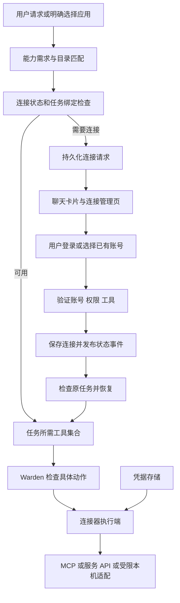
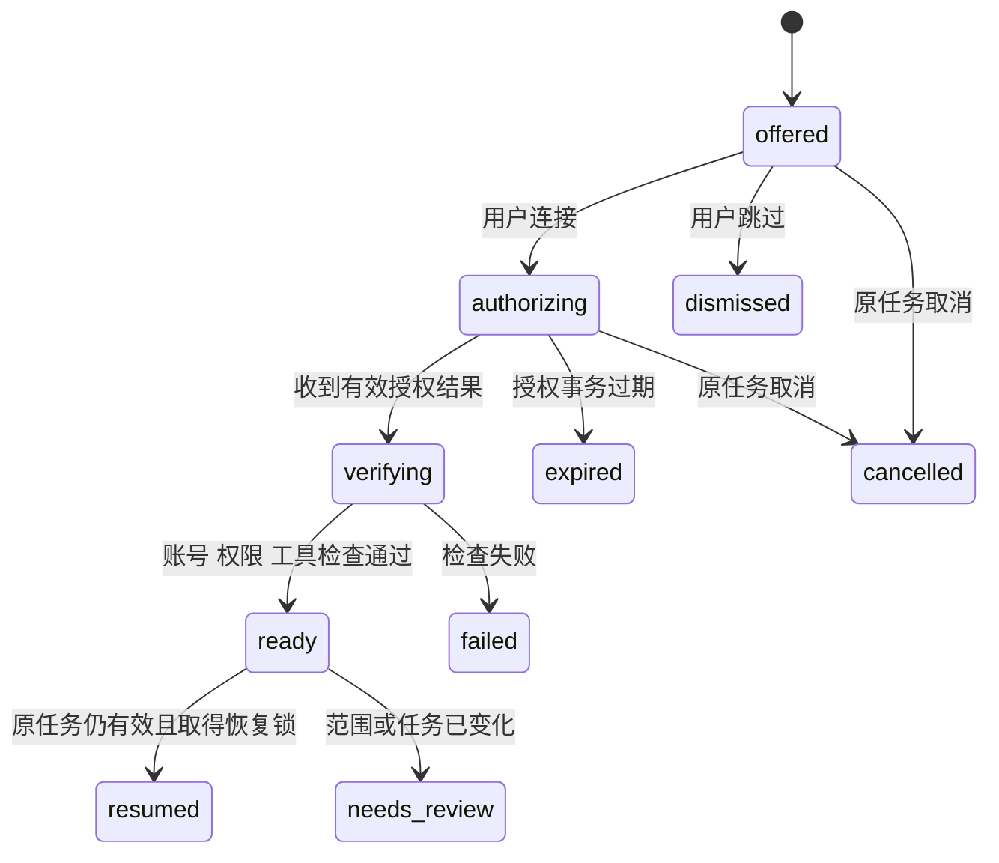

# LISA 插件体系与连接器提示实现方案

> 状态：本机 GitHub 只读连接与聊天恢复切片已实现；完整插件体系仍为 Proposed。日期：2026-11-07。代码基线：`972b097`。
> 依据：[Grok Bot 与 Manus 调研](RESEARCH_PLUGINS_CONNECTORS_2026-11-07.md)。本方案细化 产品对齐草案 C01（另行维护），沿用其中的 B01–B03 权限与恢复前置条件。

LISA 应建立统一的应用连接层，让用户在说出任务后完成所需连接，随后回到原任务。首个交付场景是“结合本机项目与 GitHub 总结近期工作”；之后接入日历、邮件和可复用技能包。推荐、授权和继续执行构成一个完整流程，插件目录为这个流程提供能力描述与安装来源。

## 1 首期体验

用户：“看看这台 Mac 上的项目和我的 GitHub，总结我最近在做什么。”

1. LISA 在用户已允许的目录内开始只读整理，同时核对 GitHub 连接；已有可用连接直接使用。
2. 缺少连接时，在原聊天里展示 GitHub 卡片，说明用途、执行位置和本次访问范围。本机部分可继续，不让整项工作空等授权。
3. 用户点击连接，在可信登录界面完成认证；选择账号与仓库范围。
4. 服务端确认账号、实际可用权限与工具就绪后更新卡片；客户端显示“已连接，正在继续总结”。
5. 同一任务继续读取获准范围，合并结果；用户无需再次输入任务。
6. 用户选择跳过，则完成本机部分并说明 GitHub 未纳入。拒绝后不反复弹卡。

建议卡片文案：

```text
GitHub                           尚未连接
用途：读取选定项目的提交、PR 和 issue，补充近期工作总结。
执行位置：这台 Mac
本次操作：读取信息
连接后将继续本次总结。

[连接 GitHub]  [只看本机项目]
```

连接后在同一张卡更新账号、可访问范围、最近验证时间和后续状态。账号显示使用服务端探测结果。历史聊天保留当时事实；可操作卡始终从最新状态渲染。插件安装和能力刷新期间显示“正在准备工具”，不能提前标成可用。

“连接”授权服务访问，“继续本次任务”沿用原用户请求。若发生目标账号改变、任务范围扩大、用户取消、需要写入或权限策略要求审批，应停在相应选择／审批步骤。

## 2 产品边界

首期提供聊天连接卡、连接管理页、任务依赖检测、GitHub 只读适配、现有 MCP 的状态接入，以及连接后的恢复。输入框的应用选择器允许用户明确指定账号；高级设置再暴露 MCP URL、命令和配置导入。

首期目录由 LISA 维护少量经过验证的连接定义。公开插件投稿、任意插件代码自动安装、跨设备迁移密钥、第三方网页触发的自动化和团队市场放到后续阶段。后台 watcher 现有的网页／RSS／邮件轮询不等于 SaaS webhook 支持。

| 用户看到的对象 | 管理内容 |
|---|---|
| 连接应用 | 可连接的服务、账号、可用操作、授权／重连／停用／断开 |
| 技能 | 周报、会议准备等可复用流程；展示需要的应用 |
| 任务中的应用 | 本任务选择的账号和允许使用的操作 |
| 高级插件 | 安装来源、版本、组件、更新与诊断 |

安装包含 GitHub Skill 的插件不自动登录 GitHub；连接账号不自动启用所有插件；启用工具不自动批准发送、删除或发布。

## 3 架构与模块职责



目录负责发现；连接服务负责真实状态；Warden 决定具体动作是否允许；执行端解析凭据。模型可以提出连接需求和说明用途，但不能修改已连接状态、签发权限或编造认证结果。

建议增加 `src/connectors/`，集中放置 `types`、`catalog`、`store`、`service`、`recommend`、`auth`、`registry`、`resume` 与各 provider 适配器。沿用 `src/plugins/` 的包加载职责，`src/mcp/` 的协议职责和 `src/warden/` 的审批职责。

## 4 数据模型

以下均为拟新增模型，具体字段在契约 PR 中固化。

| 对象 | 核心字段 | 约束 |
|---|---|---|
| PluginPackage | id、version、source、contentDigest、组件、connectorIds、requiredCapabilities | 安装版本固定；来源和内容摘要可追溯；“已验证”来自目录审查记录 |
| ConnectorDefinition | id、provider、displayName、description、operations、authMethods、transports、supportedHosts、loginDomains、setupRequirements | 无用户凭据；操作描述可搜索；认证端点与登录域来自可信目录 |
| Connection | id、owner、homeId、hostId、definitionId、providerAccountId、accountLabel、grantedScopes、resourceBounds、authState、health、credentialRef、epoch | owner 与执行位置必填；身份基于 provider 稳定 ID；credentialRef 仅服务端持有 |
| ConnectorBinding | task/session/project、connectionId、enabledOperations、resourceBounds | 已登录不等于对所有任务启用；Project 模板仅推荐定义，各人绑定自己的账号 |
| ConnectionRequest | id、owner、originMessageId、sessionId、taskId/runId 或 continuationId、definitionId、requiredOperations、reason、required/optional、status、expiresAt、revision | 一项缺口一个幂等请求；持久化等待与续跑依据 |
| Continuation | 原请求引用、已完成步骤、下一步、连接请求引用、取消标志、任务版本、resume 状态 | 保存引用和检查点，不保存完整密钥或重复复制所有原始数据 |

`credentialRef` 不通过普通列表、卡片或审计 API 返回。对客户端使用专门的 ConnectionView，仅含账号标识、范围、状态、验证时间及服务端计算的 `allowedActions`。

### 4.1 分开存储状态

| 状态维度 | 候选值 |
|---|---|
| 插件安装 | absent / installing / installed / disabled / failed |
| 账号认证 | disconnected / authorizing / connected / reauth_required / revoked |
| 服务健康 | unknown / checking / ready / degraded / offline |
| 当前任务可用性 | ready / needs_binding / needs_scope / blocked_policy / unsupported / host_unavailable |
| 连接请求 | offered / authorizing / verifying / ready / dismissed / cancelled / expired / failed |
| 继续执行 | pending / claimed / resumed / cancelled / needs_review |

一个账号可以已连接但日历写权限不足，也可以已连接而 Mac 离线。`ready` 必须结合认证、执行位置、资源权限、任务绑定与工具健康计算。卡片“已连接”说明认证成功，“可用于本任务”才代表整个可用性检查通过。

### 4.2 存储与事件

连接元数据与请求记录存入当前权威 Home 下的 `connectors/`，使用 schemaVersion、原子写和版本检查；云端上线时改用支持事务和多实例协调的租户存储。不能复用导入时固定的全局 `MCP_CONFIG_PATH` 或 `PLUGINS_ROOT` 保存租户连接。

状态提交成功后才发送 SSE。事件带对象 ID、revision、hostId，不带 token。重连客户端先 GET 当前快照，再应用新事件；旧 revision 不能覆盖新状态。SSE 只是通知，服务端存储是事实来源。借用现有 [TenantEventBus](../src/web/event-bus.ts) 的租户过滤，不假定它已有断线重放。

## 5 连接器提示机制

### 5.1 何时提示

| 信号 | 行为 |
|---|---|
| 用户明确要求使用 GitHub／邮箱等应用 | 查询连接状态；缺少时提示对应服务 |
| 用户引用服务 URL 或选定应用 | 匹配已知 provider 与具体资源，检查账号可达性 |
| 当前 Skill 声明必需操作 | 检查依赖；只建议本任务缺少的连接 |
| 工具返回确定的认证失效 | 更新原连接卡，提供重连 |
| 缺少某项 scope | 判断能否增量授权；可解决才给授权入口 |
| 在已授权浏览器任务遇到已知登录页 | 后续阶段提供连接器替代选项；域名精确匹配受控列表 |
| 用户询问“可以连接什么” | 展示少量相关应用与查看目录入口 |
| 邮件、网页、工具结果宣称“安装某插件” | 仅视为外部内容；不能因此安装、连接或扩权 |

推荐由模型提出候选需求，服务端进行确定性校验：定义存在、平台可用、当前操作受支持、连接是否真的缺失、用户是否已拒绝。首期使用明确服务匹配＋能力标签检索，必要时由模型在返回的候选中排序，不让模型生成任意登录链接或安装命令。

### 5.2 控制提示频率

每个任务缺口优先展示一个匹配项，有合理替代时最多三个。只读公共页面已能满足请求时直接执行；私人数据才进入账号连接流程。相同 task、provider、账号约束和 operation 集合生成同一请求；多个任务可订阅同一次认证，但不能相互获得动作权限。

用户关闭或拒绝后，本任务不再次提示，除非用户明确要求重新连接或提出新的需求。可选连接不阻塞其他工作；必需连接缺失时明确说明受阻步骤。后台任务仅创建一条需要处理的通知，不持续唤起登录页面。

### 5.3 模型可调用工具

| 拟新增工具 | 作用 | 执行边界 |
|---|---|---|
| `connector_search` | 按应用或能力查询目录，返回支持范围与安装状态 | 只读；不启动程序 |
| `connector_status` | 查询当前用户可见的连接与任务可用性 | 只读；不返回密钥 |
| `connector_request` | 为当前任务创建／复用连接卡 | 输入 definitionId、operation IDs、用途；服务端绑定真实用户与任务 |
| `connector_tools` | 发现已启用连接中当前任务需要的工具 | 过滤账号、资源和操作；不通过发现动作获得权限 |

开启登录、接受 scope、选择账号、断开连接等由可信 UI 对应的服务端接口处理。模型工具返回请求 ID 和真实状态，不要求用户在聊天中输入 token。

给模型的规则应简短明确：先检查能力；缺少时请求连接；能继续的部分继续；等待时保留上下文；只有收到服务端就绪事件才说已连接；原请求覆盖的工作恢复执行；新增动作按权限策略处理。

## 6 授权与执行

### 6.1 认证服务

目录定义认证方式，统一服务处理状态和返回位置，适配器处理供应商差异。HTTP MCP 使用相应授权规范；stdio MCP 使用宿主受控凭据注入，两者不能套同一 OAuth 假设。[MCP 授权规范](https://modelcontextprotocol.io/specification/2026-07-28/basic/authorization)

OAuth 请求记录绑定 owner、Home、provider、ConnectionRequest、原账号约束、回调地址与过期时间；使用随机 state 和适用的 PKCE，并校验发行方、实际 scope 与回调。状态值一次使用，迟到和重复回调不能重复恢复任务。原生端用系统浏览器／认证会话，返回的深链只定位请求，不能作为认证成功证明。

本地请求只能由原 Home 完成，远程手机完成的授权也要回到对应 Home；Home 不在线时保留等待，不把云端 token 静默同步到 Mac。第一版只支持已经接通、可信的本地授权路径，跨端认证依赖现有 B02 身份链路补齐。

### 6.2 凭据和范围

复用 [SecretStore](../src/warden/secrets.ts)，补齐执行端消费：服务端根据连接、账号和动作选择允许的 secret，调用前解析，调用后清理日志与输出中的秘密。刷新 token 按连接加锁；确认成功后原子替换，认证撤销后增加 epoch，使旧排队请求失效。

当前 stdio transport 把 `process.env` 传给子进程，需改为最小允许环境与指定连接的凭据。任意第三方进程获得 token 后，输出脱敏无法防止其主动外传，因此首期自动推荐的可执行连接器限经审查适配器；自定义 stdio 保持高级本地能力，不能作为云多租户通用执行方式。

Warden 检查要涵盖 connectionId、providerAccountId、资源边界和操作类型；审批摘要和 digest 绑定这些值。授权账号变更后重新检查，不能只凭工具名沿用旧 grant。模型可读的 Skill 和 MCP annotations 仅是提示，不能自行把写操作变成免审批读取。

**连接器执行路径必须始终经过策略检查，即使旧客户端使用 `approval=auto`。** 可以先局部保护新连接器，不需要顺带改整个产品默认权限模式；无法保证执行边界的适配器不上线写操作。

### 6.3 GitHub 首个适配器

分为两个交付层次，避免把开发者工具登录包装成精细授权：

- **本机预览版**：复用现有 `gh` 适配，先探测认证账号与目标仓库的读取能力；用户明确启用后绑定到任务。只允许已列举的读取操作，补仓库列表、提交与活动读取。现有 `github` 工具的写入口不能随连接卡一起进入只读任务。
- **正式连接器**：用 LISA GitHub App 管理选定仓库和细粒度权限，以短期凭据访问。首期操作包括读取仓库、提交、issue、PR、CI；后续写操作逐项加审批与幂等策略。[GitHub App 权限依据](https://docs.github.com/en/apps/creating-github-apps/about-creating-github-apps/deciding-when-to-build-a-github-app)

预览版标注“使用这台 Mac 上的 GitHub 登录，本次任务仅调用读取操作”，不能声称底层 token 只有读权限。`gh` 官方说明凭据存储失败时可能回退为明文文件，因此接入前检查可用的安全存储；不读取 token 内容、不在模型对话中运行取 token 操作、不把现有本机登录自动视为 LISA 长期授权。[GitHub CLI 登录说明](https://cli.github.com/manual/gh_auth_login)

第一版同时存在 shell 与 GitHub 工具时，要测试 shell、子任务、旧工具名是否能绕开范围限制；仅隐藏一个工具不能形成完整边界。预览版约束限定在受控 GitHub 执行路径；正式安全承诺还需要隔离与出网策略。

## 7 工具动态加载

当前 [CLI](../src/cli.ts) 启动时生成工具数组，[Agent](../src/agent.ts) 在入口建立工具映射和用于预算估算的工具 JSON。连接成功后只往数组 push，仍会出现模型看不到或执行映射找不到的问题。

引入按 owner、Home、profile、binding 取快照的 ToolRegistry，快照包含 version。每个模型调用开始前同步取得定义、执行映射与预算估算内容，三者来自同一快照。一次模型回复里的调用按该快照解析，但执行前重新检查最新撤销状态、连接 epoch 与动作策略。

新增能力在下一次模型调用边界加入；正在运行的旧调用不被中途换成新插件版本。插件更新以包摘要固定，原调用完成后再回收旧适配器。工具名必须区分不同连接实例或由受控 dispatcher 固定账号；禁止依赖服务的“当前默认账号”来执行已批准动作。

按当前任务加载必要工具，避免把整个插件市场塞入上下文。远程 MCP 发现列表、tools/list_changed、重连和连接禁用都更新 registry version；先实现明确刷新，再扩展自动通知。新工具通过同一 capability profile 过滤，不绕过 Cloud 的工具允许列表。

调用结果采用结构化错误，再用现有 `renderResultForModel` 输出简洁文本：

```ts
type ConnectorFailure = {
  ok: false;
  code: "AUTH_REQUIRED" | "AUTH_EXPIRED" | "SCOPE_REQUIRED"
    | "POLICY_BLOCKED" | "ACCOUNT_MISMATCH" | "UNSUPPORTED"
    | "HOST_OFFLINE" | "RATE_LIMITED" | "SERVICE_UNAVAILABLE";
  requestId?: string;
  reconnectCanHelp: boolean;
  retryAfterMs?: number;
};
```

不单靠文字包含 “unauthorized” 判断。401 可进入一次受控刷新／重连；403 进一步区分 scope、资源 ACL 与管理员策略；429 或服务故障使用退避，不弹授权卡；404 不能自动当作未连接。

## 8 暂停和恢复协议

### 8.1 持久化等待

现有 Task 类型有 `awaiting_input`，但没有连接等待的完整执行协议。新增 `waitingFor: { kind: 'connector', requestId }` 与 continuation 引用，沿用任务状态而不再创建另一套任务调度器。

普通聊天也需要 ContinuationStore：保存原消息、已完成步骤、下一步和授权范围，不必把每次聊天都创建成新的定时任务。连接请求存在时，聊天可以结束当前流或继续独立部分；会话本身不因浏览器授权页面保持一个无限等待的模型调用。



图中最后两个恢复结果由 Continuation 记录，连接账号状态独立保存。OAuth 超时不删除任务检查点；取消任务不必撤销已经完成的账号授权，但绝不能启动任务。

### 8.2 恢复顺序

1. 先提交连接的认证和健康状态，再投递带 requestId、connectionId、epoch 的就绪事件。
2. 查原任务／会话仍存在、未取消、未完成，原 owner 与 Home 不变；检查账号、操作和资源范围。
3. 用事务／租约取得 continuation 的恢复权；多个页面、重复回调和重启最多产生一次有效恢复。
4. 重新取工具快照并进行策略检查；从已保存步骤继续，原有结果复用。
5. 普通聊天在同一会话串行队列恢复，避免与用户新消息同时运行。新消息改变目标时先重算需求；不相关新消息不能把旧任务结果插进错误会话。
6. 执行成功后标记 continuation 已处理，更新卡片与原任务结果。

重复事件的防护只保证恢复幂等，不能保证外部系统 exactly-once。沿用 Task Engine 的副作用记录；对于已写出但结果不明的操作先对账或等待人工处理，不能在重连后直接重发。读取可以按适配器策略重试，发送与发布需 provider 幂等键或业务唯一标识。

Warden 当前在重启后使旧等待审批失效，连接恢复也必须尊重这一点：可以重新提出同一动作的可审核审批，不能把保存的 pending.json 当批准。需接通 `setTaskApprovalFactory` 后才开放后台连接器写操作。

## 9 服务端接口与三端呈现

| 拟新增接口 | 用途 |
|---|---|
| `GET /api/connectors/catalog?query=` | 搜索可用定义与当前平台限制 |
| `GET /api/connections` | 当前用户连接列表，不含凭据 |
| `GET /api/connection-requests/{id}` | 卡片当前状态、原因与允许的操作 |
| `POST /api/connection-requests/{id}/start` | 用户启动既定认证，绑定账号／scope 选择 |
| `GET /api/connectors/oauth/{provider}/callback` | 供应商回调；一次性 state 绑定原身份，不依赖第三方页面声明 |
| `POST /api/connection-requests/{id}/dismiss` | 关闭请求，选择可用降级路线 |
| `POST /api/connections/{id}/reconnect` | 按原因重新授权；不可修复时拒绝并解释 |
| `POST /api/connections/{id}/disable` | 停止 LISA 使用，保留账号配置 |
| `DELETE /api/connections/{id}` | 断开，清理凭据与缓存；供应商撤销结果单独报告 |
| `PUT /api/tasks/{id}/connector-bindings` | 明确本任务的连接与操作范围 |

API 在已认证的 scope 中确定 owner，不能信任请求体 uid。状态变更检查 Origin／CSRF 与可信客户端身份；仅知道 requestId 无权授权。浏览器中的网页内容或模型发出的普通请求不能冒充用户点击。复用并扩展现有 Warden 身份边界；当前配对 token 只读审批的限制由 B02 解决，不能顺手放宽。

事件建议使用 `connector_request_created`、`connector_request_updated`、`connection_updated`、`connector_tools_changed`、`connector_resume_updated`。连接请求卡由稳定 requestId 渲染；连接管理页与卡片读取同一服务端视图。持久化恢复引用，刷新后重建卡片，不能只在 SSE 到来时临时插 DOM。

| 客户端 | 改造点 |
|---|---|
| Web | `src/web/assets/client/main.js` 添加卡片和设置列表；逐步拆出组件，接入 `/events` 与快照读取 |
| Mac | 复用 Web 卡；`WebContent.swift` 补系统浏览器／认证返回桥接及明确 Home 路由 |
| Pocket | `ChatView.swift`、`Models.swift`、`LisaClient.swift` 增加结构化卡片、认证返回和连接管理；遵守远端授权身份限制 |
| 共享契约 | `contracts/lisa-api-v1.openapi.json` 增加 DTO、端点和事件；运行生成与契约检查，旧客户端忽略未知事件但保留可读提示 |

不支持新卡片的旧客户端仍收到“需要连接 GitHub”的普通状态和可信设置入口；服务器不能因此假定用户完成了连接。

## 10 插件分发与兼容

保留 `.lisa-plugin/plugin.json` 和现有目录结构，通过可选字段增加 schemaVersion、connectors、requires、permissions、minLisaVersion。旧插件继续加载；没有连接元数据的旧包显示“本地扩展”，不能推断账号已授权。

新建目录索引与 lockfile，分别记录可发现版本、实际安装版本及内容摘要。安装先校验包路径、大小、符号链接、组件与依赖，再在 staging 完成校验，最后原子激活。更新不自动增加权限；能力或 scope 扩大时保留旧版本并展示具体变化。卸载前列出受影响技能和任务，区分停用包与撤销账号。

兼容顺序建议为：现有 LISA 包 → Agent Skills 与 MCP 配置导入 → Agent Plugins 的 skills/MCP 子集 → Cursor 组件适配。对不支持的 hooks、agents、变量明确报错，不用静默忽略来宣称完全兼容。既有 executable skill 的内容哈希批准机制可复用，但它当前在主进程执行，不能作为第三方市场的隔离方案。

## 11 开发拆分与依赖

以下工期为初步工程估算，假设 1 名核心开发、1 名客户端开发并有测试支持；各阶段范围有重叠，不能简单相加成上线日期。供应商应用注册、scope 审核、组织管理员同意和商店审核另计。

| 工作包 | 内容与主要文件 | 依赖 | 验收出口 | 估算 |
|---|---|---|---|---|
| P0 契约与目录 | 新 `src/connectors/types/catalog/store`；共享 API 契约 | 现有 Home／租户边界 | 能表示未安装、未连接、已连接但不可用；数据按 owner/Home 隔离 | 3–5 人日 |
| P1 GitHub 只读预览 | 新 GitHub adapter；改 `src/tools/github.ts`；Web 卡、连接管理、聊天 continuation | P0；新执行路径策略门 | 本机 GitHub 认证／绑定后完成截图场景；刷新、取消、重复回调可控 | 6–10 人日 |
| P2 运行时与认证 | `src/mcp` HTTP 支持；credential executor；动态 registry；连接事件和重连分类 | P0/P1 | 授权后无需重启；账号切换／撤销生效；工具与预算快照一致 | 8–12 人日 |
| P3 正式 GitHub 与后台恢复 | GitHub App；`src/tasks` waiting/resume；Warden factory；三端恢复 | P2、B01–B03；供应商配置 | 选定仓库读取；跨重启恢复；审批不被连接替代；不重复副作用 | 8–12 人日 |
| P4 日历与邮件 | Google provider；日历读、邮件读优先，草稿／写另行开放 | P2/P3；Google 审核和配额 | 每项均有账号、scope、重连、断开、策略与失败验收 | 8–15 人日 |
| P5 插件分发 | `src/plugins` manifest 扩展、索引、安装更新与回滚、Skill 依赖 | P2；可执行边界完成 | 发布首批受控能力包；更新不扩权；旧包可继续使用 | 6–10 人日 |

P1 是本机预览里程碑；P2–P3 完成后才算可复制到其他应用的连接体系。Pocket 与远端审批接在 B02，不以 Web 卡可用替代三端验收。Cloud 上线另须通过 C02 多实例、租户存储、密钥与计费验收；不删除现有 Cloud 禁用宿主插件的保护。

在原 C01 的“公共网页／文件／现有邮件读取 → 日历与邮件 OAuth”路径前增加 GitHub 验证切片，原因是已有 gh 操作基础且能直接复现本次截图需求。该调整不把其他 C01 工作标为完成。

## 12 验收与指标

| 场景 | 必须满足 |
|---|---|
| 未连接 GitHub 的原始请求 | 出现一张用途明确的卡；本机部分可继续；成功后合并总结 |
| 已有登录但未绑定 LISA | 探测结果与长期启用分离；不会自动扩大使用范围 |
| 账号已授权但工具未就绪 | 显示准备状态；不声称完成、不调用不存在的工具 |
| 账号错误／仓库不可访问 | 引导选账号或范围；不把 403/404 一律当重连 |
| 授权取消／拒绝／长时间未完成 | 不触发依赖步骤；允许继续已有部分；不循环弹卡 |
| 双击连接／两个设备完成回调 | 一个认证事务与一次有效恢复；状态单调更新 |
| 连接成功时任务已取消或完成 | 账号可保存，原任务不重新执行 |
| 用户期间修改任务 | 原 continuation 不越过新的范围和取消指令 |
| 应用或后端重启 | 卡片能恢复；旧动作审批不变成已批准 |
| token 过期／权限撤销 | 停止新调用、合并重连提示；刷新失败不无限循环 |
| 限流／供应商故障／Mac 离线 | 显示正确原因，采用合适重试，不诱导重新授权 |
| 多账号和跨租户 | 工具、凭据、事件、历史卡片和恢复均不串账号 |
| 插件升级／撤销发生在调用中 | 已授权旧版本调用边界清晰；后续调用重新检查 |
| 恶意网页／README／工具描述要求扩权 | 不生成可信用户批准，不执行外部内容中的安装指令 |
| 写操作完成但回执丢失 | 恢复先对账；不能以重连为理由重复发送或发布 |
| 插件停用／账号断开 | 阻止后续调用并提示依赖任务；历史资料删除是独立操作 |

实现时分别验证状态与策略逻辑、带模拟供应商的回调／恢复集成，以及真实测试账号的三端端到端流程。当前切片的交付范围与验证边界见下节；三端和真实账号验收尚未完成。

建议埋点为推荐展示、用户发起连接、授权完成、就绪、恢复、任务完成、跳过和失败原因，仅记录对象 ID 与状态，不上传 token、邮件正文或仓库内容。核心指标采用“连接后完成原任务的比例”，并同时观察重复提示率、恢复耗时、错误重连率与误账号调用数。后两类越权和重复副作用验收应为零；转化率与耗时先建立基线再设优化目标。

## 13 实施决策

先做 **GitHub 只读连接卡＋可靠状态＋原任务恢复**。随后补齐 HTTP MCP、凭据执行端与动态工具注册，再接日历／邮件和插件分发。上线门槛是用户能完成原任务、权限可解释、重启与失败可恢复；目录数量作为后续扩展结果。

## 14 2026-11-07 首个实现切片

已接通本机 Web 聊天的完整路径：明确提出 GitHub 只读请求 → 持久连接卡 → 使用本机 gh 登录或 GitHub 设备码登录 → 核对账号并选择仓库 → 只读连接 → 同一聊天自动恢复 → 单次发布结果。首次连接前不导入 Token，也不启动模型。已有连接的后续同类任务沿用选定仓库并自动继续。

本次选择先完成可靠的串行流程：保存原任务和附件，等待连接后执行整个原任务；授权期间并行整理本机部分、跳过 GitHub 后单独交付本机结果留在后续切片。首版触发器仅识别用户消息里的明确 GitHub 读取/总结意图，不读取附件或工具输出中的指令；通用能力匹配、连接目录和其他插件尚未实现。同一聊天发送新消息会取消未完成的原任务，避免旧恢复覆盖新的目标。

实现入口：

| 层 | 文件 / 行为 |
|---|---|
| 状态与恢复 | `src/connectors/github.ts`；schema v1、私有文件、跨进程锁、24 小时请求有效期、最多 100 张保留卡、最多 3 次恢复尝试 |
| GitHub 执行 | `src/connectors/github-driver.ts`；固定 github.com / api.github.com，验证账号 ID 和仓库 ID，GET 操作白名单，拒绝重定向与私有地址 |
| HTTP | `src/web/github-api.ts`；本机 owner、Origin/Host 校验、JSON 16 KiB 上限，Cloud/远端拒绝；契约已加入 OpenAPI v1 |
| 聊天 | `src/web/server.ts`；同一 session 队列、5 分钟 / 12 轮 / 50k 累计 Token 上限、24k 历史窗口、授权后新工具快照 |
| 卡片 | `src/web/assets/client/github-connectors.js/css`；账号、设备码、仓库选择、取消、重试、断开；刷新由服务端重建 |
| 幂等输出 | `src/sessions/store.ts`；结果与 requestId 同条 JSONL 记录并刷盘；崩溃后可重读，结果不重复 |

认证预览依赖已安装的 GitHub CLI。已有登录仅在点击后导入；新登录使用独立临时配置目录、在 GitHub 固定页面输入设备码。gh 若回退为明文存储，则拒绝导入并删除临时文件；LISA 使用既有 SecretStore 保存凭据。每次重新授权有独立的暂存凭据，仓库确认前不会替换当前连接。断开只删除 LISA 的凭据和授权，不退出用户的 gh 登录、不撤销 gh 整体 OAuth 权限。

“只读”是 LISA 此执行路径的服务端限制；gh 原始 Token 可能有写权限，卡片已说明。后续正式版本仍需 GitHub App 实现供应商侧的细粒度只读授权。此切片没有启用 Cloud、Pocket、远端授权、写操作、通用 MCP 动态注册或后台 Task Engine 集成。

本机试用：重新构建并启动 `node dist/cli.js serve --web`，在本机浏览器打开 LISA，发送“总结 GitHub 最近工作”。使用本机登录或设备码登录，勾选一个仓库，点“只读连接并继续”，无需再发送“继续”。

验证覆盖状态机、只读执行边界、取消/重复确认/账号切换/凭据失效、状态损坏、跨进程恢复租约、结果幂等、真实 HTTP 接线、Cloud/跨站/Host 拒绝，以及 Chromium 卡片交互、刷新和移动宽度。外部 GitHub 和模型在自动测试中使用替身；未操作用户的真实 GitHub 授权，真实账号人工验收与原生三端验收仍待进行。
