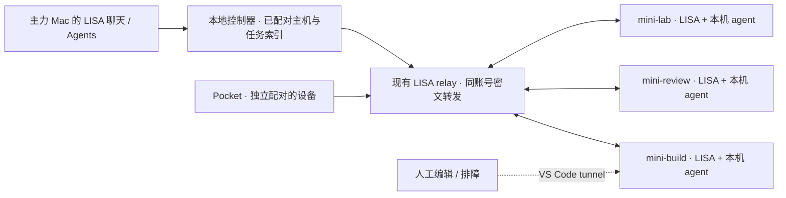

# 用 LISA 管理三台远程 Mac mini 上的 agent

2026-11-08 完成设计评审与首版实现。2026-11-09 在基于 `main@5803049` 的独立 PR 分支完成同机三实例验收，玄兔真机验收待接入。LISA 版本为 0.30.3。早期的三实例 PTY 验证和 88 个基线测试在 main 的独立快照上运行。[评审基线 b25fc86](https://github.com/oratis/LISA/tree/b25fc86caae3c8edad0e4f26bd9b057c37a5b73c)

[首版操作步骤](#首版操作步骤) · [验收记录](#首版验收记录) · [实现前的代码评审](#实现前的代码评审)

## 决策

**可行。每台 mini 运行自己的 LISA Mac 后端和 coding CLI，由你的主力 Mac 上的 LISA 选机、派工、跟进和收结果。** 继续使用现有 LISA 账号发现、逐机配对和加密中继。玄兔的 VS Code 隧道作为每台机器的可选编辑器入口，适合初装、打开同一工作区、解决 CLI 登录或手动调试。首版服务一位所有者的三台机器，以手动指定目标为准。

例如，你可以说「让 mini-build 在 iOS 项目跑测试，让 mini-review 检查这次改动，mini-lab 先空着」。LISA 展示两张任务卡，各有机器、工作区、基线提交、agent 和状态。你可以只给 mini-review 追加一句，手机离线之后回到同一任务，或从失败卡打开对应机器的 VS Code。这个跨机工作流是本提案的交付目标。

## 已发布版本的 Pocket 与隧道入口

1. 任选一台 mini，通过玄兔提供的 SSH 或 UU远程登录。需要编辑器时，在该机运行 `code tunnel user login --provider microsoft`，在微软页面完成设备码登录，再按玄兔指南安装 `code tunnel service install --accept-server-license-terms`。在自己的 VS Code 使用 Remote - Tunnels 和同一微软账号选中这台机器。三台应有可辨认的隧道名称。[玄兔接入指南](https://co.xuantu.co/help#tunnel) · [VS Code Remote Tunnels](https://code.visualstudio.com/docs/remote/tunnels)
2. 在 mini 的 macOS 用户下运行 LISA Mac，登录自己的 LISA 账号并启用 **Connect iPhone**。在同账号 Pocket 的 **Settings → Connect your Mac** 选择机器，核对双方验证码并逐端确认。支持 v2 的版本可在两端打开 **Require secure pairing**。每台 mini 都需要独立身份。现在可以在 Pocket 的 Agents 页操作当前选中的一台。[现行配对步骤](REMOTE_CONNECTIONS.md) · [Pocket 操作入口](../packaging/ios-companion/Sources/RosterView.swift)
3. 先试 managed agent。要操作真正的 Claude Code，再用自己的账号在该机原版 CLI 中完成登录，启用含可用 `node-pty` 的 LISA 后端、设置 `LISA_PTY_AGENTS=1` 并重启后端。从 Agents 新建 Claude 任务，追加指令、查看输出、取消。观察 Codex 需要启用相应 observer，启动 Codex 则另需在该机安装并配置 CLI。每台依次验证。可选原生模块、CLI、登录状态应分别检查，运行在终端与运行在登录服务下的环境也应分别检查。[Mac 打包与检测](../packaging/mac-client/README.md) · [PTY 能力](PTY_AGENTS.md) · [观察器默认配置](../src/integrations/hub.ts)

微软账号管理 VS Code 隧道，LISA 账号加双方设备密钥管理 LISA 控制链路，CLI 凭据决定代码发给哪个模型服务、消耗哪个账号的额度。玄兔说明 Claude Code 已预装且使用租户自己的账号，这三台实例的实际版本、登录状态和套餐仍须上机核实。个人交互使用原版 CLI；面向用户提供程序化 Claude 服务时，应按 Anthropic 文档采用相应 API 或云提供商凭据。[玄兔 Claude Code 说明](https://co.xuantu.co/help#claude) · [Anthropic 凭据使用说明](https://code.claude.com/docs/en/legal-and-compliance)

## 实现前的代码评审

| 领域 | 已实现及对三机的影响 |
|---|---|
| 发现、传输 | 生产 relay 的代码按已认证账号路由，在线列表返回主机公钥指纹、名称和状态。每账号最多 10 个 host 连接、80 个 socket，每 host 最多 64 个 client channel。mini 主动连接 relay；现有实现也会起 LAN 的加密监听。三台主机本身不需要扩容或公网暴露 5757。Node broker 适合本地/单实例，生产路径是按账号分片的 Worker。[生产 relay](../deploy/relay-worker/src/index.ts) · [主机实现](../src/remote/host.ts) |
| 客户端 | Pocket 的传输会固定主机公钥、尝试 LAN、回退 relay，支持 HTTP/SSE。连接配置对 Mac 模式只保存一个 `remoteMac`，AppState 和当前 LisaClient 随之切换。主力 Mac 上的 Remote Devices 窗口当前管理连入本机的设备。桌面发起连接、多机固定、并行订阅及跨机汇总都需要开发。[Pocket 配置](../packaging/ios-companion/Sources/ConnectionProfiles.swift) · [加密客户端](../packaging/ios-companion/Sources/RemoteMacTransport.swift) · [Mac 设备窗口](../packaging/mac-client/Sources/Lisa/RemoteDevicesWindow.swift) |
| agent 与会话 | `GET /api/agents/sessions`、steps 和事件可提供单机结构化观测。managed 支持 start/send/cancel/approve。PTY 是 LISA 创建的真实 CLI，可 start/send/cancel、读输出尾部和 SSE；安静约 4 秒即推断 waiting。外部运行中的终端会话只能观察。现有 resume-adopt 只对空闲 Claude 开放，远端采用还需 Mac 侧开启策略。Codex 没有同等接管路径。外部会话的原始 transcript 只服务 loopback。[单机控制路由](../src/web/server.ts) · [PTY 生命周期](../src/agents/pty.ts) · [Claude 存活检测](../src/integrations/claude-code/liveness.ts) |
| 后台派发 | 现有 `dispatch_agent` 在本机起 detached CLI，记录 PID、启动标识及输出。可查询、取消；退出未被观察到时账本能返回 unknown。它与 managed、可交互 PTY 的能力不同，UI 要逐种呈现。现有 Task Engine 也区分允许无人值守的工具。直接增加一个模型可填的远程 shell 参数会绕开这些边界。[本机派发](../src/tools/dispatch_agent.ts) · [派发账本](../src/integrations/dispatch-ledger.ts) · [任务工具策略](../src/tasks/policy.ts) |
| 聊天、云和连接器 | Cloud 版在 HTTP 层拒绝 host agent/control 路由；managed 子 agent 已有可用工具子集。新的执行权限应在端点和工具注册层明确表达，目录里可以有「远程 Mac」入口。[Cloud 能力边界](../src/web/capabilities.ts) · [工具过滤](../src/tools/registry.ts) · [连接器规划](PLAN_CONNECTOR_EXPANSION_2026-11-07.md) |

### 写操作开放前应处理的问题

| 优先级 | 可复核的证据 | 设计要求 |
|---|---|---|
| P1 · 审批可能答错请求 | main 的 managed approve 用 `payload.allow !== false`，空体、容错解析后的坏 JSON、缺字段都会走允许分支，只要此时有 pending。pending 只对外提供工具名，`decide` 解析当前等待项。旧卡片的迟到响应可能落到下一次调用。见 [HTTP 处理](https://github.com/oratis/LISA/blob/b25fc86caae3c8edad0e4f26bd9b057c37a5b73c/src/web/server.ts#L4047) 和 [managed 审批](../src/agents/managed.ts)。 | 先修已有入口的显式布尔校验。新写协议将一次性 approvalId 绑定机器、工作区、run、工具及规范化参数摘要，提供可读预览和过期时间；原子校验并消费。旧客户端没有请求标识时只开放兼容的安全能力。 |
| P1 · 项目与设备权限太粗 | 主机策略默认 `remoteControl=true`、`remoteAdoptExternal=false`，是整机开关。start 接受客户端绝对 cwd，也能回退到后端工作目录。现有已配对设备可访问多类 API，桥接器只显式排除部分路由。PTY 在 cwd 下直接启动 CLI。[控制策略](../src/control/policy.ts) · [转发器](../src/remote/host.ts) · [PTY spawn](../src/agents/pty.ts) | 为新的控制器身份发 agent 专用 grant，在主机转发前正向列出 method、route 和 scope。拒绝通用 chat、events、owner 管理和旧 agent 路由的旁路。按设备和工作区重验；cwd 只能由 mini 根据本机登记的 workspaceId 解析。真正承诺读写范围时还须约束子进程。 |
| P1 · 重试可造成重复开工 | 传输 UUID、challenge 和过期检查防重放；近期请求表和 managed/PTY 注册表在进程内。两个不同 HTTP 请求仍可启动两份 CLI。断线后客户端看不出请求是否已被执行。[协议](../src/remote/protocol.ts) · [转发与去重](../src/remote/host.ts) · [managed 注册表](../src/agents/managed.ts) | 在目标主机保留业务操作记录。先用相同操作号查询结果。遇到无法对账的外部副作用显示「结果待核实」，避免盲目重发。 |
| P1 · 错机与双写 | 现有 roster 去重键是 `agent + sessionId`。两台机器上相同项目、相同 transcript 副本可能被合并。Claude 存活检查遇到目录缺失返回空集合，读坏记录会跳过；检查和 spawn 之间还存在窗口。[名单合并](../src/web/agent-roster.ts) · [存活检查](../src/integrations/claude-code/liveness.ts) | 命令与 UI 持有不可变的目标引用；切换界面后旧卡仍归原主机。首版对外部会话只读。要开放接管，再加本地检测可靠性、会话锁和占用冲突测试，无法确定是否有写入者就停止。 |
| P2 · 产物、输出与状态会失真 | PTY 只保留约 4000 字符的尾部。它可能停在登录页、权限提示或普通问题；managed 的等待原因和 detached 的退出码有不同含义。订阅中断及 Mac 重启也可能丢失最终状态。[PTY 状态](../src/agents/pty.ts) · [dispatch 状态](../src/integrations/dispatch-ledger.ts) | 区分待输入、已确认要求审批、连接失效、执行结果未知。原始日志按需查看。成功需要执行器终态，能附测试退出码、提交及产物引用时一并给出。 |

## 架构与产品入口



- **主力 Mac** 增加「远程 Mac」入口和登录设备身份。建议由本机 Node 后端实现控制器，以现有 Node 密码协议和 Swift 客户端测试向量验证互通，让聊天工具和本地 WebView 共用一份授权、路由与审计。控制器密钥放系统 Keychain；WebView 使用同源、限权接口。当前 relay 拒绝浏览器 Origin，只接受原生 Bearer，不能让前端 JS 持有 relay 凭据。[本地 broker](../src/remote/broker.ts) · [生产实现](../deploy/relay-worker/src/index.ts)
- **每台 mini** 复用 Mac 后端，登记工作区别名、目录、可用 agent、控制范围、可选 VS Code 隧道名。一个用户级常驻进程负责接单。可复用 `lisa autostart install --load` 的 LaunchAgent；它依赖该 macOS 用户登录，首次登录前、锁屏后 Keychain 可用性、主机休眠及重启均列入实机验收。[现有 autostart](../src/autostart/install.ts)
- **设备目录** 按 `(cloudOrigin, uid, hostId)` 固定公钥和本地别名，在线发现叠加已信任的离线记录。名字只是展示字段。重装换钥显示「需重新配对」。Pocket 的旧单机配置迁为一个条目并保留默认机；切换账号、移除主机时清理对应缓存、订阅与待操作。MVP 中 Pocket 和桌面分别与每台 mini 配对，mini 上的记录是它们共同读取的任务真相。
- **在 VS Code 中打开** 由所有者在主机配置中绑定实际 tunnel 名和项目目录。按钮在本地按路径段编码，构建固定 `https://vscode.dev/tunnel/<name>/<folder>` 地址，交给系统打开；微软登录由微软处理。隧道可用性和 LISA 后端可用性单独显示，不能由其中一个的在线状态推断另一个。[VS Code 隧道链接](https://code.visualstudio.com/docs/remote/tunnels)
- **任务卡** 始终显示机器、工作区、agent、最后更新时间及运行状态。三台并列，一台离线仍可读另两台；离线条目展示上次观测时间。批量任务给每台生成独立 run，出错后可单独处理。首版每台默认一个写任务；同机同一工作树互斥。要让几台协作同一个仓库，固定基线 SHA、使用独立分支/worktree，结果以 commit/diff 汇合，合并与推送单列为操作。
- **聊天派工** 添加受限的「列主机/工作区、列任务、启动、追加、取消、查询结果」工具。控制器从用户选定的目标生成引用，向用户展示实际执行机、目录别名和接收数据的服务。代词绑定对话内已有 run；同名或多义才让用户选机。运行动作经过 LISA 工具审批分类和主机授权两道检查；模型不能给自己授予设备权限或批准工具调用。自动化、子 agent、托管 Cloud 账号对这些工具默认无权。Pocket 已有的 AI sharing consent 应按目标主机及接收者重新计算。[已有披露逻辑](../src/web/ai-disclosure.ts) · [Pocket 发起 agent 操作](../packaging/ios-companion/Sources/RosterView.swift)

**为什么选这条路。** 三台都支持 SSH，人工首次安装可用 SSH 密钥或 VS Code 终端，图形登录可用 UU远程。用 SSH 转发 5757 会让后端看到 loopback，足以改变 owner 权限判断，因此不将它当作产品控制入口。微软也提供独立的 Agent Host 与 AHP，适合未来对接由 VS Code 自身托管的会话；采用前要逐项验证目标 CLI 版本、认证、客户端支持和所需操作。普通 tunnel URL 只说明编辑器可以连到机器。对于用户已经在终端打开的 Claude 会话，还可从官方 Remote Control 入口继续交互。LISA 首版直接打开这些官方入口即可。[VS Code Server 使用边界](https://code.visualstudio.com/docs/remote/vscode-server) · [微软远程 agent 会话](https://code.visualstudio.com/docs/agents/run/remote-agent-sessions) · [Agent Host 架构](https://code.visualstudio.com/docs/agents/concepts/agent-host) · [Claude Remote Control](https://code.claude.com/docs/en/remote-control)

## 建议的接口与执行语义

以下是拟新增的 **mini 端** API。路径避开桥接器禁止远程访问的 `/api/remote/*` 和 `/api/relay/*`。现有 session、managed、PTY 实现可抽出复用，新控制器凭证只获准调用下列方法。OpenAPI、TypeScript 与 Swift 的解码、错误和版本协商随首个切片一起交付。[现行协议源](../contracts/lisa-api-v1.openapi.json)

| 操作 | 协议约定 |
|---|---|
| `GET /api/agent-host/v1/capabilities` | 返回协议版本、hostId、backendInstanceId、已授权工作区别名、agent 可用性与 actions。按 host policy、设备 grant、工作区和实际运行时取交集。单独报告 CLI 缺失、PTY 缺失、登录未知、服务失联；只读旧主机提示升级。 |
| `GET /api/agent-host/v1/runs`、`GET …/runs/{runId}` | 结构化列表、状态、版本、允许的下一步与结果引用。已有外部会话可显示 inspect 能力。每个引用显式带 hostId 和 workspaceId；本地聚合键再包含 agent 类型和原始 sessionId。 |
| `POST …/runs` | 输入 workspaceId、agent、任务、可选 baseCommit 和 operationId。主机检查身份、权限、并发、实际工作目录和 CLI 能力后登记，返回 runId。不得接受客户端指定命令、可执行文件、任意 URL 或绝对路径。 |
| `POST …/runs/{id}/messages`、`…/cancel`、`…/decisions` | 追加和取消也有 operationId。决策另外携带 approvalId、expectedRevision、显式 allow/deny；过期或参数已变返回 409，重复同一操作返回原结果。PTY 输入按能操作终端的独立权限处理，不映射为 Warden 审批。 |
| `GET …/operations/{id}`、`GET …/events?after=cursor` | 业务收据解决响应丢失；有界的主机级事件流减少三机订阅数。游标有效则补发，超窗则刷新快照。按设备授权过滤所有行和事件，不转发全机 `/events`。详情页按需申请输出，结果页提供工作区内的产物引用。 |

**故障恢复。** 主机原子登记 `(deviceId, operationId, payloadHash)` 和 runId，先持久化意图再启动，键相同而内容不同返回 409。运行动作串行更新版本；并发重发只允许一个执行者领取。执行器应记录可对账的子进程身份或持久会话号。若进程在 spawn 后、写回 receipt 前崩溃，重启时按运行标识对账；证据不足标记 `unknown`，留给用户检查。收到取消先显示「正在取消」，确认进程或执行器终止后才给终态。发送追加文本也可能在写后崩溃，不能宣称对 PTY 的副作用恰好一次。

**断线与撤权。** 关闭客户端或 SSE 只结束观察；同一主机查询原 run 可以继续跟进。首版离线不排队，不自动换机执行。主机重启以 backendInstanceId 发现内存会话失效；只有执行器能验证时才恢复控制。撤权立即关闭该设备的连接并拒绝新命令；已授权运行的任务归主机所有，主机端另提供明确的「取消任务」。同一台 mini 上的工作区变更、设备被撤销或授权版本变化时，待执行和待审批操作须重新核验。

**工作区和输出边界。** 远端 agent 专用 grant 默认只读，按设备逐项授权 observe、start、send、cancel、readOutput、decide。两端强制 v2 并固定主机公钥；现存 Pocket grant 和 v1 设备不得静默升级成跨机控制器。主机本地对白名单根做 realpath、符号链接和路径变更复核。仅切换 cwd 无法限制任意 shell；带写权限的 CLI 须经验证的 OS 沙箱或独立低权限执行环境，隔离主机控制凭据、其他租户/项目、loopback owner 端口和无关 Keychain 项。约束 unavailable 时只保留可兑现的能力。普通项目文件与 Git 凭据按任务所需单独授权。[现有沙箱入口](../src/sandbox/sandbox.ts) · [受保护资源](../src/sandbox/protect.ts)

**租用机器的身份。** 现有 RemoteHost 用 LISA 账号 session 向账号服务验明身份。个人试点可依当前设置逐机登录；面向更多租户前，建议在账号服务签发仅能以指定 hostId 向 relay 注册的可撤销凭据，支持轮换、到期和退租解绑，主机本地保留设备私钥。此项需要账号服务及生产 relay 配合。远程出租机可提供「仅中继」选项以关闭 LAN 监听。工作区使用者变化或整机抹除后，旧配对失效，新实例从首次配对开始。[现有主机注册](../src/remote/host.ts) · [relay 身份校验](../deploy/relay-worker/src/index.ts)

**数据与成本。** relay 可见账号路由、在线情况、公钥及连接元数据；命令、输出和审批走端到端加密。控制器默认缓存结构化状态，原始 PTY 尾部仅在授权详情页显示；外部 transcript 继续保留在来源机。写入审计的是发起设备、主机、工作区、操作摘要、决策、时间和结果。输出、文件名和 diff 进入模型前按外部内容处理，单独披露接收者。成果优先返回测试结果、文件相对路径、commit/diff 引用；跨机取内容需要有界、可撤销的读取。CLI 账户使用其本机认证，控制器无须保存微软设备码、SSH 私钥或 CLI 登录令牌。限每机并发、任务时长和输出字节；供应商不提供费用时显示未知，托管 LISA 推理遵循现有计费准入。[外部内容边界](../src/tasks/external.ts) · [AI 接收者](../src/web/ai-disclosure.ts)

## 交付顺序与验收

| 阶段 | 改动与通过条件 |
|---|---|
| 1 · 桌面三机只读 | 在 `src/remote` 补控制器、主机目录、v2 专用 grant 和检测接口，在本地 Web/Mac Agents 增加机器选择与结构化总览。逐台比较验证码；三台同名仍可区分，一台下线后其他两台继续刷新；只读 grant 直接调用旧写路由或 chat/events 均被拒绝。 |
| 2 · 指定机器完成一项工作 | 用一台已授权 mini 验证指定工作区、启动、跟进、查看测试结果，另起一项工作验证取消。先打通 managed 的请求级审批；真实 CLI 优先验证玄兔预装的 Claude Code，Codex 按实际检测开放新建。为 CLI 提供受限执行模式，PTY 保留有人值守的交互入口。需要逐工具审批时采用能明确发出审批事件的接口；当前版本只支持手动操作时，在 UI 显示「打开终端处理」。[Claude 程序化接口](https://code.claude.com/docs/en/headless) |
| 3 · 三机并行和 Pocket | 用同一任务协议接聊天和 Pocket，迁移旧配置。三台同时各跑一个有确定结束标志的任务，确认标识、输出、审批、取消、分支和结果均归对机器。桌面发起、Pocket 跟进，变更接收者时重新获取同意。 |
| 4 · 真机发布门槛 | 在三台实际租用机上记录 macOS/架构、LISA 构建、CLI 与登录、PTY 真正 spawn、网络和机器续租状态。演练 Wi-Fi/蜂窝切换、休眠、重启/用户未登录、账号过期、换钥、撤权、部分成功，以及设备重装前的成果取回。分发物必须对实际架构完成签名、加载和一次真实 CLI 往返。 |

协议测试还应包含同 sessionId 跨机互不覆盖、点 A 的审批时切到 B、旧卡恰逢下一次审批、坏 JSON 和重复请求、收到启动请求后断网、幂等记录损坏、主机崩溃后 PTY 所有权不明、恶意符号链接、agent 访问 owner 端口、仅观察设备访问原始输出及收到恶意终端文本。测试撤销对单台机器以及单工作区的影响。版本不匹配进入只读或提示升级；回滚时可逐台关闭新入口。

## 实现前的基线验证

- **88 个现有测试全部通过，无跳过。** 73 个覆盖 managed/PTY、控制策略、配对密码协议、roster、Cloud 能力边界、AI 接收者和 Claude 存活检测；15 个覆盖实际本地 WebSocket/HTTP 的账号隔离、配对、重放、撤权和 owner 限制。使用 Node 26.12.1，本机 `node-pty` 的真实 `cat` 往返也通过。旧文档关于 Node 26 的本地限制不能直接外推到这次环境。
- **另做了三实例联测。** 在同一台开发 Mac 上启动三个独立后端进程，使用三个临时 LISA home、相同 hostname、不同设备密钥及本地 Node relay。一个测试控制器分别完成三次 v2 配对；并发通过加密链路启动三个 PTY，分别追加唯一文本，读回的输出没有串机；逐个取消并单独撤销 A，B/C 仍能调用受保护的连接并查询 PTY 能力。CLI 固定为 `/bin/cat`，账号服务为本地替身。此次验证覆盖路由和真实进程控制。
- **实机待验证项** 为玄兔三台 mini 的配置和跨境链路、真实 Claude/Codex 登录及推理、生产 relay 与发布版客户端的三机组合、断电后恢复。后续工作树实现及其验证见下节。

## 首个实现切片的复核决定

桌面入口放在本机 LISA 侧栏的「远程 Mac」。mini 所有者先登记工作区，再核对 v2 验证码并为此控制器勾选目录和写权限。角色在加密的配对消息里协商并由两端确认，旧端不能默默把控制器当作 Pocket。公网 relay 继续传递密文。

Claude Code 的 PTY 只能看到终端文字，从中推测审批会把普通问题和授权混在一起。这个切片改用原版 Claude Code 的双向 stream-json，读取明确的工具授权请求、每轮 result 和退出状态。首个受支持配置为 Mac mini 上的 Claude API key、受约束的文件工具、在已授权目录内由人确认的改动。启动后同一进程接受追加指令。断网后查同一 run。进程丢失则显示状态未知。终端版已有交互登录仍可走既有的 Pocket PTY。

## 首版操作步骤

1. 主力 Mac 和三台 mini 都运行含本次改动的 LISA 后端，分别使用独立的 LISA home，在同一个 LISA 账号下登录。源码环境用 Node 22.19 或以上，安装项目依赖并执行 `npm run build`，在配置好账号会话的环境运行 `node dist/cli.js serve --web`。本机默认入口为 `http://127.0.0.1:5757/fleet`，也可从 LISA 侧栏进入。玄兔的 SSH、远程桌面或 VS Code 隧道可用于安装和维护。[玄兔指南](https://co.xuantu.co/help#tunnel) · [LISA 账号中继配置](REMOTE_CONNECTIONS.md)
2. 在三台 mini 各自的本机页面展开「配置这台 Mac 作为执行机」，启用账号连接，登记项目目录的绝对路径与显示名称。Claude Code 所在的执行机须向 LISA 后端提供 `ANTHROPIC_API_KEY`。后端按现有规则查找独立安装于项目外的 macOS 原生 `claude` 二进制，必要时在该机用 `LISA_PTY_CLAUDE_CMD` 指定可执行文件的绝对路径。此模式使用标准输入输出，独立于 `LISA_PTY_AGENTS` 和 node-pty。使用代理时由机器所有者配置 `ANTHROPIC_BASE_URL`，项目内容和指令会发往该模型端点。[执行适配器](../src/remote/fleet/claude.ts)
3. 在主力 Mac 逐台选择并配对。两端核对同一个验证码，在 mini 点「刷新本机配置」，勾选工作区。仅在 A 上勾选「允许在选定目录启动和控制 Claude Code」，B、C 先保留观察权限。回主力 Mac 确认验证码。主机同名时用公钥指纹区分，控制器排除自身。撤权在 mini 的本机配置中完成。
4. 选 A 和一个已授权的测试工作区，输入「新建 fleet-check.txt，写入 mini A」。启动后可查看工具名和实际参数，允许一次或拒绝。等到「本轮已完成，可追加指令」再继续，例如「读取刚才的文件并报告内容」。任务卡显示最近一轮结果，取消在子进程组退出后显示「已取消」。代码文件留在该工作区，可从该机的编辑器核对。
5. 模拟掉线时保留此浏览器标签，恢复连接后选回原机。若响应丢失，点「核对收据并重试原操作」。刷新当前标签可恢复待核对操作。关闭标签后重新打开，可以在远端任务列表核实已启动的任务。执行机后端重启后，无法认领的任务显示「结果待核实」并占用执行位。到 mini 核实旧 Claude 进程已退出，在本机配置里释放执行位。

若只有 SSH，可以在主力 Mac 用 `ssh -N -L 127.0.0.1:15801:127.0.0.1:5757 mini-a` 打开 A 的本机配置页，再访问 `http://127.0.0.1:15801/fleet`。将 `mini-a` 换成实际别名，另两台可用 15802、15803。SSH 转发用于首次本机授权，日常任务走已配对的 LISA 中继。

## 首版协议和运行边界

| 决定 | 在此版本中的含义 |
|---|---|
| 身份与范围 | 每台 mini 独立签发 v2 控制器授权，按设备勾选工作区，再与本机 `remoteControl` 策略取交集。远端仅可访问明确列出的 Agent Host v1 方法。设备自己的任务和最近结果按主机、设备及工作区过滤。控制器按账号固定主机公钥，私钥位于独立的 Keychain 服务，测试 home 使用独立加密文件。[配对与转发](../src/remote/host.ts) · [控制器](../src/remote/fleet/controller.ts) |
| 执行与权限 | 每台一次一个活动进程，最长一小时。远程只能发送任务文本。主机解析工作区 UUID 并复核真实路径及 inode。Claude 运行于 macOS Seatbelt，工具限 Read、Edit、Write，关闭项目 hooks、MCP 和 slash commands。文件请求超范围、包含隐藏路径或符号链接时拒绝。每次审批有独立 ID、工具参数及五分钟有效期。当前模式适合读代码、解释结果和受审文件改动。构建、测试命令及 Git shell 操作留给后续切片。 |
| 操作收据 | 在 mini 的 `$LISA_HOME/fleet/runs.sqlite` 里先以 SQLite 事务登记操作与内容摘要，随后执行。相同请求重放返回现有收据，换内容重用操作号返回 409。收据的 accepted 表示已提交给执行器，run 状态表示实际进度。崩溃窗口保留 unknown。选机、切工作区和账号切换都不会改写原操作目标。[任务账本](../src/remote/fleet/host-service.ts) · [接口契约](../contracts/lisa-api-v1.openapi.json) |
| 观察与留存 | 控制页轮询选中机器的状态，主机目录每 20 秒更新。每次列出最近 20 个任务，保留每个任务最近一轮有界结果。每个任务另有一份按序号读取的任务经过，记录每轮的开始与结束、审批及其结果、被工作区策略拒绝的请求、取消，以及后端重启后的结果待核实。每条只存显示所需的摘要：指令开头 500 字、审批的工具和目标路径、每轮结果末尾 4,000 字。执行机为每个任务保留最近 500 条，控制页按游标补读，超出留存时说明缺口。浏览器只在当前标签的 sessionStorage 暂存未核对操作及其原始输入。逐任务的跨设备查看、产物传回和多机编排仍在后续计划。[任务经过的记录与读取](../src/remote/fleet/host-service.ts) |
| 兼容 | 已有 Pocket 配对单独保留。现有 managed 审批接口同步要求明确布尔值与请求 ID。旧客户端连接此版后端时需升级才能处理 managed 审批。Pocket 的本次改动覆盖该兼容更新，三机控制界面位于桌面本地 Web。 |

## 首版验收记录

| 场景 | 开发机实测结果 |
|---|---|
| 同名三机与两个工作区 | 四个独立后端进程、一套本地账号服务与真实 WebSocket relay。主力端看到三台唯一指纹的执行机，A 的两个目录可切换，B、C 保持只读，跨机写请求被拒绝。 |
| 原版 Claude Code | macOS 上用 Claude Code 2.1.158 和真实 Seatbelt 子进程运行。确定性的 Anthropic Messages 测试服务依次发出 Edit、Read。审批前未写入，允许后真实落盘，拒绝后目标文件未生成。追加得到下一轮结果，另外让模型请求保持运行，取消后等到子进程退出。 |
| 两种掉线 | A 在等待审批时与 relay 断开，B、C 仍在线。A 重连后审批 ID 相同。另在 Chrome 中放行启动请求到 mini，丢弃回包，再刷新页面。切到其他工作区不能重试，回到原工作区查询收据后只存在一个新任务。 |
| 任务经过与补读 | 控制端在等待审批时记下游标，随后执行机断线。重连后一次读取按序返回其间的审批结果、两轮结果、取消和结束，每条只出现一次，尽管每个指令都发了两遍。另一台 Mac 读不到这个任务，撤权后读取被拒绝。Chrome 中刷新页面后，任务经过从执行机重新读出。后端重启只追加一条结果待核实，旧账本里的任务从可核实的状态开始。 |
| 沙箱内读取与新版 CLI | 2026-11-11 在 macOS 27.2 用 Claude Code 2.1.318 复验。Seatbelt 中点名具体操作的拒绝规则优先于其后的通配放行，原策略因此让 agent 能写入工作区却读不到其中的文件，也读不到自己的临时目录，新版 CLI 启动即退出。放行规则补上 `file-read-data`，并用 `CLAUDE_CODE_TMPDIR` 把 CLI 的内部临时文件指到任务私有目录后，审批、编辑、读取、追加和取消全部通过。联测确认获准的 Read 把文件内容交给了模型，测试替身 CLI 也会读回工作区文件和临时目录。 |
| 失败与隔离 | 重复提交追加、审批与取消使用原收据。错误审批号和非布尔决策被拒绝。新后端打开旧账本后返回 unknown，不重新启动。替换工作区为符号链接、跨源 owner 请求、未签名请求、旧 Pocket grant 及控制器越权访问旧 API 均被测试覆盖。单台撤权后其他机器仍可查询。 |

独立 PR 分支的全库 Node 测试 4,117 项通过，零跳过。其中三机联测使用已安装的 Claude Code 与 Chrome。构建、服务端与客户端类型检查、OpenAPI 契约检查、格式和 lint 检查通过。Pocket 的审批改动另通过了模拟器编译。

在 macOS 的仓库根目录可复跑下面的联测，需要 Chrome、项目依赖和本机 Claude Code。测试创建临时账号、密钥、目录与模型响应，结束后清理。普通的 Node 测试运行相同的中继流程，默认用 Xcode Command Line Tools 编译临时原生测试 CLI。

```sh
LISA_FLEET_TEST_BROWSER=1 LISA_FLEET_TEST_CLAUDE="$(command -v claude)" \
  node --import tsx --test src/remote/fleet/fleet.test.ts src/remote/host.test.ts
```

真实玄兔实例、生产账号中继和真实模型推理需要在租用机器上另做验收。通过标准是三台实际指纹同时可见，在选定的测试工作区完成读写、拒绝、追加、取消及掉线恢复，并在其余两台核对无任务和文件副作用。[联测用例](../src/remote/fleet/fleet.test.ts)
