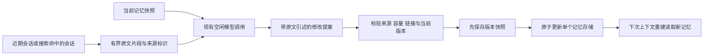

# Rêve 记忆整理与原文校验

日期：2026-11-07。适用基线：LISA 0.28.1。

Rêve 已具备会话反思、空闲运行、心跳、自我状态和 Wiki。这次改进集中在记忆的可靠性：把“生成更多笔记”补成“读取已有记忆、核对原始证据、提出修改、检查并发、保存版本”的闭环。实现复用现有模型调用和自主运行预算，兼容当前模型 Provider 与本地文件存储。

## 研究依据

Anthropic 于 2026-11-06 发布的 [The components of agent memory](https://www.anthropic.com/research/components-of-agent-memory) 是带评测结果的工程研究文章。它讨论了四层记忆：原始会话、记忆笔记、Wiki 等知识表示、每次会话注入的上下文。本文采用其中三项设计启发：回到原文校正记忆；保留搜索与 Wiki 的互补关系；把始终注入的内容维持在小规模。文章也提醒，不应把每次整理都变成扩写任务，记忆的用途应决定保留什么。

[Managed Agents Dreams 官方文档](https://platform.claude.com/docs/en/managed-agents/dreams) 描述了输入存储与输出存储分离的流程。LISA 在现有文件架构中采用较轻的对应方案：修改前先保存提案、来源和前后快照，再比较当前文件是否仍等于读取时的版本。它不是 Anthropic 托管 Dreams API 的封装，也没有复现该文章的模型评测结果。

## 模块审查

| 路径 | 已有机制 | 此次发现与处理 |
| --- | --- | --- |
| `src/idle/watcher.ts` | 空闲达到阈值后触发一次，用户活动后重新启用 | 保持现有调度，避免另开循环整理任务 |
| `src/idle/runner.ts` | 自治开关、跨进程锁、受限工具集、默认 200k token 预算、运行账本 | 加入基于原文的记忆整理流程；单次建议一个存储、一份提案；单独暴露 Wiki 维护提示 |
| `src/reflect.ts` | 会话反思输出日志、记忆、技能、情绪和欲望；坏 JSON 重试 | 原先不读取现有记忆且只会追加；现在读取两份记忆快照，支持带证据的追加、修正和删除 |
| `src/memory/store.ts` | MEMORY.md 4096 字节、USER.md 2048 字节上限 | 原先原子替换文件不能保护整个读改写过程；现在所有正常写入共享每个存储的跨进程锁 |
| `src/memory/search_tool.ts` | 对历史会话做全文或语义搜索，返回摘要 | 保留；搜索找到的 session id 可以交给 review 读取原始片段 |
| `src/kb/{store,links,memory-links}.ts` | 来源、Wiki、图索引、反向链接、断链与孤立页、记忆指针 | 复用现有结构；整理不能新增不存在于索引中的 Wiki 指针 |
| `src/prompt.ts` | 记忆与 KB 索引注入，记忆链接展开标题 | 写入限制之外增加读取端限制，覆盖手工编辑或旧文件过大、展开标题后超限的情况 |
| `src/heartbeat/runner.ts` | 按来源区分用户任务与自驱任务，预算与运行锁 | 保持现有任务路径；新增记忆操作由现有工具权限边界管理 |
| `src/web/autonomy-sweep.ts` | 租户范围、时间间隔、会话用户消息水位、计费统计 | 保留现有调用；反思层新增证据指纹去重，使其他入口也受益 |

## 新的整理流程

现有 `memory` 工具增加以下操作：

| 操作 | 输入与行为 |
| --- | --- |
| `review` | 指定 `store`；可选 `session_ids`。返回 review id、原记忆、证据片段、是否已经整理过 |
| `consolidate` | 使用 `review_id` 和 `changes` 提交修改；每项包含种类、修改理由与来源引述 |
| `history` | 返回当前存储最近十条版本记录，含修改前后内容、引用和执行状态 |
| `restore` | 指定 `revision_id`；只有当前记忆仍等于该版本修改后的内容才执行撤销，并记录新的版本 |

`changes` 支持 `append`、`replace` 和 `remove`。替换或删除要求原文唯一匹配；每项需引用 1–4 段本次提供的原文，每段 6–500 字符；完整原始来源不足六字符时允许完整引用。用户偏好必须至少包含一条用户消息依据；工具返回不会因为其位于 `user` 类型消息中就被误认成人的表述。单凭助手自己的断言不能确立事实。

每个存储的整份提案先完成校验，再写入。若提案中一项无效，该存储不会部分更新。不同存储之间不构成事务。空提案是正常结果，不要求模型为了“有产出”而修改记忆。

旧的 `read/append/replace/remove` 操作继续服务即时记忆编辑。默认的自主工具集仅允许 `read/history/review/consolidate`，运行时同样检查动作。用户发起的即时编辑以及显式开启的 `LISA_AUTONOMOUS_FULL_TOOLS=1` 继续使用完整工具集。

## 成本与数据边界

- 默认按修改时间选择最近六个会话，包含重新打开的旧会话。也可指定最多六个历史 session id。
- 每个会话只读取末尾 64 KiB；单段原文最多 3000 字符，超长时拆分为各 1500 字符的头尾片段并标记偏移；证据对象序列化（含数组分隔符）合计限制为 24000 字符。多个会话分摊预算。
- 不使用系统提示快照、反思摘要、连接诊断记录、内部异议提示或附件的 base64 包装作为原始证据。会话日志保持原样。
- 每份提案最多八项修改。MEMORY.md 与 USER.md 的注入上限继续为 4096 / 2048 UTF-8 字节，标题展开后再次检查。
- 临时 review 存在当前租户的 `memory/reviews/`。有效期一天，后续 review 操作会清理过期草稿并保留最近 48 份；没有后台定时删除器。版本记录位于 `memory/revisions/`，保留前后快照、被引用的片段和来源标识，不复制整份会话。新建记录文件权限为 0600。
- 整理工具本身不调用模型。空闲整理发生在现有 `runSubagent` 内，继承其工具限制、预算和取消信号。选择整理还是其他内部工作仍由空闲运行决定。
- 会话反思继续使用原有调用，增加 90 秒共享超时，坏 JSON 最多重试一次。它没有新增独立推理路径。

## 并发与恢复

普通记忆编辑和整理共享同一个存储锁。整理提交时要求当前内容逐字等于 review 读取时的内容；聊天写入、其他反思或其他进程更新后，旧提案会被拒绝。原文唯一匹配与替换回调也避免了空字符串误删、歧义修改和 `$&` 等替换字符被解释的问题。精确重复的单行追加变为无操作。

版本先以 `prepared` 状态落盘，随后更新记忆，最后标记 `applied`。如果最后一步失败，前后快照仍存在；重试会检查当前内容，避免再次执行已生效的修改。相同 review 不能用于提交另一份提案。撤销同样检查当前版本，保护后来的新增内容。手工绕过存储接口直接写文件不受协作锁约束。

`reflectOnSession` 使用会话锁及有界证据的指纹记录已完成反思。同一输入再次到达时，不调用模型也不重做操作；新的证据可以再次反思。无法解析的输出不记录完成状态。这个去重机制不等于所有 Soul 操作的崩溃事务：进程如果在部分日志或情绪操作完成、完成记录写入前退出，仍有恢复窗口。带版本的记忆提交自身可去重，其他 Soul 操作继续沿用现有机制。

## 验证与实际限制

类型检查通过。相关回归共 **346 项通过**，覆盖记忆、反思、Wiki、Soul、会话、自治、Cloud sweep、工具注册和上下文构建；其中新增 **25 项**覆盖并发追加、错误证据、来源角色、原文截断、租户隔离、快照写入失败、恢复、取消、失效提案、重复反思和断链提示。改动文件的 lint 无错误，保留原有三条日志警告。

引述匹配能验证“原文中确实有这段话”，不能证明新结论在语义上必然成立。语义纠错、重要性选择以及真假陈述的判断仍依赖模型；历史原文中的注入指令也不能仅靠引述校验消除。提示中明确把证据视为数据。有限片段之外的内容需要继续搜索，不得因当前片段没提到就删除旧事实。

初次实现使用离线可控的模型替身验证。随后已完成真实模型对比评测，并根据短更正、长消息尾部、无依据细化和删除表达的实际输出继续修复；详见 [真实模型评测与界面更新](REVE_LIVE_EVAL_2026-11-07.md)。
