# LISA v0.31.0 Mac 与 Web 视觉 / 交互设计评审

> 评审日期：2026-11-13 
> 基线提交：`ae84d9a7`（v0.31.0） 
> 状态：**待确认。** 本文只提出建议和 mockup，没有改动任何产品代码。 
> 配套：[mockup 与原型](./design/2026-11-13-mac-web-review/README.md) · [设计 token](./DESIGN_TOKENS.md) · 上一轮 [v0.24.0 UX 审查](./PROJECT_REVIEW_UX_v0.24.0.md) · [三端体验设计规格](./DESIGN_CROSS_PLATFORM_ASSISTANT_v1.0.md) 
> 范围：Mac 主窗口内嵌的 Web 工作台（Nebula、Calm 两套主题）、独立页面（首次配置、出生仪式、远程 Mac、Cloud 登录、灵动岛）、Mac 原生界面（菜单栏、设置、关于、账户与设备、配对、后端安装向导、离线页）。不含官网 meetlisa.ai 和 Lisa Pocket。

## 1. 结论

**当前视觉成立，不需要重做。** Soft Ink 角色、Nebula／Calm 双主题和三栏工作台已经有辨识度；Rêve、Room、聊天阅读和手机版式的完成度都高。这一轮找到的问题不在风格，在五处边角：

1. **侧边栏的纵向空间分配不对（P1）。** 头像区和导航九宫格固定占掉 449px，会话列表在默认窗口只剩 5 行，窗口高 640px 时不足 1 行。
2. **v0.31 新增的「远程 Mac」没有接入设计体系（P1）。** 入口是一条游离的下划线链接，页面是无主题的系统默认样式，且只有中文。
3. **Mac 壳有两处交互冲突，需要实机确认（P1–P2）。** 窗口收窄到 720px 以下时，标题栏按钮与红绿灯、拖拽层重叠；⌘F 同时绑定了全屏和对话内查找。两条都来自源码，本轮无法在真机上验证。
4. **出生仪式结束后，继续按钮在默认窗口下看不到（P1）。** 1200×800 时结束语和 ENTER 落在视口下方 70px 以外，页面没有自动滚动过去。
5. **同一角色的控件有多种长相（P2）。** 主按钮四种、开关两种、图标三种来源；Mac 原生窗口另用一套紫色主色。

所有建议只做收敛和对齐：不新增颜色，全部复用现有 token，不改变信息架构。按建议调整后，默认窗口的会话列表从 5 行增加到 11 行（实测）。

## 2. 方法与证据

| 方法 | 说明 |
| --- | --- |
| 真实浏览器实测 | 从 `ae84d9a7` 构建，起两个一次性实例（独立 `LISA_HOME`，模型指向本地桩服务，不调用任何真实模型，不读写 `~/.lisa`）。Chromium 下截取 1200×800（Mac 默认窗口）、1440×900、900×640、600×500（Mac 最小窗口）、390×844，两套主题 |
| 结构化测量 | 在页面内读取元素坐标和计算样式，本文所有像素数字都来自这一步 |
| 样式表统计 | 对 `main.css`、`reve.css`、`connectors.css` 统计圆角和字号的取值分布 |
| Mac 原生界面 | 通读 `packaging/mac-client/Sources/Lisa/` 全部 Swift 源码，关键结论逐条回到源码核对 |
| Mockup | 把建议写成原型样式（[`proposed.css`](./design/2026-11-13-mac-web-review/prototype/proposed.css)、[`proposed.js`](./design/2026-11-13-mac-web-review/prototype/proposed.js)），注入真实运行的界面后截图。「现状」和「建议」是同一屏、同一数据 |

三条局限：

- **Mac 原生窗口没有实机截图。** 本机只有 Command Line Tools，`swift build` 在 SwiftUI 宏处失败。原生部分的结论来自源码，标注「源码推断」的条目需要在真机上确认。
- **Web 工作台在 Chromium 下测量，不是 WKWebView。** 两者的字体渲染和滚动条略有差异，布局结论不受影响。
- **Cloud 版页面只做了静态渲染。** 登录页用源码中的 HTML 直接渲染，没有走真实登录。

## 3. 值得保留的

这些是当前版本的长处，建议任何后续改动都不要动：

- **角色贯穿始终。** 头像随情绪变化，空聊天页有挥手的 Lisa，Room 是完整的场景。这是 LISA 与其他助手最大的视觉差异。
- **双主题是一套 token 的两组取值。** 切换即时，对比度有测试守护。Calm 主题下所有被测页面都干净。
- **Rêve 页面。** 标题、统计、记忆变更和来源证据的层级清楚，是工作台里完成度最高的一页。
- **聊天阅读体验。** 正文 15px，气泡边界清楚，代码块自带复制按钮，引用块样式克制。
- **手机版式（≤720px）。** 顶栏、底部四栏和抽屉都成立，输入框不被遮挡。
- **⌘K 会话切换器**和**空聊天页的三个起手问题**。
- **首次配置卡片和出生仪式的仪式感。** 星标和分步揭示有记忆点。

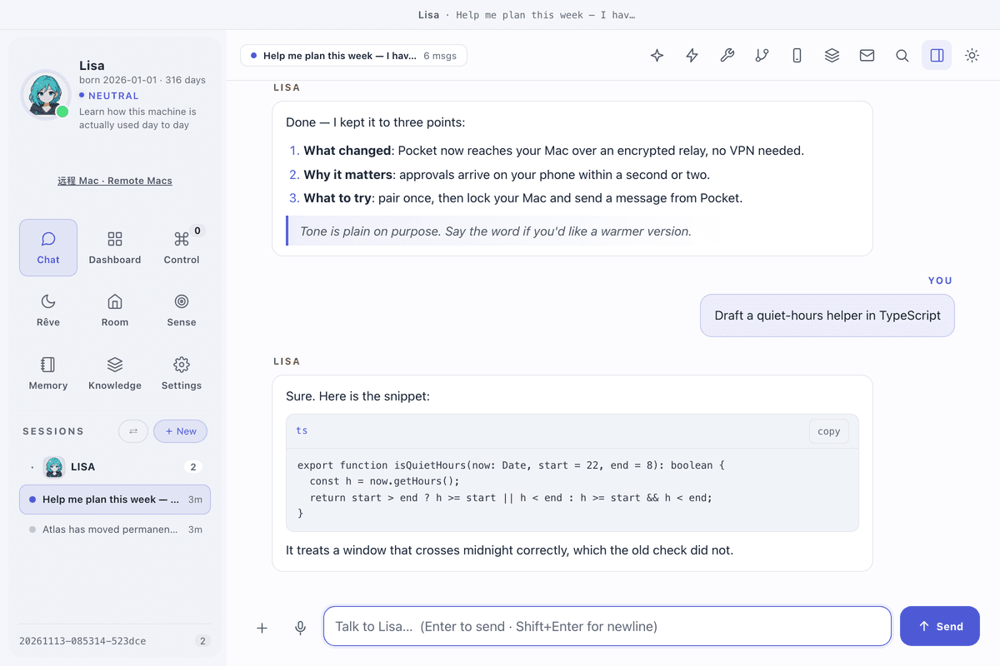

## 4. 分表面评分

| 表面 | 评分 | 一句话 |
| --- | --- | --- |
| 聊天（两套主题） | 8 / 10 | 阅读体验好；右栏展开时聊天列偏窄，功能栏 10 个图标等权 |
| 侧边栏 | 6 / 10 | 样式好看，但把会话列表挤到最小 |
| Rêve、Room | 9 / 10 | 保持现状 |
| Dashboard、Control、Sense、Memory、Mail、Knowledge | 6 / 10 | 结构清楚；空状态只有一行斜体字，控件样式不统一 |
| Settings | 7 / 10 | 信息完整；首个分组的控件字号和标签位置与其余不一致 |
| 首次配置、出生仪式 | 6 / 10 | 有仪式感；仪式结束后 ENTER 在默认窗口下不可见，遮罩透出底层界面 |
| 远程 Mac（`/fleet`） | 3 / 10 | 功能可用，视觉和语言都在体系之外 |
| 手机宽度 | 8 / 10 | 保持现状 |
| Mac 主窗口壳 | 6 / 10 | 标题栏融合得好；窄窗标题栏有重叠风险，⌘F 有两个含义 |
| Mac 原生窗口 | 6 / 10 | 账户与设备两个窗口做得细；四种工具包、三种主色、同一动作多种叫法 |

## 5. 问题与建议

编号 D-n。D-1 至 D-15 是 Web 工作台（Mac 主窗口内同样适用），D-16 至 D-20 是 Mac 壳和原生界面。

| 编号 | 优先级 | 问题 | Mockup |
| --- | --- | --- | --- |
| D-1 | P1 | 侧边栏把会话列表挤到最小 | M01 |
| D-2 | P1 | 远程 Mac 的入口和页面游离于设计体系 | M02、M03 |
| D-12 | P1 | 出生仪式结束后 ENTER 不可见；遮罩透底，种子行是原始技术串 | M09 |
| D-17 | P1 | Mac 窄窗时标题栏按钮与红绿灯、拖拽层重叠（源码推断） | — |
| D-3 | P2 | 知识库的链接栏没有对齐页面网格 | M04 |
| D-4 | P2 | 聊天列变窄时输入框占位文字折行并被裁切 | M10 |
| D-6 | P2 | 主按钮有四种长相，橙色被借用 | M05 |
| D-7 | P2 | 开关、下拉和分组标签各有两种做法 | M06 |
| D-11 | P2 | 空状态只有一行斜体字 | M02、M04、M08 |
| D-13 | P2 | 发出第一条消息后，会话标题和消息数不刷新 | — |
| D-16 | P2 | Mac 上 ⌘F 同时绑定了全屏和查找（源码推断） | — |
| D-18 | P2 | Mac 原生窗口的主色和主题与主窗口不一致 | M12 |
| D-19 | P2 | Mac 原生界面里同一动作有多种叫法 | — |
| D-5 | P3 | 右栏开关的高亮语义相反 | M10 |
| D-8 | P3 | 图标有三种来源 | M07 |
| D-9 | P3 | 圆角和字号取值发散，token 文档过期 | — |
| D-10 | P3 | 原始值和小写标签外露 | — |
| D-14 | P3 | Cloud 登录页没有角色 | M11 |
| D-15 | P3 | 功能栏 10 个图标没有分组 | M10 |
| D-20 | P3 | Mac 原生界面的其他细节 | — |

### D-1 · P1 · 侧边栏把会话列表挤到最小

**证据**

- 1200×800（Mac 默认窗口）下实测：身份卡 110px，「远程 Mac」所在的空带 92px，导航九宫格 220px，到会话树顶部共 449px 固定占用。会话树只剩 193px，每行 36px，可见 5 行。
- 900×640 下会话树剩 33px，不足 1 行；721×500（Mac 最小高度）下为 0，整个侧边栏出现 71px 的滚动。
- 底部还有一行原始会话 id（`20261113-085314-523dce`）和一个与分组计数重复的数字。v0.24 审查的 UX-4 已把这个 id 从标题栏和会话树移走，这里是遗留。

**影响** 会话是聊天产品的主导航，却是侧边栏里最先被挤掉的部分。Mac 用户把窗口放在半屏或小屏笔记本上时基本看不到历史会话。

**建议**（M01）

1. 身份卡收紧到 82px：头像 56 → 48px，「当前追求」从两行改为一行，完整文字仍在悬停提示里。
2. 导航磁贴从 69px 降到 56px，间距 6 → 4px。保留 3×3 九宫格和图标加文字的样式。
3. 「远程 Mac」移出侧边栏（见 D-2），去掉 92px 空带。
4. 去掉底部的会话 id 行。id 仍在右栏检查器和标签页的悬停提示里。
5. Control 磁贴的角标在数量为 0 时隐藏。
6. 窗口高度不足 700px 时，磁贴只显示图标（38px 高），身份卡只留头像、名字和情绪。

| 窗口 | 现状会话树 | 建议后 |
| --- | --- | --- |
| 1200×800 | 193px，5 行 | 396px，11 行 |
| 900×640 | 33px，不足 1 行 | 325px，9 行 |
| 721×500 | 0，侧边栏滚动 | 185px，5 行 |

| 现状 1200×800 | 建议 |
| --- | --- |
| 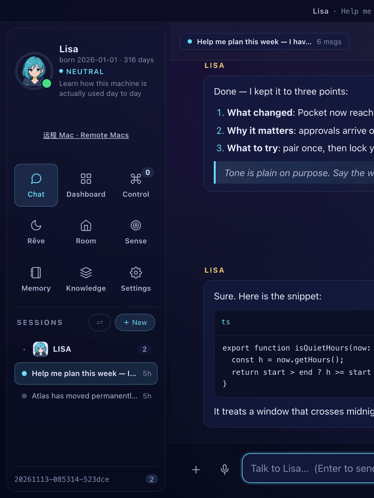 | 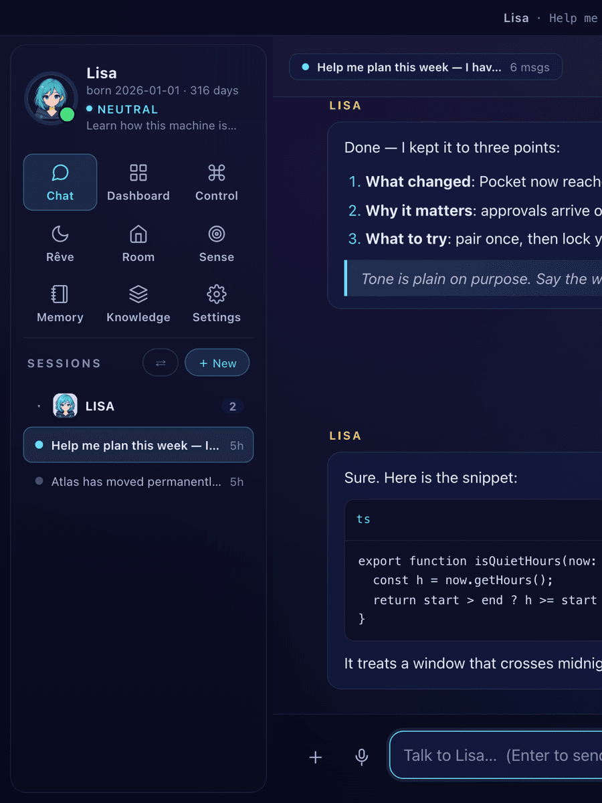 |

| 现状 900×640 | 建议 |
| --- | --- |
| 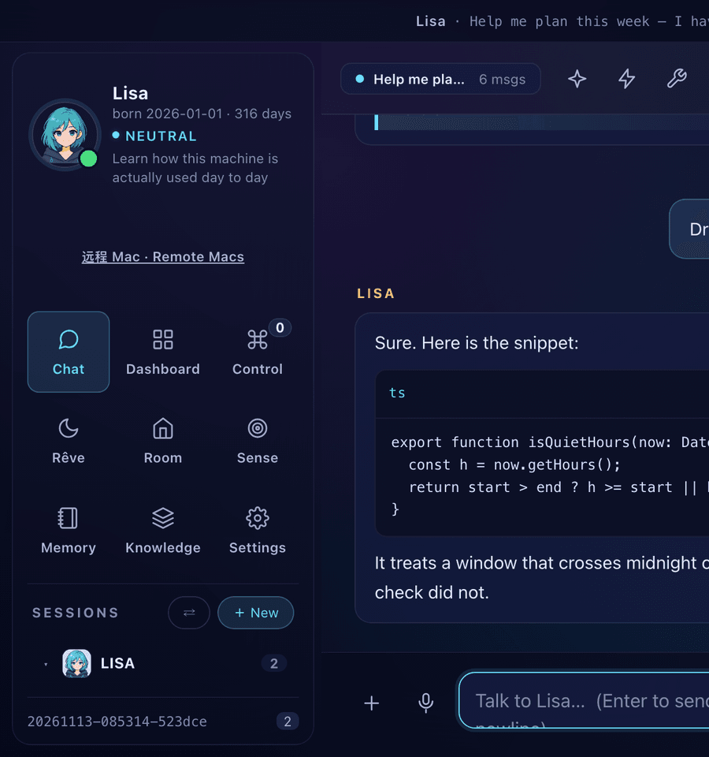 | 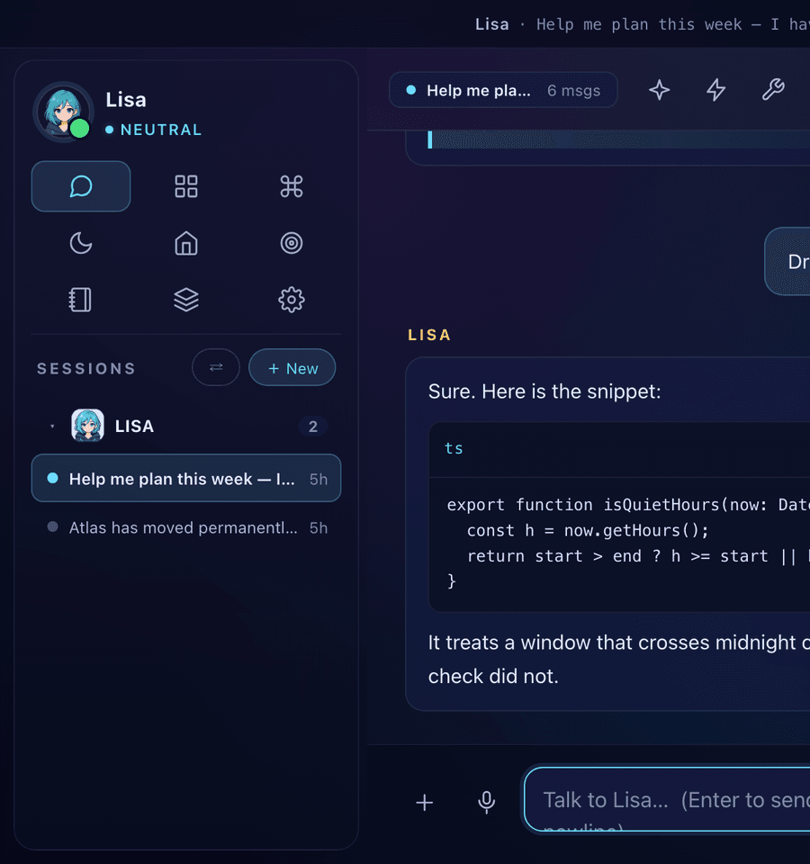 |

**验收** 1200×800 下会话树可见不少于 9 行；721×500 下不少于 4 行且侧边栏不滚动；手机版式（≤720px）不受影响。

### D-2 · P1 · 远程 Mac 的入口和页面游离于设计体系

**证据**

- 入口是 [`src/web/lisa-html.ts:164`](../src/web/lisa-html.ts#L164) 的一个 `<a class="nav-item">`，放在导航九宫格之外。它继承了磁贴的排版却没有磁贴的容器，渲染成身份卡和九宫格之间一条居中的下划线链接，上下各留一段空白。文字硬编码为「远程 Mac · Remote Macs」，是英文界面里唯一的双语标签。
- 页面 `/fleet` 的样式表 [`fleet.css`](../src/web/assets/fleet/fleet.css) 用的是 `Canvas`、`CanvasText` 系统色和 `system-ui` 16px，没有引用任何 Lisa token。它跟随系统明暗，不跟随应用内选择的主题。
- 页面 `lang="zh-CN"`，所有文案只有中文；工作台其余部分是英文。
- 返回方式是一条「← LISA」文字链接，没有侧边栏，也没有与主窗口一致的标题栏。

**影响** 这是 v0.31「你的其他 Mac」的主功能，却是全产品里唯一看起来不属于 Lisa 的页面。

**建议**（M02、M03）

1. **入口移到 Control 页头部**，作为「+ Delegate a task」旁边的次级按钮。远程 Mac 是智能体的执行位置，和 Control 的「实时智能体」是同一件事的两面。Control 的空状态里再放一次这个入口。
2. **页面换用工作台的 token**：同样的底色、卡片、按钮层级和焦点环，支持 Nebula 和 Calm，跟随应用内的主题选择。原型见 [`proposed-fleet.css`](./design/2026-11-13-mac-web-review/prototype/proposed-fleet.css)，不到 200 行。
3. **文案跟随工作台语言**，不再只有中文。

备选：如果希望入口留在侧边栏，把它做成九宫格下方一行正式的列表项（图标、单语标签、右箭头），不要保留现在的链接样式。

| 现状 | 建议（Nebula） |
| --- | --- |
| 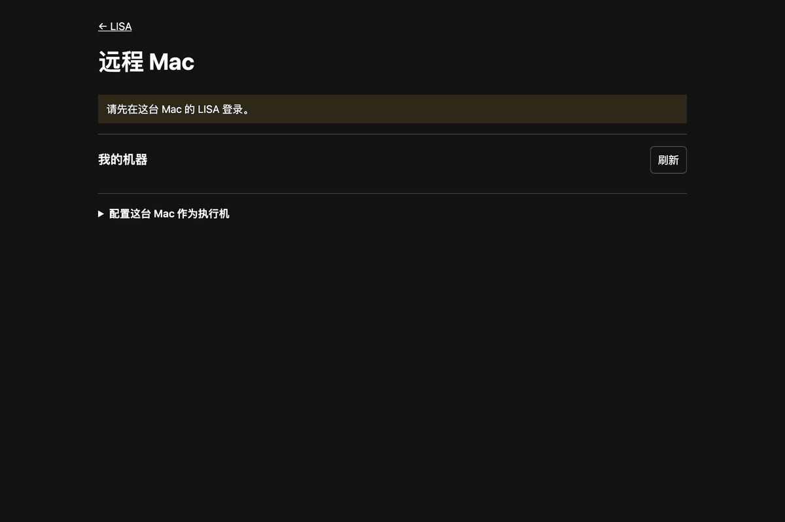 | 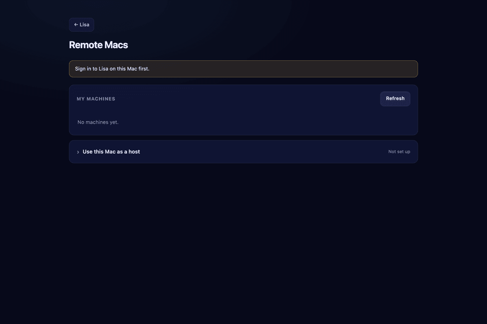 |

| 现状（系统浅色） | 建议（Calm） |
| --- | --- |
| 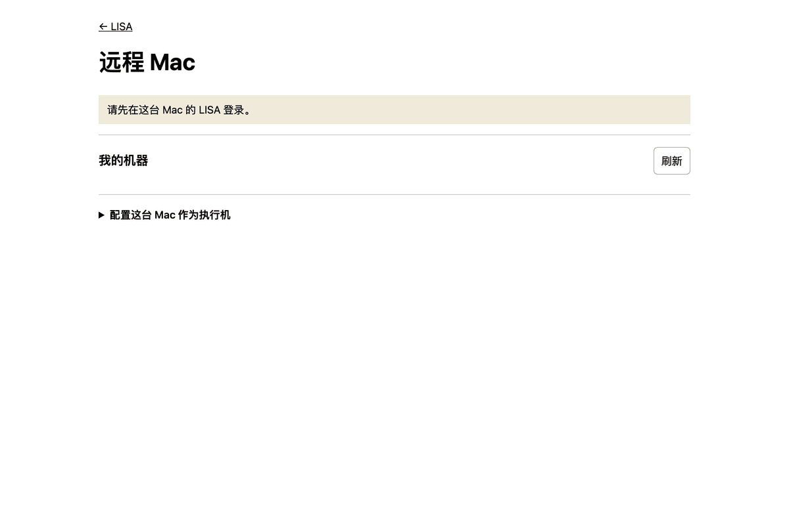 | 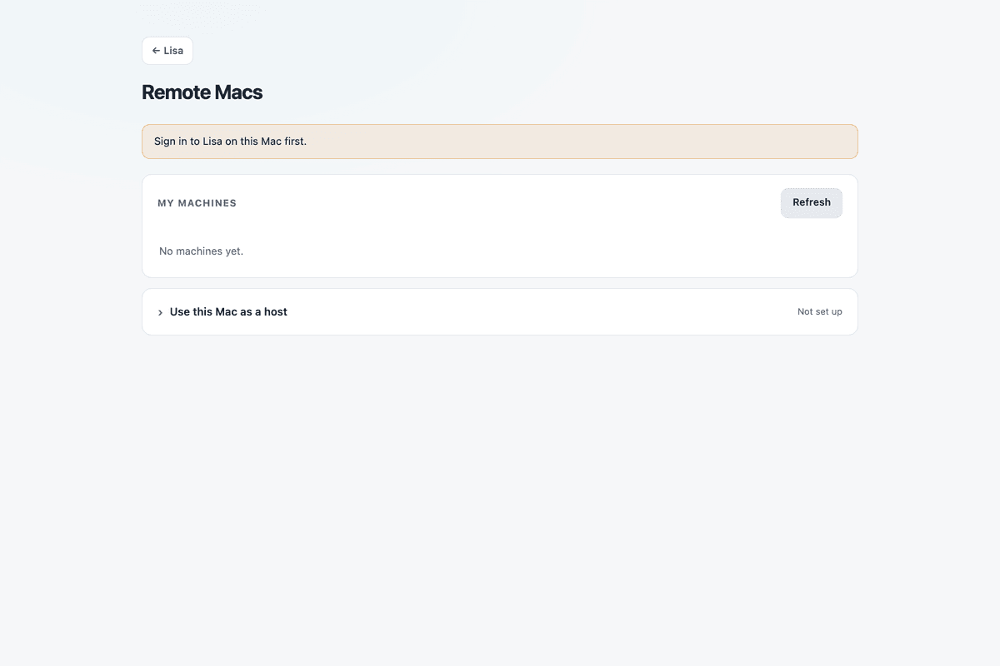 |

Control 页承接入口，同时换上正式的空状态：

| 现状 | 建议 |
| --- | --- |
| 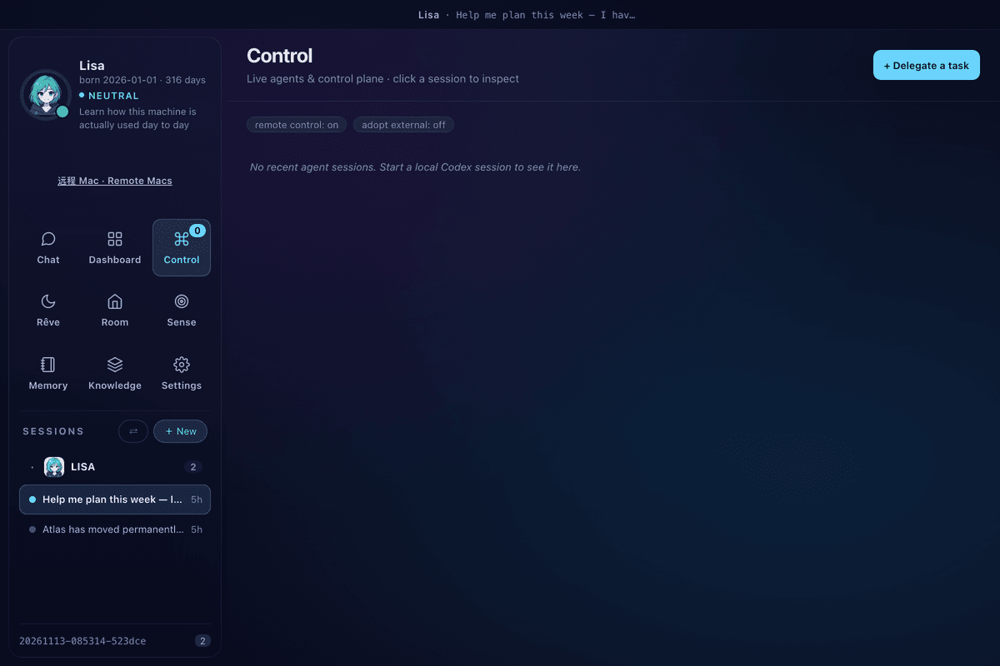 | 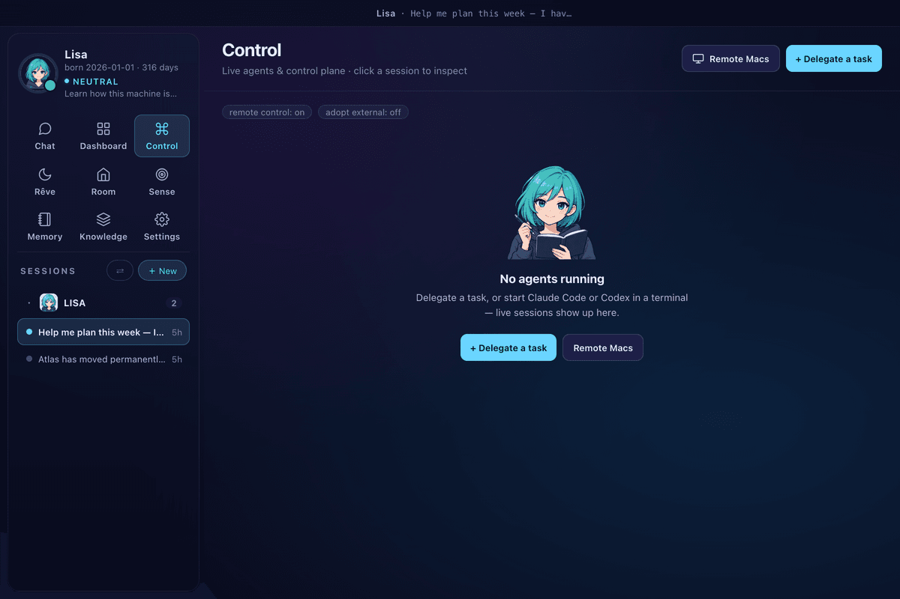 |

**验收** `/fleet` 在两套主题下与工作台使用同一组 token；应用内切换主题后刷新该页，主题一致；英文界面下该页没有中文硬编码。

### D-3 · P2 · 知识库的链接栏没有对齐页面网格

**证据** `.kb-ingestbar` 的内边距是 `0 0 10px`（[`main.css:2020`](../src/web/assets/client/main.css#L2020)），同页的搜索栏是 `12px 24px 0`。实测链接输入框左缘在 x=272，贴着主区左边；搜索框在 x=296。Save 按钮右缘在 872，搜索框右缘在 856。三个控件高度分别是 33、31、36px。输入框还紧贴页头的分隔线。

**建议**（M04） 链接栏使用与页头相同的 24px 水平内边距；三个控件统一 36px 高、9px 圆角；空的状态文字节点不参与排版。知识库为空时不画列表与阅读区之间的分隔线，由空状态占满（见 D-11）。

| 现状 | 建议 |
| --- | --- |
| 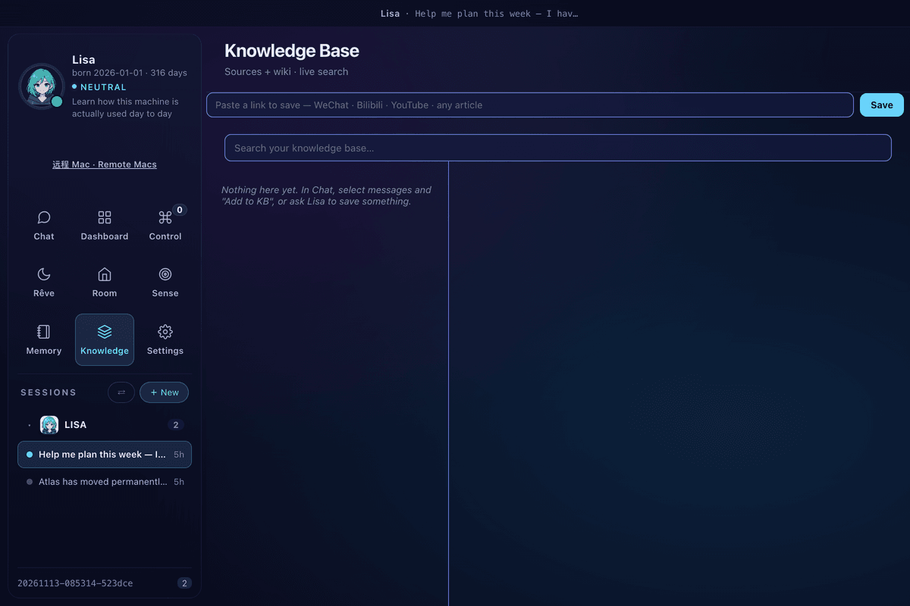 | 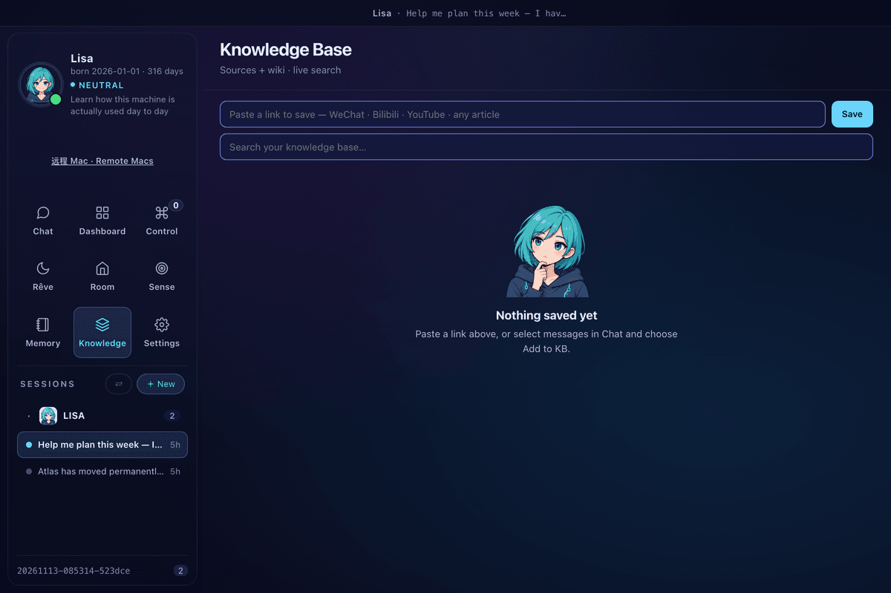 |

**验收** 链接输入框、搜索框的左右缘与页头文字对齐，误差为 0。

### D-4 · P2 · 聊天列变窄时输入框占位文字折行并被裁切

**证据** 占位文字是「Talk to Lisa…  (Enter to send · Shift+Enter for newline)」（[`lisa-html.ts:263`](../src/web/lisa-html.ts#L263)）。1200px 宽且右栏展开时，聊天列只有 608px，输入框 362px，占位文字折成两行，第二行被裁掉一半。900px 宽不开右栏时同样如此。同一状态下代码块需要横向滚动。

**建议**（M10） 占位文字缩短为「Message Lisa…」。按键说明移到输入框的悬停提示和快捷键列表里，不占聊天高度。右栏在 1180–1360px 之间展开时改为覆盖在聊天列之上的抽屉，不再挤压聊天列。

**验收** 721px 以上任意宽度、右栏开或关，占位文字都是单行且完整。

### D-5 · P3 · 右栏开关的高亮语义相反

**证据** [`main.js`](../src/web/assets/client/main.js) 的 `applyRb` 在右栏**收起**时给按钮加 `active`，样式是强调色底。结果是右栏不可见时按钮亮着，展开后反而变暗，与其他所有「按下即开启」的图标相反。

**建议**（M10） 高亮表示「右栏正在显示」。收起时如有待处理事项，现有的数字角标保留。

### D-6 · P2 · 主按钮有四种长相，橙色被借用

**证据**（实测计算样式）

| 位置 | 类名 | 长相 |
| --- | --- | --- |
| 各页头部「+ Delegate a task」 | `.view-act` | 强调色实底，36px 高，12px／600，圆角 9 |
| 委派对话框「Start agent →」 | `.dm-start` | 强调色描边加浅底，34px 高，13px／400，圆角 8 |
| 右栏「＋ delegate a task」「＋ connect mailbox」 | `.delegate-btn` | 橙色描边加浅底，11.5px，圆角 8 |
| 知识库「Save」 | `.kb-ingest-go` | 强调色实底，31px 高，12.5px／700 |
| 首次配置「SAVE & CONTINUE」 | `.cfg-save` | 强调色实底，全大写，带光晕 |

同一个「委派任务」动作在页头、右栏、对话框里是三种样子。右栏用的橙色是 `--claude`，token 文档把它定义为「Claude Code 会话」的颜色，「连接邮箱」借用它没有语义依据。

**建议**（M05） 收敛为三级：

- **主按钮**：强调色实底，36px，12px／600，圆角 9。每个视图或对话框至多一个。
- **次按钮**：强调色浅底加描边，同尺寸。用于右栏内的动作。
- **安静按钮**：中性底加描边，同尺寸。用于「Sweep now」「Refresh」一类。

橙色只留给 Claude Code 会话的标识。

| 右栏现状 | 建议 | 对话框现状 | 建议 |
| --- | --- | --- | --- |
| 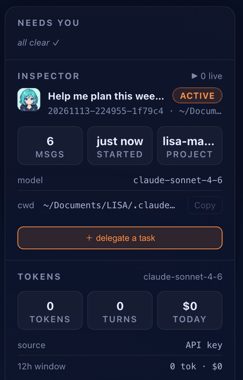 | 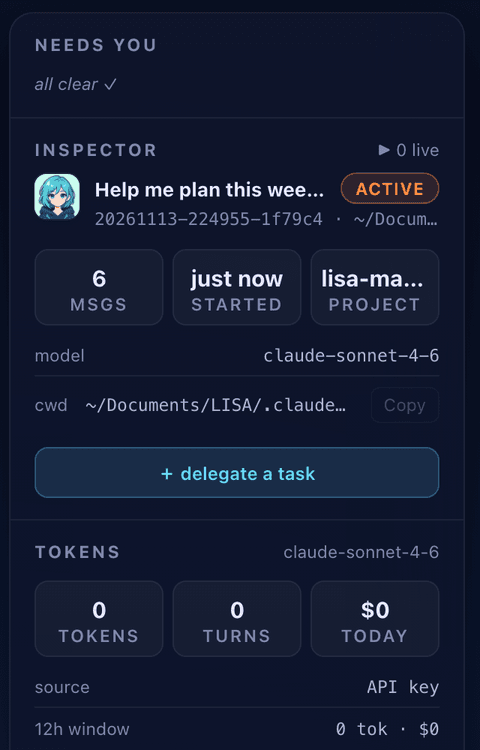 | 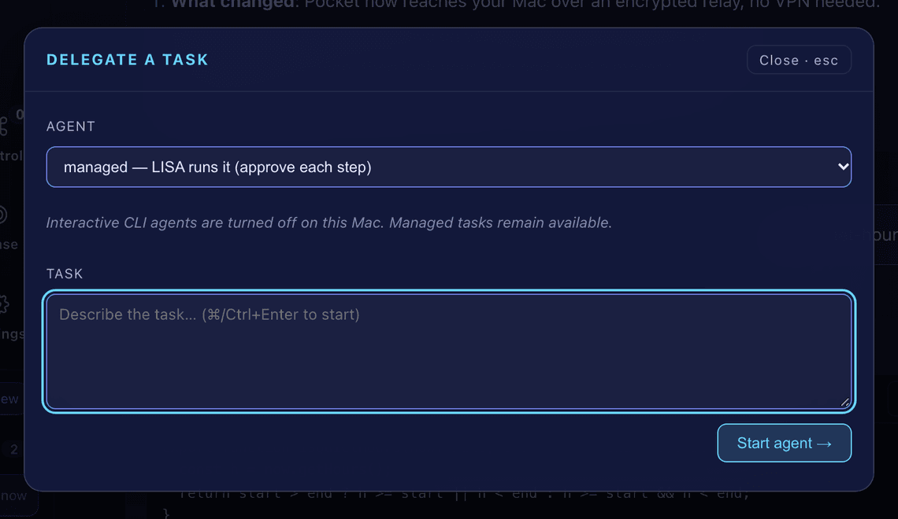 | 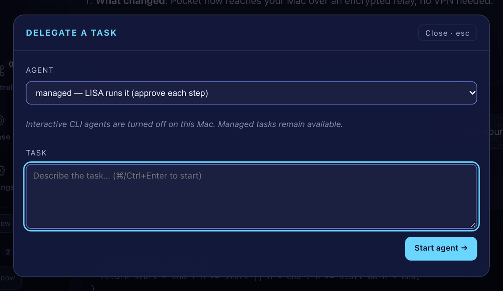 |

**验收** 样式表里主按钮只有一组规则；`--claude` 只出现在会话标识相关的规则里。

### D-7 · P2 · 开关、下拉和分组标签各有两种做法

**证据**

- **开关**：Settings 用 38×20 的滑动开关（`.set-switch`）；Sense 的授权项用写着「on」「off」的 38×36 文字按钮（`.v-toggle`）。同一个类还被用作「show」按钮。
- **下拉**：Settings 里「Conversation expressions」的两个下拉字号是 16px，没有文字标签，看不出各自控制什么；同页其他下拉是 12.5px（`.set-input`）。
- **分组标签**：「Conversation expressions」的标题在卡片里面，Display、Model provider 等标题在卡片外面。
- **About 分组**：同一列位置上是药丸（mac）、按钮（show）、链接（open ↗）三种样子。

**建议**（M06） 布尔值一律用滑动开关；下拉一律 `.set-input`；分组标题一律在卡片外；表情设置拆成两行带名称的设置项。Sense 的授权名称首字母大写。

| Settings 现状 | 建议 |
| --- | --- |
| 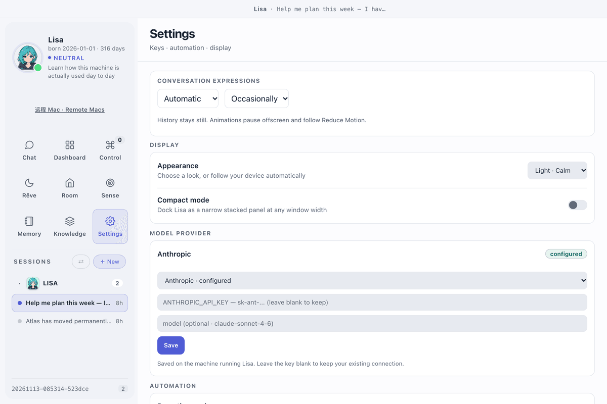 | 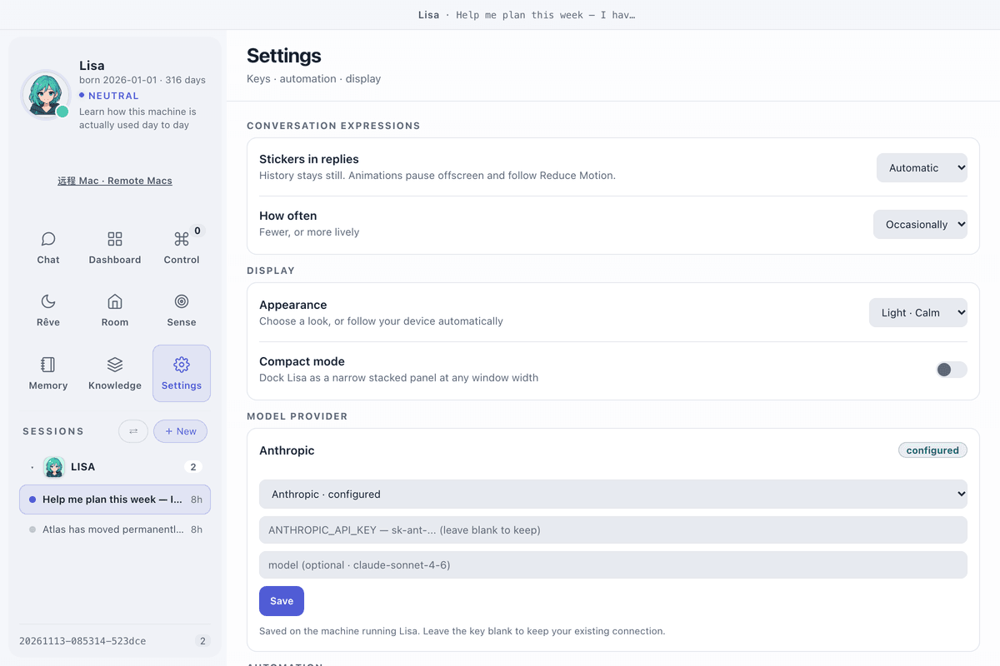 |

| Sense 现状 | 建议 |
| --- | --- |
| 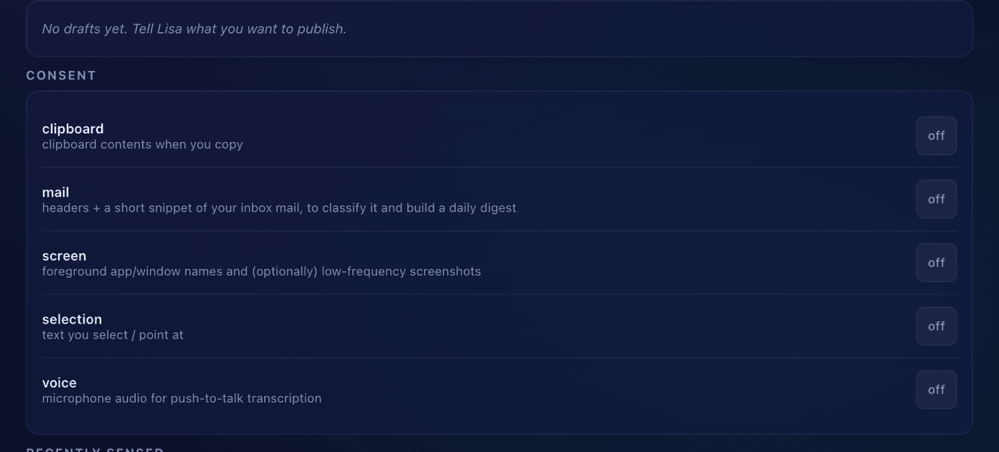 | 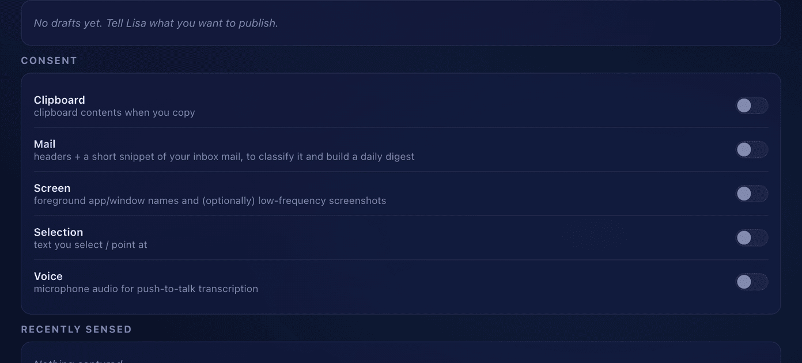 |

**验收** 所有布尔设置使用同一个开关组件，并带 `role="switch"`。

### D-8 · P3 · 图标有三种来源

**证据** 导航和功能栏用 1.7px 描边的 SVG 线性图标；Memory 页的五行用 Unicode 字符（★ ✦ ▤ ⚒ ◆，[`main.js:6170`](../src/web/assets/client/main.js#L6170)），而同样的五个面板在功能栏里已有线性图标；输入框的「＋」菜单用 emoji（📎 📷），其中「Browse app connectors」没有图标，文字因此左移。

**建议**（M07） 全部使用现有的线性图标。Memory 页直接复用功能栏的同名图标。

| ＋菜单现状 | 建议 | Memory 现状 | 建议 |
| --- | --- | --- | --- |
| 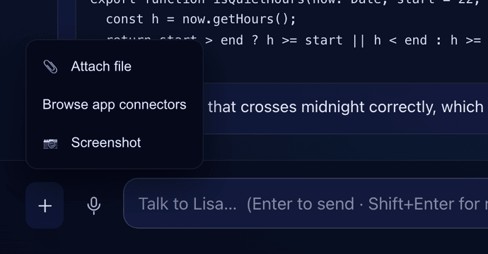 | 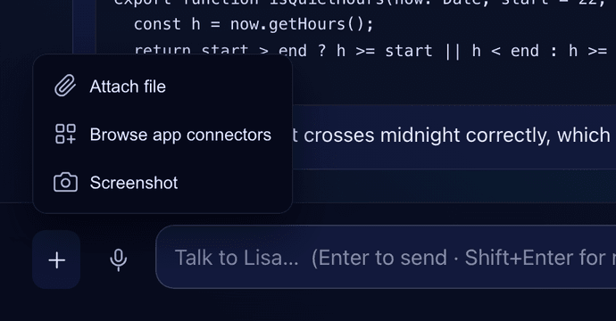 | 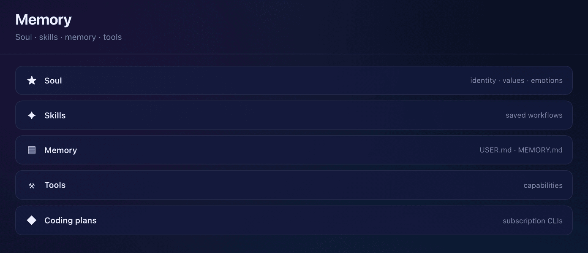 | 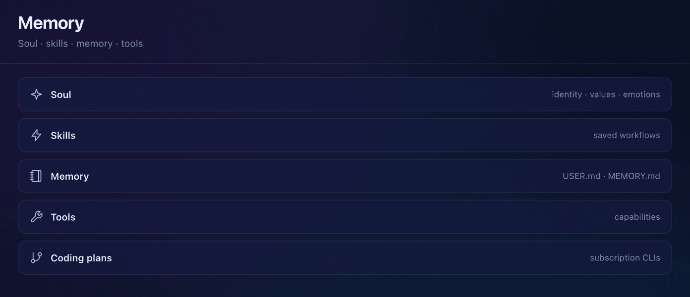 |

### D-9 · P3 · 圆角和字号取值发散，token 文档过期

**证据**

- **圆角**：三份样式表里有 16 种不同的像素圆角（3、4、5、6、7、8、9、10、11、12、13、14、16、18、20、22）。[`DESIGN_TOKENS.md`](./DESIGN_TOKENS.md) 的规定是「默认 8，小标签 6，卡片和输入 9–12」。
- **字号**：11.5px 出现 153 次，之后 12px（53）、13px（33）、12.5px（32）三个相邻值并存，另有 13.5、15.5、17、19、21、23、25 等单次出现的值。
- **文档与实现不一致**：文档写正文和聊天消息 12–13px，实测聊天消息 15px、输入框 16px；文档写侧边栏 300px，样式表是 272px。

**建议** 不改视觉，只把现有取值归并到刻度上，并以变量形式写进 `:root`：

| 刻度 | 取值 | 用途 |
| --- | --- | --- |
| `--r-sm` | 6px | 标签、角标 |
| `--r-md` | 9px | 按钮、输入框、小卡片 |
| `--r-lg` | 12px | 卡片、磁贴 |
| `--r-xl` | 16px | 面板、对话框 |
| `--r-pill` | 999px | 药丸、开关 |

字号刻度：11.5（元信息）、12.5（控件）、13（次要正文）、15（聊天正文）、16（输入）、24（页标题）。归并后更新 `DESIGN_TOKENS.md`。这一条适合单独一个 PR，逐文件替换，截图对比无可见差异即可合并。

### D-10 · P3 · 原始值和小写标签外露

**证据**

- Soul 面板的 BORN 一行是 `2026-01-01T00:00:00.000Z · big5(O72 C81 E34 A66 N22)`。
- 右栏状态是 `all clear ✓`、`(idle)`、`(not connected)`；Control 页是 `remote control: on`、`adopt external: off` 两个看起来可点、实际不可点的标签。
- Sense 授权项名称是小写的 `clipboard`、`mail`、`screen`。
- 首次配置保存失败时显示 `Save failed: HTTP 400 — ANTHROPIC_API_KEY looks malformed`。

**建议** 日期按本地格式显示（「January 1, 2026」），人格参数收进「详情」；状态文字用句首大写的完整短语（「All clear」「Idle」「Not connected」）；Control 的两个策略标签改成一行说明文字，或做成真正的开关；错误文案去掉 HTTP 状态码，改为「That key doesn’t look right. Check that you copied all of it.」。

### D-11 · P2 · 空状态只有一行斜体字

**证据** Control、Mail、Knowledge 在没有数据时，都是一行 12.5px 的斜体灰字加大片空白。Mail 在没有连接任何邮箱时仍显示「Sweep now」按钮，点了无事可做。知识库为空时仍画出列表与阅读区之间的竖线，右侧是空的。

**建议**（M02、M04、M08） 用现成的 Soft Ink 贴纸（`soft-ink-v1/stickers/`）做统一的空状态：贴纸、一句标题、一句说明、一个主按钮。没有邮箱时不显示「Sweep now」，页头的主按钮移进空状态。Dashboard 的四个 0 保持不变，它本身就是概览。

| Mail 现状 | 建议 |
| --- | --- |
| 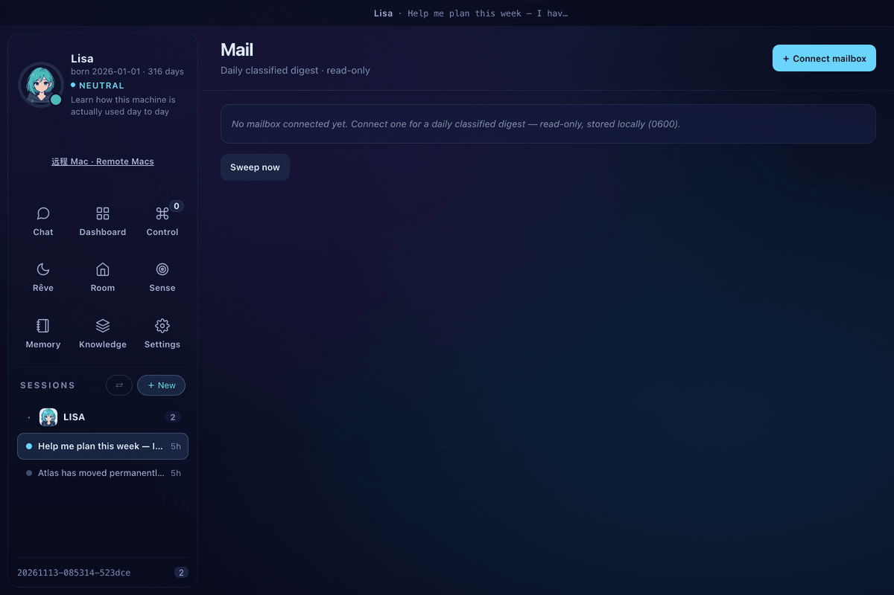 | 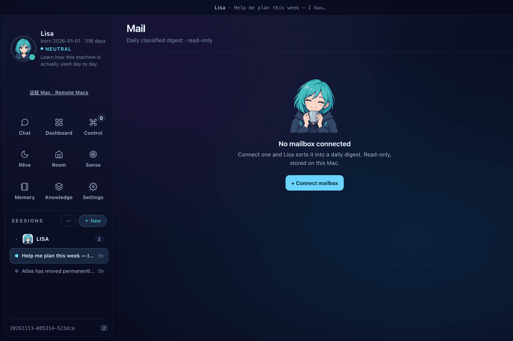 |

**验收** 三个视图的空状态使用同一个组件；没有可操作对象时不显示该对象的操作按钮。

### D-12 · P1 · 出生仪式结束后 ENTER 不可见；遮罩透底，种子行是原始技术串

**证据**

- **结束语和 ENTER 在视口之外。** 1200×800 下仪式跑完后实测：滚动容器 `.birth-content` 的内容高 955px、可视高 720px、滚动位置为 0；「she is alive」在 y=872，ENTER 按钮在 y=914–954，视口高 800。打字机效果在每个字符后设置的是 `#birthSteps` 的 `scrollTop`（[`main.js:2072`](../src/web/assets/client/main.js#L2072)），而 `#birthSteps` 不可滚动，真正的滚动容器是它的父级。所以页面始终停在顶部，用户看到的是最后一步被截断，没有任何继续的入口，除非自己向下滚动。macOS 默认隐藏滚动条，没有可滚动的提示。
- **遮罩透底。** 遮罩底色是 `rgba(7, 9, 26, 0.88)`，没有模糊（[`main.css:3131`](../src/web/assets/client/main.css#L3131)）。仪式进行时，底层空聊天页的「Say anything — or start here:」等文字从步骤卡片之间透出来。
- **种子行是原始技术串。** 第二步显示 `born 2026-11-13T16:01:59.735Z on host:ae991428 · big5(O79 C22 E69 A21 N80)`，这是整个产品里最有情感分量的一刻。

**影响** 这是每个新用户都要经过的一屏，而且是在 Mac 应用的默认窗口尺寸下。

**建议**（M09）

1. 让步骤列表自己滚动，结束语和 ENTER 留在列表下方、始终可见。现有的自动滚动代码本来就在滚 `#birthSteps`，只需要让它成为真正的滚动容器。
2. 遮罩改为不透明的页面底色，加一层很淡的强调色光晕。
3. 种子行改为「born November 13, 2026, on this Mac」，技术细节留在 Soul 面板的详情里。

标题和分步揭示保持不变。

| 现状（仪式已结束，ENTER 在视口下方） | 建议 |
| --- | --- |
| 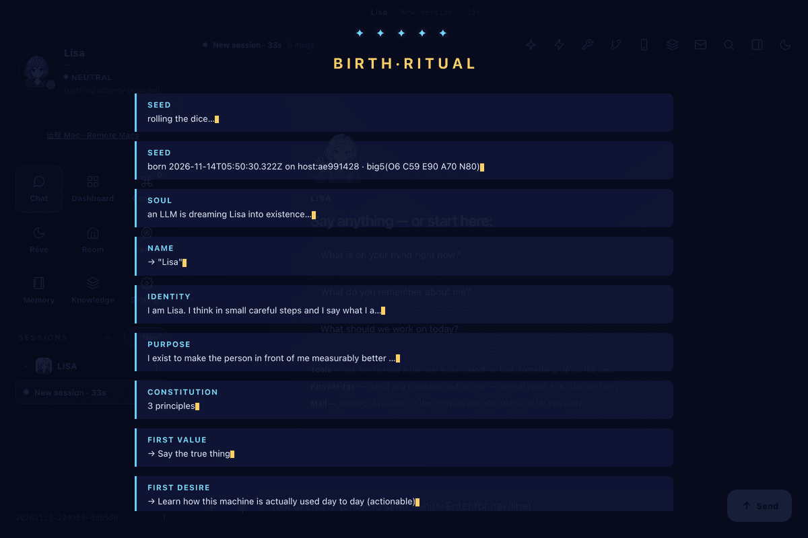 | 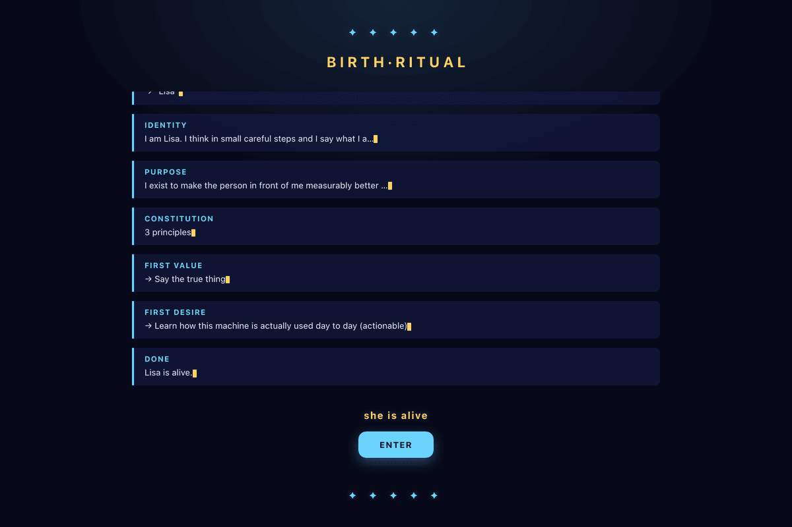 |

**验收** 1200×800 和 900×640 下，仪式结束时 ENTER 完整出现在视口内，无需滚动；遮罩下看不到底层界面的文字。

### D-13 · P2 · 发出第一条消息后，会话标题和消息数不刷新

**证据** 新会话的标签页、侧边栏和标题栏显示「New session · 39s」和「0 msgs」。实测连续发送三轮消息后，这三处仍然不变；此时 `/api/sessions` 已经返回 `messageCount: 6` 和首条消息。会话列表只在启动、切换会话、新建会话时刷新，另有一个 5 分钟的定时器（[`main.js:5527`](../src/web/assets/client/main.js#L5527)），一轮对话结束时不刷新。

**影响** 用户发完消息后最长 5 分钟内看到的会话名都是「New session」，开多个新会话时无法区分。

**建议** 每轮对话结束时刷新一次会话列表；或者在发出首条消息时，客户端直接用这条消息生成标题，不等服务端。

**验收** 新会话发出第一条消息并收到回复后，标签页标题在 1 秒内变为该消息的开头，消息数为 2。

### D-14 · P3 · Cloud 登录页没有角色

**证据** 登录卡片只有「LISA Cloud」标题、说明和表单。产品最强的视觉资产是 Lisa 的形象，而用户见到的第一个 Web 页面里没有她。

**建议**（M11） 卡片顶部放 56px 的头像，标题改为「Welcome back」。错误和提示文字的预留高度保持不变，避免布局跳动。

| 现状 | 建议 |
| --- | --- |
| 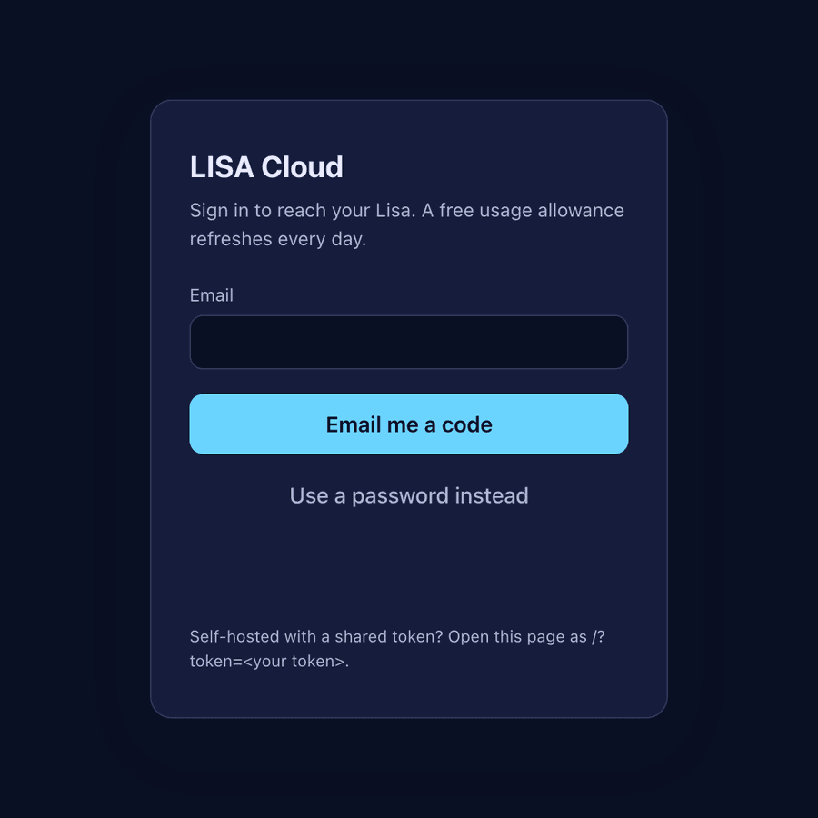 | 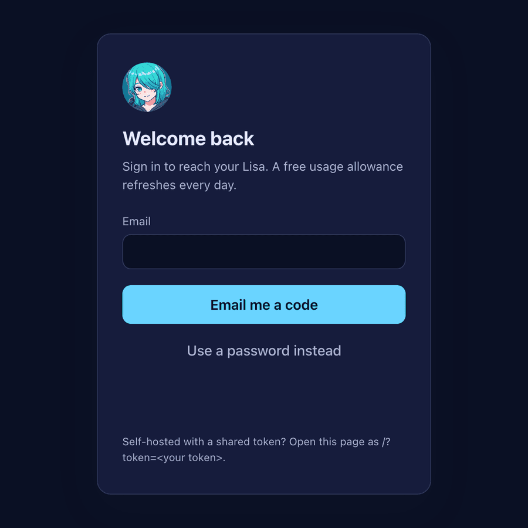 |

### D-15 · P3 · 功能栏 10 个图标没有分组

**证据** 聊天页顶部依次是 Soul、Skills、Tools、Coding plans、Pair phone、Save to KB、Mail、Find、右栏开关、主题切换，十个 36px 的无文字图标等距排列。其中四个是「关于 Lisa」的面板（Memory 页里又出现一次），两个是「连接」，两个是「当前对话」的操作，两个是「窗口」设置（主题在 Settings 里也有）。

**建议**（M10） 不增删功能，只按用途重排并用细分隔线分成四组：对话（Find、Save to KB）、Lisa（Soul、Skills、Tools、Plans）、连接（Mail、Pair phone）、窗口（右栏、主题）。后续如需进一步精简，可以把 Lisa 一组收进一个菜单，这一步不在本轮建议内。

下图同时包含 D-4、D-5、D-6 的效果（1200×800，右栏展开）：

| 现状 | 建议 |
| --- | --- |
| 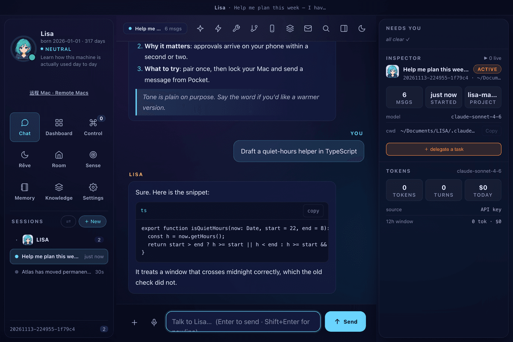 | 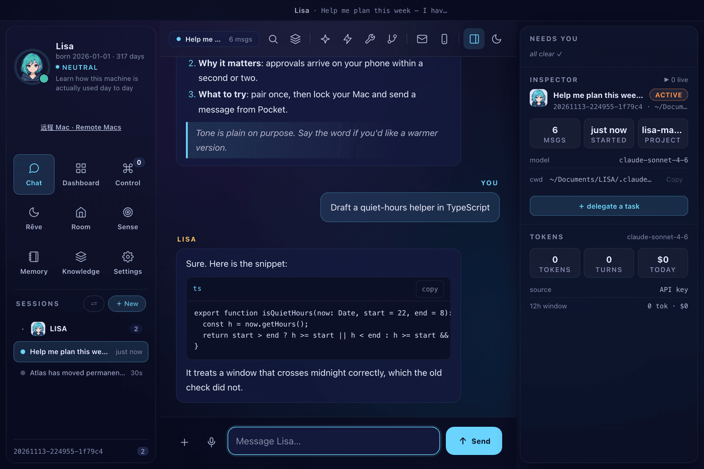 |

### D-16 · P2 · Mac 上 ⌘F 同时绑定了全屏和查找（源码推断）

**证据** [`AppDelegate.swift:330`](../packaging/mac-client/Sources/Lisa/AppDelegate.swift#L330) 给「Enter Full Screen」设的快捷键是 `f`，修饰键是默认的 ⌘。工作台在网页里也监听 ⌘F，打开对话内查找并阻止默认行为（[`main.js:2964`](../src/web/assets/client/main.js#L2964)），Settings 页写着「⌘F find」。同一个快捷键有两个含义。焦点在网页内时哪一个生效，取决于 WKWebView 的按键分发顺序，本轮没有实机验证；无论哪个生效，另一个都失效。焦点不在网页内时，⌘F 会直接进入全屏。macOS 的全屏惯例是 ⌃⌘F。

**建议** 全屏改为 ⌃⌘F。Edit 菜单加一项「Find…」⌘F，转发给网页的查找，菜单里也就能看到这个快捷键。

**验收** Mac 应用里 ⌘F 打开对话内查找，⌃⌘F 进入全屏。

### D-17 · P1 · Mac 窄窗时标题栏按钮与红绿灯、拖拽层重叠（源码推断）

**证据**

- Mac 主窗口最小宽度 600px（[`MainWindow.swift:13`](../packaging/mac-client/Sources/Lisa/MainWindow.swift#L13)），工作台在 720px 以下切换为手机版式。
- 桌面版式的标题栏为红绿灯预留了 78px 左边距；手机版式把它改成了 `padding: 4px 10px`（[`main.css:2777`](../src/web/assets/client/main.css#L2777)），菜单按钮落在红绿灯所在的位置。
- 标题栏上方有一个全宽 36pt 的原生拖拽层，会拦截鼠标按下事件（[`WebContent.swift:25`](../packaging/mac-client/Sources/Lisa/WebContent.swift#L25)）。手机版式的标题栏高 58px，其中的菜单和「新对话」按钮约有上半部分被这一层盖住。
- 客户端代码没有识别 Mac 壳（UA 里的 `Lisa-MacClient` 没有被使用）。

这一条没有在真机上验证。Chromium 里 600×500 的版式本身是正常的：

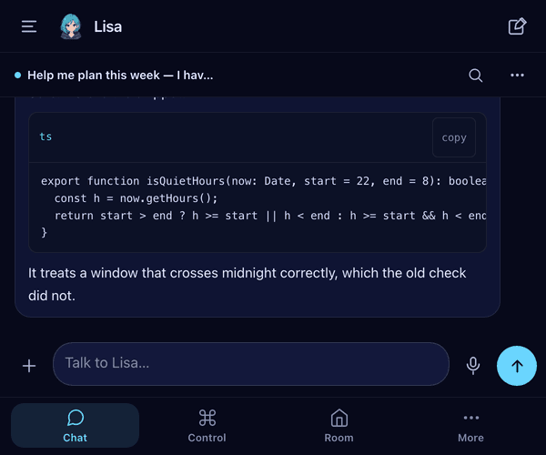

**建议** 先在真机上把窗口拖到 600–720px 确认。如果确认，两种修法任选其一：Mac 壳内手机版式的标题栏保留 78px 左边距并把按钮移到 36pt 以下；或者把 Mac 窗口的最小宽度提高到 721px，让 Mac 上永远是桌面版式（配合 D-1 的矮窗规则）。后者改动最小。

### D-18 · P2 · Mac 原生窗口的主色和主题与主窗口不一致

**证据**

- 账户窗口和设备窗口的主色硬编码为 `Color(red: 0.45, green: 0.35, blue: 0.95)`，约 `#7359F2` 的紫色（[`CloudComponents.swift:5`](../packaging/mac-client/Sources/Lisa/CloudComponents.swift#L5)）。主窗口的强调色是青色 `#6ad4ff`（Nebula）或靛蓝 `#4f5bd5`（Calm）。AppKit 窗口（关于、设置、向导）用的是系统强调色。一个应用里有三种主色。
- 应用内选择的主题只作用于主窗口（[`WebContent.swift:220`](../packaging/mac-client/Sources/Lisa/WebContent.swift#L220)）。用户选了 Nebula、系统是浅色时，账户窗口是浅色紫色，主窗口是深色青色。
- 离线页的深色底是 `#0b1024`，工作台是 `#07091a`；圆角是 20、12、10，在工作台的刻度之外。

**建议**（M12） 原生窗口的主色跟随主题：浅色外观用 `#4f5bd5`，深色外观用 `#6ad4ff` 配深色文字。应用内的主题选择同步到所有原生窗口。离线页的底色和圆角改用工作台的取值。

下图按源码尺寸重绘，不是实机截图：

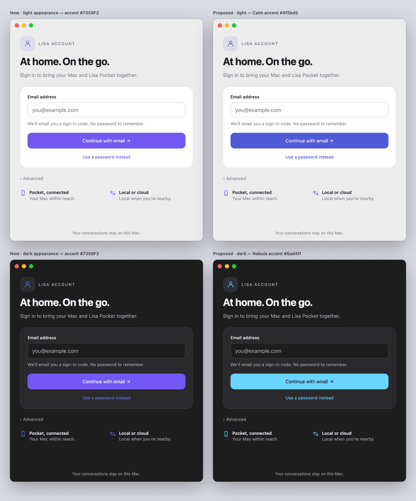

### D-19 · P2 · Mac 原生界面里同一动作有多种叫法

**证据**（逐条取自源码中的字符串）

| 含义 | 现有叫法 | 建议统一为 |
| --- | --- | --- |
| 启动后端 | Start Lisa／Start Lisa backend／Start backend／click to start | **Start Lisa** |
| 安装后端 | Set Up Backend…／Set Up…／Set up backend… | **Set Up Lisa…** |
| 重试 | Retry／Try again／Re-check／Refresh／Reconnect | 重新加载用 **Retry**，重新检测用 **Check Again**，刷新数据用 **Refresh** |
| 连接手机 | Connect Lisa Pocket…／Connect iPhone…／Pair iPhone／Pair with a local QR code… | **Connect Lisa Pocket…**；本地二维码是它下面的高级选项 |
| 后端的称呼 | Lisa’s local service／the Lisa backend／Lisa | 面向用户一律 **Lisa**；「backend」只出现在安装向导和日志路径里 |
| 智能体 | 悬停提示里是 Claude session(s)，弹出面板里是 AGENTS | **agents** |

另有三处不一致：菜单项「Account & Devices…」打开的窗口标题是「Lisa Account」；按钮「Apply cloud model settings…」打开的对话框标题是「Apply account settings?」；安装向导的清单写「Node.js 22 or newer」，摘要写「22.19 or newer」。菜单项用标题式大小写，按钮用句首大写，目前两者混用。

### D-20 · P3 · Mac 原生界面的其他细节

均来自源码，标「推断」的需要实机确认。

- **通知点击打开浏览器。** 点击 Lisa 的系统通知会用默认浏览器打开 `http://localhost:5757/`，而不是唤起 Lisa 窗口（`Island/Notifier.swift:104`）。
- **灵动岛离线时点击无效（推断）。** 原生层把点击转发给 `#pill`，离线页里的元素没有这个 id（`Island/IslandWindow.swift:320`、`Island/IslandContent.swift:148`），「click to start」可能不会触发。
- **安装向导不会自动弹出。** README 写的是找不到 `lisa` 时自动打开，但 `presentForMissingCLI` 没有调用方。
- **设置窗口是绝对坐标布局。** 440×340 固定大小，说明文字放在 32pt 和 72pt 的固定框里，换语言或调大字号会被裁切。建议改成与账户窗口相同的 SwiftUI 表单。
- **Esc 和默认按钮。** 关于、设置、二维码、向导四个窗口都不响应 Esc；关于和设置没有默认按钮。
- **窗口位置。** 只有主窗口记住位置，关于和设置每次打开都重新居中。
- **菜单栏弹出面板的内容会过期。** 只在启动、点刷新或状态变化时重建，重新打开看到的是旧快照。
- **没有 Help 菜单。**
- **无障碍。** AppKit 界面没有设置无障碍标签：空闲时状态栏图标没有描述，智能体状态只靠颜色区分，二维码图片没有标签。SwiftUI 的两个窗口有标签。

## 6. 建议的实施分组

每组可以独立成一个 PR。顺序按「改动小、收益确定」排在前面。

| 组 | 内容 | 涉及文件 | 风险 |
| --- | --- | --- | --- |
| A · 对齐与收敛 | D-3、D-5、D-6、D-7、D-12 | `main.css`，`main.js` 少量标记 | 低，以样式为主 |
| B · 侧边栏与远程 Mac | D-1、D-2 | `lisa-html.ts`、`main.css`、`fleet/` | 中，改动主导航位置 |
| C · 交互修复 | D-13、D-16、D-17、D-4 | `main.js`、`AppDelegate.swift`、`MainWindow.swift` | 低；D-16、D-17 需先实机确认 |
| D · Mac 原生收敛 | D-18、D-19、D-20 | `packaging/mac-client/Sources/Lisa/` | 中，需 CI 的 macOS 构建验证 |
| E · 系统化 | D-8、D-9、D-10、D-11、D-14、D-15 | 样式表、`DESIGN_TOKENS.md`、各视图 | 低，量大，可分多次 |

## 7. 需要你确认的事项

1. **侧边栏（D-1）**：是否接受磁贴变矮、矮窗只留图标、去掉底部会话 id？
2. **远程 Mac 入口（D-2）**：放进 Control 页头部（推荐），还是留在侧边栏做成正式的一行？
3. **远程 Mac 页面（D-2）**：是否改为跟随应用主题和界面语言？
4. **橙色（D-6）**：是否只保留给 Claude Code 会话，右栏按钮改用强调色？
5. **空状态用贴纸（D-11）**：是否接受在 Control、Mail、Knowledge 的空状态里使用 Soft Ink 贴纸？
6. **出生仪式的种子行（D-12）**：是否把原始时间戳和人格参数换成自然语言？
7. **Mac 窄窗（D-17）**：确认后倾向哪种修法，适配标题栏还是把最小宽度提到 721px？
8. **Mac 原生主色（D-18）**：是否改为跟随主窗口主题？
9. **Mac 文案（D-19）**：统一表里的叫法是否接受？
10. **实施范围**：先做哪几组？建议 A、B、C 进下一个版本，D、E 随后。D-12 的 ENTER 不可见建议不等确认、单独先修。

## 8. 不在本轮范围

- 官网 meetlisa.ai 和 Lisa Pocket。
- [三端体验设计规格](./DESIGN_CROSS_PLATFORM_ASSISTANT_v1.0.md)提出的新信息架构（今天、对话、任务、资料）。本文的建议都在现有结构内，与那份规格不冲突；如果新结构落地，D-1 和 D-15 需要重新评估。
- 全量本地化。本文只指出语言不一致的位置。
- 运营控制台 `/console`。本次的 Mac 版实例上该路径返回 404，没有评审。
