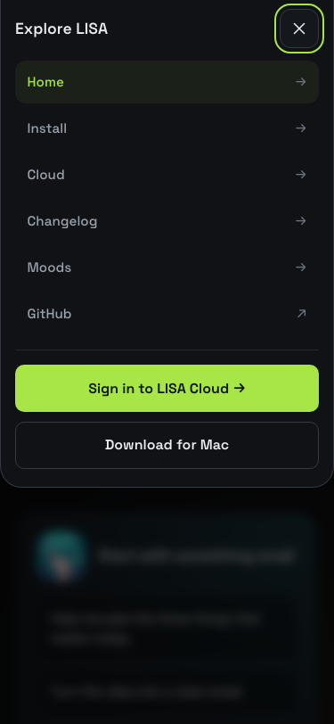

# Mobile website verification

The live homepage's wrapping navigation measured 194.94px tall at 375px. The updated shared header measures 61px (without a device safe-area inset), with language switching and a 44px menu trigger. The full navigation remains available in a native modal dialog, and the original links remain usable when JavaScript is disabled.

These Chromium screenshots were captured from the built static website at 375 × 812, with both languages checked:

| English home | Chinese home |
| --- | --- |
|  |  |

| Navigation | Cloud comparison |
| --- | --- |
|  |  |

`cd website && npm test`: 48 passing browser tests in Chromium and WebKit. All 14 routes are checked at 320, 375, 430, 768 and 1440px. Additional checks exercise modal keyboard/touch behavior, backdrop and Escape dismissal, focus recovery, landscape scrolling, switching to desktop, language links, comparison and credit-pack labels, installation anchors with 0px and 59px simulated top safe areas and code scrolling, and no-JavaScript navigation. This is browser emulation; physical iPhone safe-area behavior is not claimed as device-tested.
