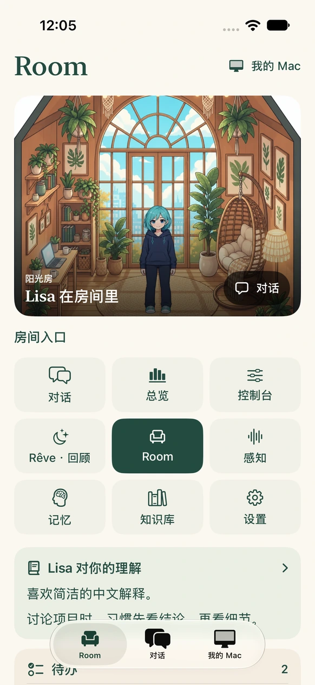
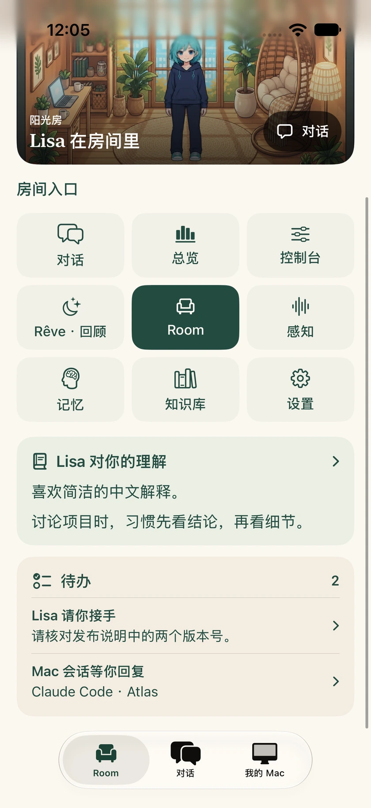
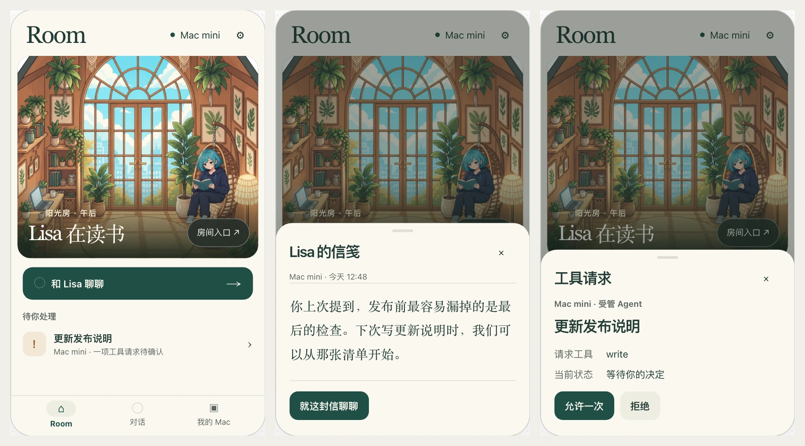

# Lisa Pocket · Room 与桌面九宫格

2026-11-10 · iOS 实现与验收说明

Room 是 Pocket 的首页。上半屏呈现和 Mac 共用的房间插画、角色和当前来源，下半屏直接显示九宫格。用户熟悉某个 Mac 入口后，可以在 iPhone 的相同位置找到它。底栏保留 Room、对话、我的 Mac，收到 Agent 通知或从小组件打开时仍可直达会话。



## 九个入口

| 左 | 中 | 右 |
|---|---|---|
| **Chat · 对话**。继续当前实例的流式聊天，沿用现有发送前同意流程 | **Dashboard · 总览**。看 Agent、运行中任务、信号、当前愿望与活动，进入派工或任务记录 | **Control · 控制台**。打开当前 Mac 的 Agent 列表，可用操作遵循会话类型及主机策略 |
| **Rêve · 回顾**。读最近梦境摘要、本周反思、运行记录与 Lisa 的留言，可把留言带入聊天草稿 | **Room**。展开完整房间，切换阳光房与书房，保留上次的选择 | **Sense · 感知**。查看 Mac 的感知事件和授权，在手机上可撤销授权 |
| **Memory · 记忆**。查看当前实例记录的用户信息与记忆 | **Knowledge · 知识库**。浏览来源与 wiki，按后端索引搜索，从结果阅读正文 | **Settings · 设置**。管理账户、当前连接、通知、隐私与外观 |

## 九宫格下方



**Lisa 对你的理解** 从当前实例的用户记忆取末尾两条内容。点卡片可打开完整记忆。卡片直接展示已记录的文字，不另行生成对用户的推断。

**待办** 汇总两类需要人处理的事项。Lisa 发出的审批和交接请求进入请求详情。Mac 等待授权、等待输入和出错的 Agent 会话直接进入对应项目与会话。首页默认最多展示三项，点「查看全部待办」可以展开。连接中断或部分来源读取失败时，保留已读到的事项并显示提示。

Lisa 的审批详情遵循当前连接权限。可处理时先展示服务端返回的完整参数，再提供仅允许一次或拒绝的操作。通过配对中继查看请求时，在 Mac 上完成确认。普通未读信笺仍从房间插画下方进入。

## 在手机上的取舍

- **同一目的地可以有两种走法。** 点书架、电脑或 Lisa，分别去记忆、控制台或聊天。有文字标签的九宫格常驻，不需要先学会点插画。中央 Room 格进入可换景的完整房间。
- **普通启动先展示本地美术。** 两种背景、姿态图和图集直接复用桌面资源，随包安装。人物根据当前实例的状态显示，在连接失败时给出提示。静态构图避免常驻动画耗电，前台可见时刷新，回到前台重新读取。
- **把注意力留给要处理的事。** 单个审批请求可从房间直接进入对应会话。多项请求打开按优先级排序的 Agent 列表。没有审批且有未读留言时，显示信笺入口。
- **Cloud 与 Mac 各自拥有数据。** 从房间进入的是当前来源的对话、记忆、知识库。Cloud 模式清楚显示如何连接 Mac，感知授权和本机 Agent 控制遵循原有权限。知识和 Rêve 当前提供阅读功能，管理与撤销改动仍在桌面操作。
- **保留文字和触控入口。** 中文和英文的首页入口都有原生文字标签，插画热区至少 44 pt。辅助功能特大字号时九项按原顺序排列成两列，避免文字挤压。

## TestFlight 验收版本

**1.4（1794283691）** 已于 2026-11-10 确认为 VALID、IN_BETA_TESTING，已核实属于 oratis 内测组。打开 iPhone 上的 TestFlight，在 Lisa Pocket 中更新。[Apple 构建记录](https://appstoreconnect.apple.com/apps/6784690058/testflight/ios/a22eea42-3ebb-4fa4-b04f-6ba6d25eda8a)

本机 iPhone 17、iOS 27 模拟器通过 6 项 UI 端到端测试与 104 项其他测试。1 项生产中继专项需要独立线上环境，本轮跳过。测试通过真实本地服务读取用户记忆，打开目标 Mac 会话，移出一条 Lisa 交接请求，并核对一次性授权对隔离样例文件生效。Cloud 界面使用同一个隔离服务验证路由。截图包含测试实例的示例内容。

## 在本机复验

先按仓库常规流程构建后端，再从仓库根目录运行以下命令。测试脚本启动真实的隔离 Lisa 服务，写入专用的知识条目、反思和记忆数据，模型端使用本机测试替身。

```sh
node --import tsx scripts/test-ios-room.ts <iPhone模拟器UUID> <新的结果路径.xcresult>
```

<details>
<summary>查看初版视觉探索与后续能力规划</summary>

下文记录第一轮产品提案。九宫格、知识搜索和 Rêve 阅读的交付范围以上文为准。

打开 Pocket，第一眼是 Mac 上熟悉的阳光房。Lisa 在藤椅上看书，窗边的书架放着她的记忆，书桌上的电脑通向正在运行的任务。如果 Mac 有一项操作需要你确认，房间下面会直接出现那一项。房间承担日常陪伴，紧急工作也有最短路径。



## 首页长什么样

| 从上到下 | 用户看到什么 | 点击后 |
|---|---|---|
| 顶栏 | 左侧大标题 **Room**，右侧是当前来源，例如 **Mac mini** 或 **LISA Cloud**，旁边是设置按钮 | 点来源查看连接、明确切换实例。点设置管理账户、外观、通知和隐私 |
| 房间 | 首屏面积约一半给插画。沿用桌面 Soft Ink 阳光房、Lisa 坐姿和家具的遮挡关系。左下用一行短句显示已知状态，如「Lisa 在读书」 | 点人物进对话，点书架看记忆，点电脑进「我的 Mac」。右下常驻「房间入口」，可按名称选择目的地 |
| 主动作 | 一个通栏按钮「和 Lisa 聊聊」 | 打开当前实例的原生对话，回到已有会话。规划一天、起草文字等模板移入对话空态 |
| 此刻相关 | 最多一条。先显示需要本人决定的请求，再显示未读来信，其次是有内容的活动摘要。普通等待和明确的授权请求用不同措辞 | 点条目直接进对应详情。多项请求时显示数量，进入待处理列表。都为空时收起此区，可用「翻翻书架」作为安静态入口 |
| 底部 | **Room / 对话 / 我的 Mac**。三个 Tab 位置固定 | 通知、小组件和 Live Activity 仍可直达对应 Agent 或设备页 |

现有首页的「0 active」「Nothing in this window」和常驻的 2h / 8h / 24h 筛选占用了第一屏。活动筛选移入「我的 Mac → 活动」，设备管理并入来源按钮，邮件摘要只在 Mac 已配置邮件且有内容时出现在活动里。

## 房间如何连到功能

| 入口 | 第一次点击 | 从这里可以继续做什么 |
|---|---|---|
| Lisa | 当前来源的对话 | 继续会话、挑一个起草模板、编辑并发送。用 Tab 从任务页快速回到对话 |
| 书架 | 记忆、Soul、技能与工具 | 首版复用 iOS 的只读页面。下一阶段增加知识库搜索和条目详情，分别标识「她记住的事」与「收录的资料」 |
| 信笺 | 打开 Lisa 在你离开时留下的最近一封信 | 点「就这封信聊聊」生成一条带上下文的可编辑草稿。第一版围绕最近留言，后续 Rêve 历史用有稳定标识的记录承载 |
| 书桌 / 我的 Mac | 目标设备的 Agent 列表，优先呈现待你处理的会话 | 复用受管 Agent 的允许或拒绝，按会话类型开放发送、取消或查看 PTY 输出。观察到的外部会话显示可用操作 |
| 唱片机 | 后续加入房间的环境音乐面板 | 用户主动开始、暂停和静音。次级入口放在「房间入口」内，主画面保留给 Lisa |

浅层浏览用半屏面板，阅读长记忆、查看输出和连续聊天用完整页面。半屏面板关闭后回到原房间。每个可点物件都有文字入口，书桌和人物另外保留底部直达路径。环境光按时段变化，读书、工作、做梦等状态文字以实际信号为准。空闲时可采用自然坐姿，状态只写「Lisa 在房间里」。

## 两条需要走通的路径

**回来看看 Lisa。** Room 出现未读信笺 → 打开读信 → 点「就这封信聊聊」→ 对话中出现可编辑草稿。打开信后处理对应的已读状态。当前清除接口缺少消息标识，实现时要防止阅读旧信期间到达的新信也被清除。

**出门时处理 Mac 请求。** 从首页条目或通知直达这台 Mac 的请求 → 核对设备、会话及请求使用的工具 → 允许一次或拒绝 → 看到该请求的处理结果。只展示服务端实际给出的请求细节。执行结果另行更新。授权成功与任务完成分别呈现。请求已在 Mac 处理时，刷新该会话并显示最新状态。

## Mac 和 iOS 的能力差距

以下以当前工作树为设计基线。示例数据用于体验方案，商店发行版本需单独核对。

| 能力 | 当前基线 | 本次设计取舍 |
|---|---|---|
| Room 与角色表现 | 桌面已有场景、坐姿、时段光照、信笺、书架回想及唱片机。iOS 已有状态和角色美术，首页主要是卡片 | 首版给 iOS 一个原生 Room，复用插画、姿态锚点和状态映射。先做到房间可进入功能。音频和丰富环境动效放在后面 |
| 对话、身份与记忆 | iOS 已有流式对话、会话、Soul、Memory、Skills、Tools | 书架维持只读，聊天保持现有发送前的数据共享同意流程 |
| Rêve 与知识库 | iOS 首页能显示离开时的留言及当前愿望，桌面有专门的 Rêve 和 Knowledge 视图 | 第二阶段在信笺加入有记录的回顾，在书架加入资料搜索。先核对 Cloud、直连 Mac、加密中继各自可读的接口、所有者隔离和分页 |
| 单机 Agent | iOS 已有 Agent 列表、受管审批、PTY 输出、派工记录，以及通知到会话的深链 | 首版接入书桌和首页待办。「看状态 → 做决定 → 看结果」全程显示目标 Mac |
| 主机管理与感知 | iOS 有设备配对、Sense 事件查看和撤销授权。工作树中的桌面多 Mac 控制另有主机、工作区及权限模型 | 设备、通知和撤销权限归设置。授予传感器权限、本机连接器初始化及工作区授权留在 Mac。多机派工单独规划，首版围绕当前已配对设备 |

## 视觉和状态

- **浅色**用暖纸白底（#FBF8F1）、墨绿文字（#243D36）、松绿色主动作（#204F45）。**深色**用墨绿灰底（#20251F）、米白文字（#F4F1E6）。琥珀色搭配图标和「待确认」文字，仅给需要决策的事项。
- **排版**按 iPhone 的 390 pt 宽度设计。导航标题约 36 pt，可采用系统衬线体，正文 17 pt，辅助文字约 13 pt，内容边距 16–20 pt。房间用宽幅画框，书架与人物在小屏裁切时仍可见。场景和文字之间用局部渐暗过渡，其他分区用留白与细分隔线。
- **无障碍与耗电**。可操作区域至少 44 × 44 pt。VoiceOver 能按「和 Lisa 聊聊」「书架」「书桌」访问同一批目的地。大字号允许状态文字换行并移到插画下方。启用减少动态效果、低电量或进入后台时使用静态画面。
- **首次打开**可先看房间静态预览，主动作改成「开始使用」，接原有云端登录或 Mac 配对。**仅用 Cloud** 时仍能聊天，书架按当前实例可用能力呈现。「我的 Mac」显示连接入口。
- **Mac 暂时离线**显示设备名和最后更新时间，之前的房间标明「上次见面时」，提供重连与主动切换云端。没有可信快照时使用静态空房间。切换来源后重新加载，草稿、记忆、来信与任务按实例隔离。配对信息、账户和 Face ID 锁沿用现有机制。

## 落地顺序与验收

1. **先换首页骨架。** 用 SwiftUI 实现单个 Room 场景，打包首屏静态插画，复用 islandPing 和现有事件流。进入后台暂停，回到前台重取快照。把现在的 Home、Chat、My Mac、Settings 整数跳转整理成明确目标，设置迁入顶栏后同步迁移配对、购买与登录入口。
2. **打通两个闭环。** 接入信笺、书架、来源选择和审批。以设备与会话标识定位请求，使用实际 approvalId 提交，在服务端确认后更新待办。重连后先同步状态。禁用的远程控制、只读会话及旧后端各自给出对应提示。
3. **按使用价值补齐桌面能力。** 优先 Rêve 回顾和知识库只读搜索，再做唱片机、换景和环境动态。对每个新增入口分别验证云端及 Mac 传输支持。
4. **验收以真实任务为准。** 普通启动落在 Room，一步进入 Chat、一步打开单个待审批详情，两步以内进入记忆列表。从推送直达原会话。无任务时首屏没有空统计。离线重连能找回当前状态。切换来源后不显示前一个实例的信息。在小屏、大字号、深色及减少动态效果下走完同样流程。

实现参考见 [Pocket 根导航](../../../packaging/ios-companion/Sources/App.swift)、[当前首页](../../../packaging/ios-companion/Sources/HomeView.swift)、[移动 API 客户端](../../../packaging/ios-companion/Sources/LisaClient.swift)、[Agent 会话和审批](../../../packaging/ios-companion/Sources/RosterView.swift)、[桌面 Room](../../../src/web/room.ts) 和 [角色姿态与家具锚点](../../../src/web/room-scene.ts)。

</details>
