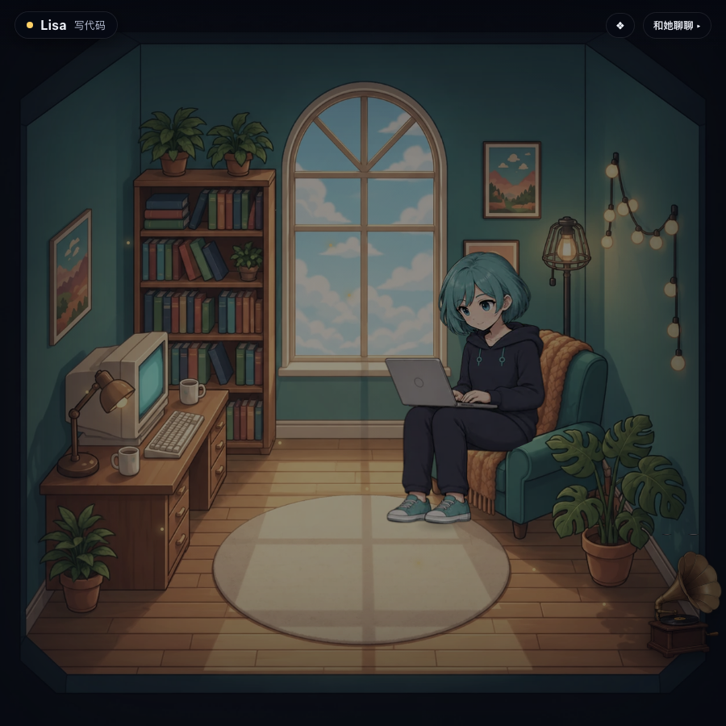
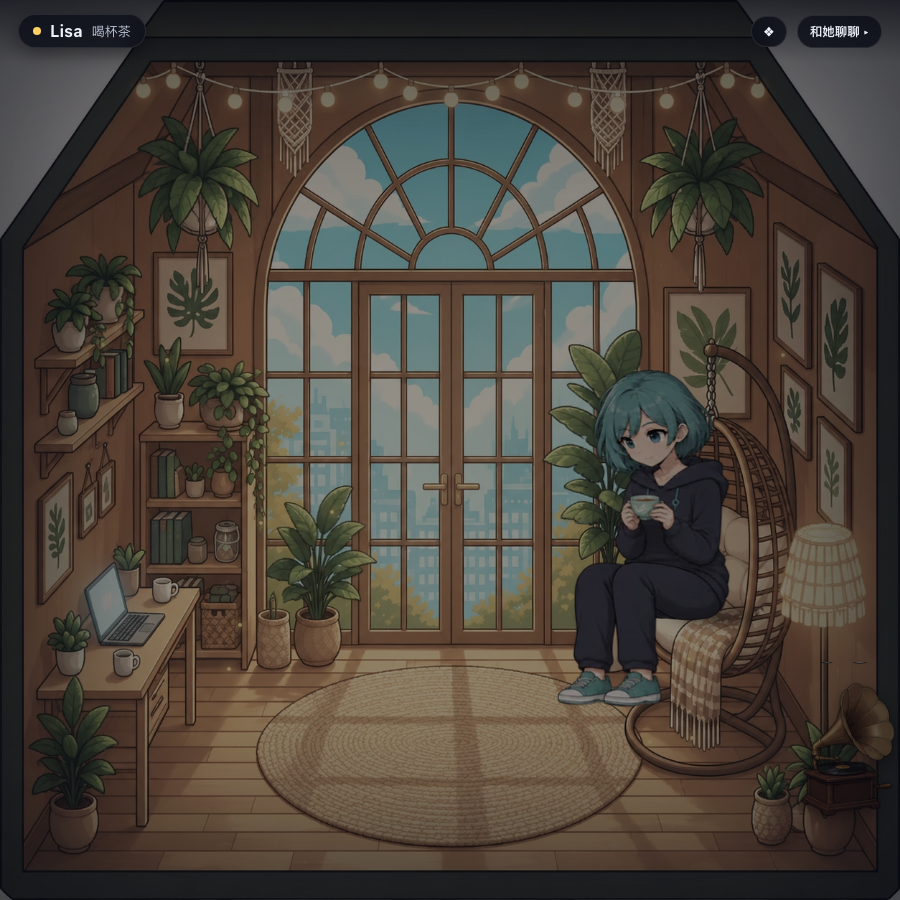
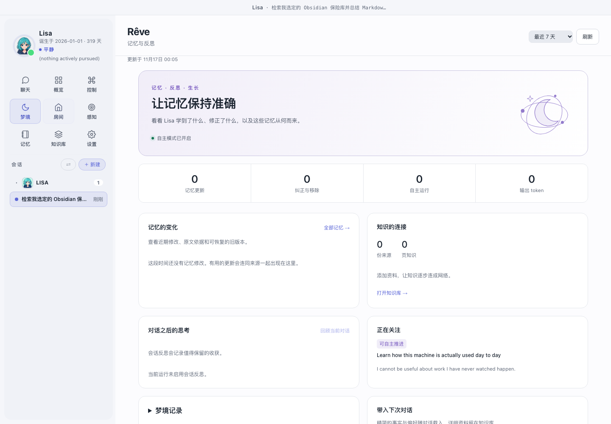
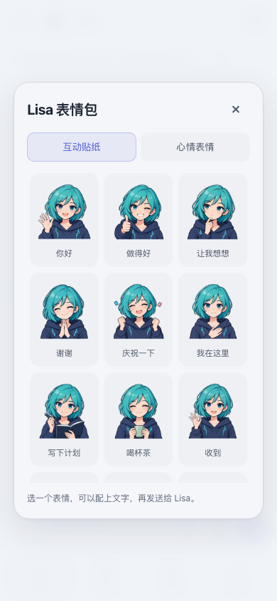

# Companion refresh — 0.32.0 acceptance candidate

The room now uses three dedicated seated clips: working, reading and tea. Their square posters and animated frames share the same hip/sole anchors; the room places each pose against the chair cushion instead of scaling an unrelated portrait animation. The hanging chair does not cast a floor contact shadow. Resting keeps its existing fitted pose and gentle breathing. Hidden windows and reduced-motion preferences stop animation.

Four new expressions — Got it, Hug, Good night and Curious — extend the sticker collection to 12, alongside 24 mood portraits. The chat composer lets the user choose a sticker, add optional text and send. User and Lisa expression metadata survive history reloads; the model receives readable context. Invalid asset IDs cannot load remote images. The gallery offers individual transparent WebP and animated GIF downloads.

Rêve pairs memory changes with knowledge, reflection with pursuits, and dreams with memory capacity. Control uses balanced tabs, a compact remote-task introduction and equally spaced workflow steps. Dashboard includes the entire 22-provider connector catalog, search, filters, saved authorization state, resource counts and setup actions. Authoritative authored copy follows the UI locale; saved conversation and knowledge content retain their original language.

## Artwork provenance and regeneration

Seven transparent three-frame masters in `sources/` were generated with the built-in ImageGen tool, using the existing Lisa art as the identity reference. `prompts.json` retains the generation prompts and cleanup instructions recorded during production. Two initial sheets with pale backdrops were rejected; only cleaned transparent sheets are included. The initial Got it prompt and final tea cleanup prompt were not separately persisted; the selected originals and their source hashes are retained.

The existing Sharp pipeline registers the lower body, packs frames and encodes WebP/GIF; it does not redraw the character. Each new loop holds the first pose, blinks briefly, and returns. The full motion collection remains below its 9 MiB budget and every animation is below 256 KiB.

```sh
node scripts/build-motion-assets.mjs docs/design/2026-11-16-companion-refresh/sources \
  sticker-got-it sticker-hug sticker-good-night sticker-curious \
  room-work-natural room-read-natural room-tea-natural
```

The configuration is in `../2026-11-07-motion-samples/production-sources.json`; generated byte counts and source hashes are in `production-report.json` beside it.

## Acceptance

- Room: both room themes, working/reading/tea, resting fallback, background suspension and reduced motion.
- Chat: 12 stickers and 24 moods, sticker-only send, Lisa's reply, durable history, cancellation and playback controls.
- Rêve/Control: desktop and mobile layouts, existing reflection and remote-task flows.
- Dashboard: all 22 providers, configured/unconfigured states, search/filter and editable setup prompts.
- Box: offline OAuth callback, scoped selection, versioned text read, refresh and CDN redirect protection.
- Obsidian: local filesystem consent/read/search, restart/disconnect, symlink/hard-link/path escape protection and the empty-vault UI.

Live Box authorization requires a configured Box OAuth application and owner consent. The offline tests do not represent a live Box account test. Obsidian filesystem tests use disposable vaults, never the owner's notes.

The installed candidate remains version 0.32.0. Public tagging/release follows owner acceptance of the local build.

## Review images

Captured from the real browser implementation with disposable fixture data:





